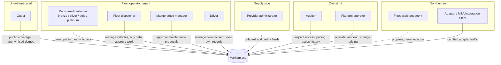
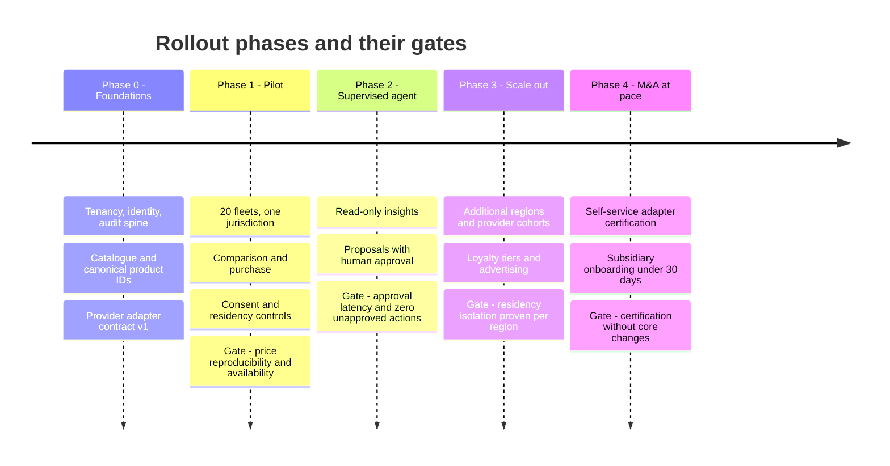

# 1. Context and scope

## 1.1 The business situation

VectorHarbor Mobility is a fleet-telematics brand that grows by acquisition.
It is launching a cloud-native telematics **data marketplace** and a
supervised **agentic fleet assistant** from scratch. There is no existing
platform and no legacy data store to migrate, which removes a large class of
risk and replaces it with a different one: everything, including the vehicle
registry, consent records, product catalogue and provider connections, must be
bootstrapped correctly on day one.

Two facts shape every decision in this document.

The group has **just exited a lawsuit settling an allegation of fraud in
data-quality and billing claims**. The new line therefore cannot treat
provenance, pricing reproducibility and audit evidence as hygiene. They are
the product. A price the company cannot reconstruct and defend months later is
a liability, not a feature.

The group **acquires aggressively**. Any design that requires an acquired
company to change its internal systems before it can contribute data will
either delay integration by quarters or quietly be bypassed. The platform must
present a contract that an acquired company can satisfy from the outside.

## 1.2 Actors

| Actor | May do | Must never do |
| --- | --- | --- |
| Guest | Browse public coverage maps and anonymised demonstrations | See vehicle locations; purchase fleet-specific data |
| Registered customer | Everything a guest can, plus tier-based pricing and early access | Cross a tenant boundary |
| Fleet dispatcher | Manage vehicles, buy data products, approve assistant proposals | Approve their own high-value proposal where four-eyes applies |
| Maintenance manager | Approve assistant-proposed work orders | Trigger remote vehicle actuation (nobody may) |
| Driver | Manage their own consent, review their own records | See other drivers' records |
| Provider administrator | Onboard feeds, submit adapter certification | See customer-side pricing or margin |
| Auditor | Inspect access, pricing and action histories, read-only | Mutate any record |
| Fleet assistant | Propose maintenance tickets and data purchases via allow-listed tools | Spend money, change operations, or actuate a vehicle |

The assistant is listed as an actor deliberately. It is a principal with its
own identity, its own permission set and its own entry in the audit log. It is
not a privileged extension of the user who invoked it.

## 1.3 Scope

### In scope for the architecture

The full platform: marketplace and catalogue, provider onboarding and
certification, quality-normalised price comparison, margin configuration with
versioned approvals, telemetry ingestion, consent and privacy controls, the
supervised assistant, payments and FX, notifications, loyalty and advertising,
observability, DDoS resilience, and the M&A integration path.

### In scope for the code

Exactly one slice: **provider-offer normalisation and ranking**. Two mock
provider endpoints, a configurable pricing snapshot, validation, eligibility,
exact-arithmetic comparison, and `GET /best-offers`. Plus the infrastructure
as code, CI/CD, tests and documentation that make it deployable and
defensible.

### Explicitly out of scope

Building a payment processor. Turnkey third-party marketplace, telematics
aggregation or agent-orchestration products are prohibited by the brief;
open-source libraries and models are permitted, and managed cloud primitives
are permitted. Regulated payment, notification and FX integrations are treated
as external interfaces and mocked. See
[23 Boundaries and licensing](23-boundaries-and-licensing.md).

## 1.4 Constraints

| Constraint | Source | Consequence |
| --- | --- | --- |
| Greenfield, no migration | Brief | Bootstrapping correctness matters more than backward compatibility |
| Everything cloud-hosted | Brief | No on-premise components, including CI and tooling |
| No turnkey marketplace / aggregation / agent products | Brief | Orchestration, ranking and agent supervision are built, not bought |
| Defensible provenance and reproducible pricing | Legal settlement | Append-only audit, versioned configuration, deterministic ranking |
| Phased rollout: 20 fleets, one jurisdiction | Brief | Residency can be single-region at launch but must not assume it forever |
| Tens of thousands of concurrent users with surges | Brief | Horizontal scale, load shedding, no shared mutable state |
| DDoS resilience is a launch requirement | Sister-product incident | Edge protection on day one, not in a hardening phase |
| No remote vehicle actuation | Brief | Hard architectural prohibition, enforced in the tool registry |

## 1.5 Quality attributes, prioritised

When two of these conflict, the higher one wins. This ordering is the single
most useful thing in this document for resolving a design argument.

1. **Integrity and defensibility.** A wrong price that can be explained is a
   bug; a right price that cannot be explained is a legal exposure.
2. **Privacy and consent.** Driver location and consent scope constrain what
   may be computed at all, not merely who may read the result.
3. **Availability.** Fleet operations are time-sensitive; degraded service
   beats no service, which is why partial results are a first-class response.
4. **Security.** Tenant isolation and supply-chain integrity.
5. **Performance.** Fast enough that dispatchers do not route around the tool.
6. **Cost efficiency.** Real, but never purchased with any of the above.

The coded slice shows this ordering concretely: it returns HTTP 200 with
`partial: true` and a per-row rejection reason rather than either failing the
whole request or silently dropping unusable rows.

## 1.6 Phased delivery

Gate criteria are quantified in [19 Deployment](19-deployment.md#195-rollout-gates).
