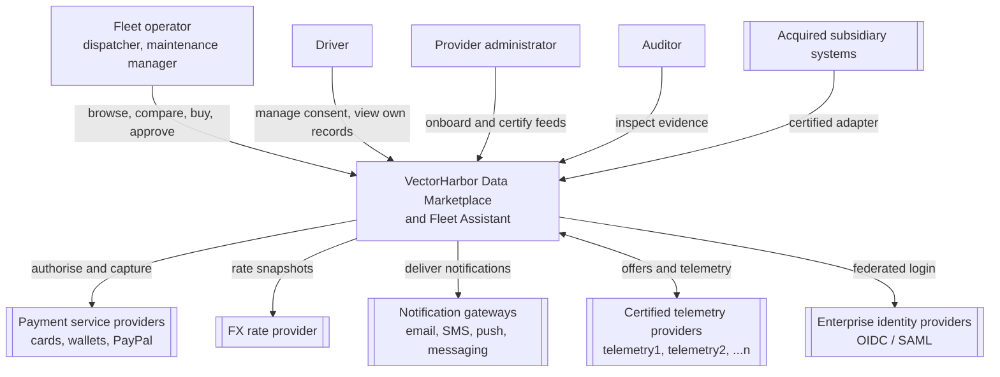
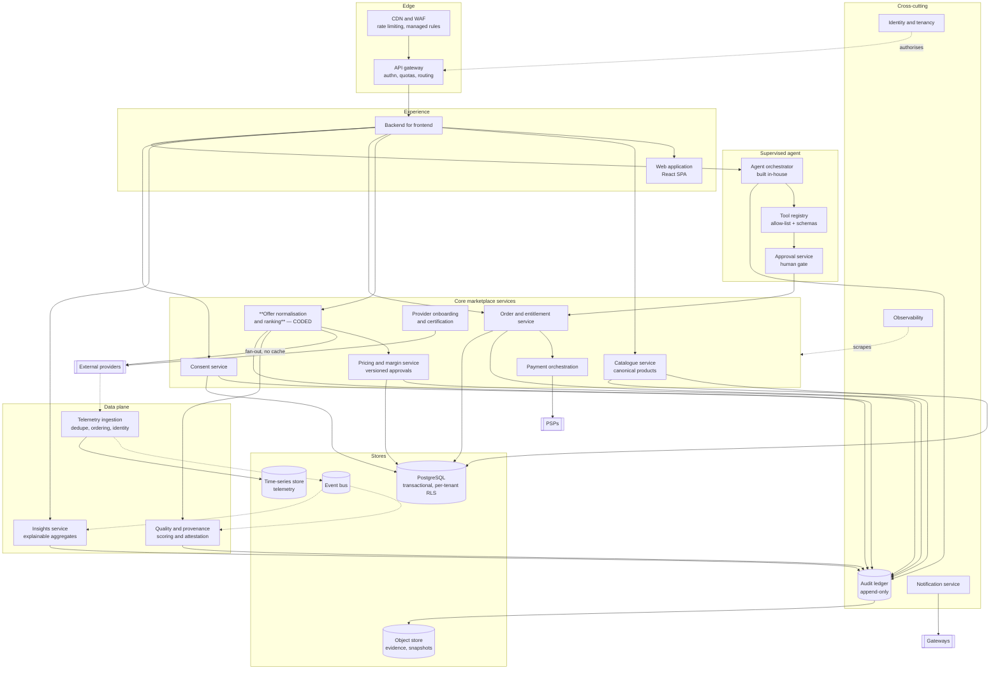
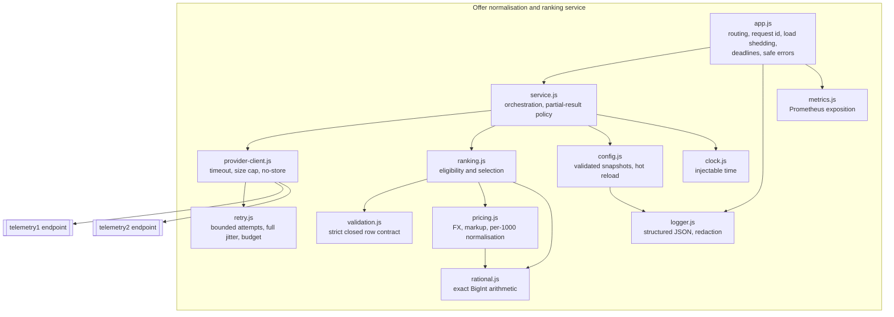

# 2. Solution overview

## 2.1 System context (C4 level 1)



Everything in double brackets is outside our control. Each has a defined
failure mode and a documented degradation path; none is permitted to make the
marketplace unavailable on its own.

## 2.2 Container view (C4 level 2)



The bold container is the slice implemented in this repository. Everything
else is designed here and not built.

### Container responsibilities

| Container | Responsibility | Why it is separate |
| --- | --- | --- |
| Catalogue | Owns canonical product IDs and their defining attributes | The canonical ID is the comparison key; one owner prevents drift |
| **Offer normalisation and ranking** | Fetch, validate, normalise and rank provider offers | Pure, stateless, deterministic — the part that must be reproducible |
| Pricing and margin | Margin configuration with versioned approvals and effective times | Changing a margin is a governed act, not a config edit |
| Order and entitlement | What a customer bought, and what that entitles them to | Entitlement outlives the offer that created it |
| Payment orchestration | Talks to PSPs; holds no card data | Keeps PCI scope out of the platform entirely |
| Consent | Consent grants, scopes, revocation, and the separation of advertising from operations | Consent is queried by nearly everything; it must not be embedded anywhere |
| Provider onboarding | Adapter registration, conformance testing, certification | The M&A on-ramp; see [15](15-ma-integration-governance.md) |
| Telemetry ingestion | Duplicate, delayed, out-of-order events and identity conflicts | Hard, high-volume, and isolated from the transactional path |
| Quality and provenance | Independent verification of quality claims; spoof detection | Must be independent of the provider making the claim |
| Insights | Explainable aggregates with source references and attribution | Explainability is a product requirement, not a debug aid |
| Agent orchestrator | Plans, calls allow-listed tools, produces proposals | Built in-house; turnkey agent products are prohibited |
| Approval | Human gate before any spend or operational change | The single enforcement point for supervision |
| Audit ledger | Append-only record of every decision-relevant event | The evidentiary backbone demanded by the legal context |

## 2.3 Component view of the coded slice (C4 level 3)



Dependencies point inward: `rational.js` knows nothing about HTTP, and
`app.js` knows nothing about FX. The ranking core is a pure function of
`(rows, snapshot, now)`, which is what makes it exhaustively testable and
reproducible from an audit record.

## 2.4 Request walkthrough: `GET /best-offers`

```mermaid
sequenceDiagram
  autonumber
  participant C as Client
  participant A as app.js
  participant S as service.js
  participant CF as ConfigStore
  participant P1 as ProviderClient<br/>telemetry1
  participant P2 as ProviderClient<br/>telemetry2
  participant R as ranking + pricing

  C->>A: GET /best-offers
  A->>A: assign request id, check readiness and concurrency
  A->>A: start request deadline, wire client-disconnect abort
  A->>S: getBestOffers(signal, requestId)
  S->>CF: current()
  CF-->>S: immutable snapshot (fxVersion, marginVersion, rates, margin, floor)
  S->>S: now = clock.now()  (one instant for the whole request)

  par Concurrent fan-out
    S->>P1: fetchOffers(signal)
    P1->>P1: attempt with timeout; retry 5xx/timeout with jitter
    P1-->>S: {ok, rows} or {ok:false, failureCode}
  and
    S->>P2: fetchOffers(signal)
    P2-->>S: {ok, rows} or {ok:false, failureCode}
  end

  alt No provider returned a valid array
    S-->>A: AllProvidersUnavailableError
    A-->>C: 503 {code: ALL_PROVIDERS_UNAVAILABLE, requestId}
  else At least one usable array
    S->>R: evaluate rows per provider
    R->>R: reject duplicates, then validate, then check eligibility
    R->>R: price eligible rows with exact rational arithmetic
    R-->>S: candidates + rejected rows with reasons
    S->>S: select best per productId, sort ascending
    S->>S: serialise with round-half-up at 2/6/4 places
    S-->>A: body with asOf, versions, partial, rejections, offers
    A-->>C: 200 (partial=true if anything was excluded)
  end
```

Three properties of this flow are worth stating explicitly, because they are
the ones an auditor will ask about.

**One snapshot, one clock, one request.** The configuration snapshot and the
evaluation instant are captured once at the start. A margin change applied
mid-request cannot produce a response in which two products were priced under
different rules.

**No cache, ever, in this slice.** Provider responses are fetched with
`cache: 'no-store'` and never persisted. Serving a stale offer would be
exactly the kind of misleading pricing claim the group has just settled.

**Exclusion is reported, not hidden.** Every rejected row appears in
`rejectedRows` with a stable machine-readable reason, and the response is
flagged `partial`. A customer can see that a cheaper-looking bundle was
excluded, and why.

## 2.5 Technology choices

| Layer | Choice | Reasoning |
| --- | --- | --- |
| Primary cloud | AWS | [ADR-0001](../adr/0001-cloud-vendor-selection.md) |
| Compute | Fargate (AWS) / Container Apps (Azure) | [ADR-0005](../adr/0005-serverless-containers.md) |
| Service runtime | Node.js 22 LTS, ES modules, zero runtime dependencies | [ADR-0003](../adr/0003-zero-runtime-dependencies.md) |
| Monetary arithmetic | Exact rationals over BigInt | [ADR-0004](../adr/0004-exact-decimal-arithmetic.md) |
| Transactional store | PostgreSQL with row-level security | Mature tenancy isolation; see [ADR-0011](../adr/0011-multi-tenancy-isolation.md) |
| Telemetry store | Time-series store with per-region partitioning | Write-heavy, append-mostly, residency-partitionable |
| Event backbone | Managed streaming with per-tenant partition keys | Ordering per vehicle without global ordering cost |
| Audit | Append-only ledger plus object storage with Object Lock | [ADR-0008](../adr/0008-event-sourced-audit-trail.md) |
| Frontend | React SPA behind a backend-for-frontend | Optional for the coded task; not implemented |
| IaC | Terraform | Both clouds, one toolchain, reviewable plans |
| CI/CD | GitHub Actions with OIDC federation | No long-lived cloud credentials |

Node.js was chosen for the coded slice because the work is I/O-bound fan-out
with strict serialisation rules, and because BigInt gives exact arithmetic
without a dependency. The same slice would be equally defensible in Go or
Java; what would not be defensible is binary floating-point money in any
language.
