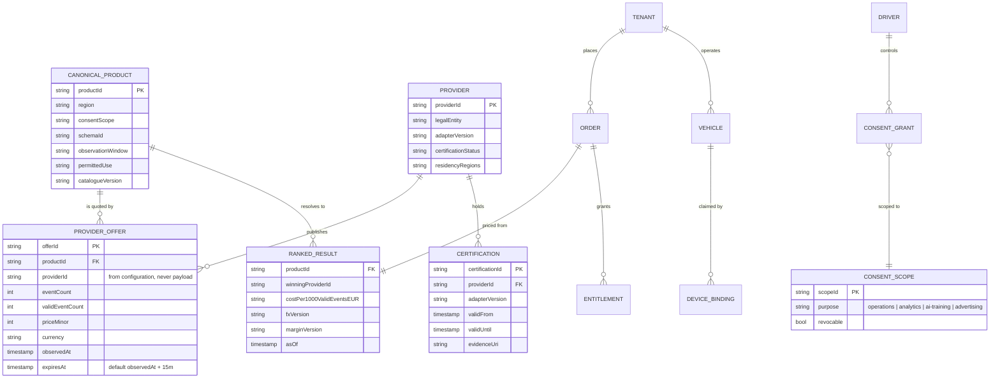
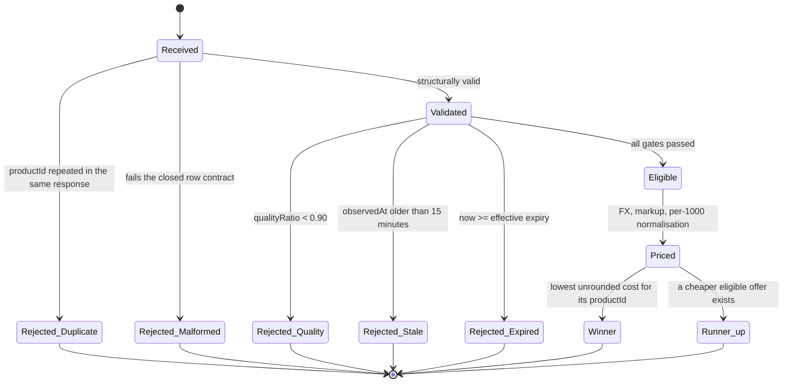
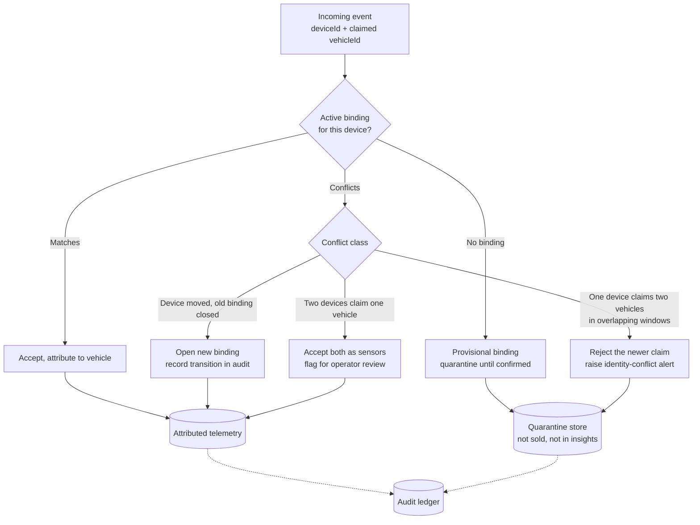

# 3. Domain model

## 3.1 The canonical product is the keystone

Nothing in this platform works unless two offers can be proven comparable. A
**canonical product ID** is the object that makes that proof possible. It
fixes five things at once:

| Dimension | Example | Why it must be fixed |
| --- | --- | --- |
| Region | `eu-north` | Coverage and legal basis differ by region |
| Fleet-consent scope | operational telemetry, excluding driver identity | Two feeds with different consent scope are not the same product |
| Telemetry schema | location-v2 at 1 Hz | Different schemas carry different information |
| Observation window | one hour | A day of data is not twelve hours twice |
| Permitted use | analytics, no model training | Rights determine value |

`eu-north-location-hour` is therefore not a label; it is a contract. Offers
with different canonical IDs are **never** compared, regardless of how similar
their names look. Offers with the same canonical ID are **always** comparable,
which is what allows a single price-per-quality number to be meaningful.

## 3.2 Provider identity comes from configuration

A provider never declares who it is. Identity is bound to the configured
endpoint, so `telemetry1` is "whatever is served at the URL we registered as
telemetry1", not "whatever the rows claim".

This is implemented in the coded slice and tested: the validator rejects a row
carrying a `providerId` field with `UNKNOWN_FIELD`, and the mock endpoints
serve rows that contain no provider field at all. The reason is direct — if
identity came from the payload, a compromised or careless provider could
attribute its offers, and its quality record, to a competitor.

## 3.3 Offer eligibility and the quality floor

The order of the gates is deliberate and tested. Quality is checked before
staleness, and staleness before expiry, so a row that fails several gates
always reports the same reason. Deterministic reasons matter: an auditor
comparing two runs of the same inputs must see identical output, including
the rejection reasons.

### Why a repeated productId poisons every copy

The contract rejects **all** rows sharing a repeated `productId` within one
provider response, not just the duplicates after the first. When a provider
contradicts itself about the same product in a single response, we have no
principled way to choose which row is true, and picking the cheaper one would
reward exactly the behaviour we are trying to prevent. Rejecting the whole
group is the only defensible option, and it gives the provider an unambiguous
signal to fix their feed.

## 3.4 Device-to-vehicle identity conflicts

Acquired manufacturers bring their own identifier schemes, and devices get
swapped between vehicles in the field. Conflicting claims are therefore
normal, not exceptional.

Quarantined events are retained, auditable and excluded from both sales and
insights. They are never silently dropped: an event that cannot be attributed
is evidence of a real-world problem, and the operator who owns that vehicle
needs to see it.

The decisive rule is that **a conflicting claim never overwrites an
established binding automatically.** A device that suddenly claims a different
vehicle is either a legitimate hardware swap, which an operator can confirm in
seconds, or an attempt to launder telemetry from an unconsented vehicle into
a consented one. The platform cannot tell those apart, so it refuses to guess.

## 3.5 Tenancy

Tenancy is enforced at four independent layers, because any single layer will
eventually be bypassed by a bug.

| Layer | Mechanism | Fails safe by |
| --- | --- | --- |
| Token | Tenant claim in a short-lived access token, audience-bound | Rejecting a token without a tenant claim |
| Service | Tenant context required to construct any repository; no ambient default | Refusing to build the repository |
| Database | PostgreSQL row-level security keyed on the session tenant | Returning zero rows rather than other tenants' rows |
| Storage | Per-tenant key prefixes and separate encryption-key scopes | Decryption failure rather than cross-tenant read |

Cross-tenant reads are impossible without defeating all four. Attempted
cross-tenant access is a security event, alerted on, not merely a 403 in a log.
See [ADR-0011](../adr/0011-multi-tenancy-isolation.md).

## 3.6 Ubiquitous language

| Term | Precise meaning | Common mistake |
| --- | --- | --- |
| Offer | A provider's quote for one canonical product at one instant | Confusing it with an order |
| Bundle price | The nominal price of the whole offer | Treating it as the comparison key — it is not |
| Valid event | A distinct, schema-valid, consented event | Including duplicates or unconsented events |
| Quality ratio | validEventCount ÷ eventCount | Treating it as an accuracy score; it is a completeness ratio |
| Cost per 1000 valid events | The comparison key, in EUR | Rounding it before comparing |
| Margin | Markup on converted provider cost | Confusing with gross margin — see [4.3](04-pricing-and-comparison.md#43-markup-is-not-gross-margin) |
| Effective expiry | Supplied `expiresAt`, else `observedAt` + 15 minutes | Forgetting the default |
| Partial result | A response where a provider failed or rows were excluded | Treating it as an error |
| Entitlement | What an order permits, post-purchase | Confusing with consent, which is the driver's grant |
| Consent scope | The purpose a driver has permitted | Treating operations consent as advertising consent |
