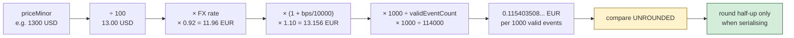
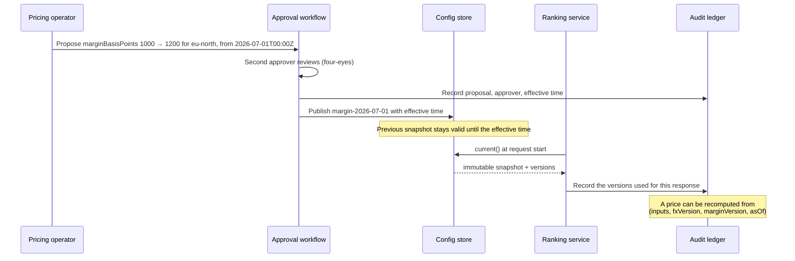

# 4. Pricing and comparison

This is the heart of the product and the subject of the coded slice. It is
also the area the recent lawsuit touched, so the standard is not "correct" but
"correct and provable months later".

## 4.1 The problem with bundle price

Two providers quote the same canonical product:

| | telemetry1 | telemetry2 |
| --- | --- | --- |
| Bundle price | 12.00 EUR | 13.00 USD |
| Events supplied | 100 000 | 120 000 |
| Verified-valid events | 98 000 | 114 000 |

telemetry1 looks cheaper and, after conversion, still looks cheaper
(12.00 EUR against 11.96 EUR — nearly identical). But the customer is not
buying a bundle; they are buying usable, consented, schema-valid events.
Per thousand of those, telemetry1 costs 0.134694 EUR and telemetry2 costs
0.115404 EUR. telemetry2 is **14% cheaper** on the thing that matters.

Displaying bundle price here would be the misleading comparison the group has
just settled a lawsuit over. The brief states the rule directly, and the code
enforces it: *do not silently replace the normalised comparison with lowest
bundle price*.

## 4.2 The normalisation pipeline



Formally, with `q = validEventCount / eventCount`:

```
eligible          ⟺  q ≥ 0.90
                  ∧  now − observedAt ≤ 15 minutes
                  ∧  now < effectiveExpiry

providerEUR       =  (priceMinor / 100) × FX[currency]
customerBundleEUR =  providerEUR × (1 + marginBasisPoints / 10000)
costPer1000       =  customerBundleEUR × 1000 / validEventCount
```

The winner for each `productId` is the eligible offer with the lowest
**unrounded** `costPer1000`. Ties break on higher quality ratio, then newer
`observedAt`, then lexicographically smaller provider ID — a total order, so
the result never depends on fan-out timing or map iteration order.

## 4.3 Markup is not gross margin

The brief says *margin is markup on converted provider cost, not gross
margin*. The distinction is worth 1% of revenue and is a classic source of
reconciliation disputes:

| Interpretation | 10.00 EUR cost at 1000 bps | Implied margin on revenue |
| --- | --- | --- |
| **Markup on cost (used here)** | 10.00 × 1.10 = **11.00** | 9.09% |
| Gross margin on revenue | 10.00 ÷ 0.90 = 11.11 | 10.00% |

There is a dedicated test asserting 11.00 and explaining why 11.11 would be
wrong, so a future refactor cannot quietly switch interpretation.

## 4.4 Why exact arithmetic, not floating point

Binary floating point cannot represent 0.1, 0.92 or 1.18 exactly. The errors
are tiny, but the comparison is a strict inequality between two numbers that
can be genuinely close, and the output is a price a customer is charged and
an auditor will recompute.

All arithmetic therefore runs on exact rationals over `BigInt`
([ADR-0004](../adr/0004-exact-decimal-arithmetic.md)). Rounding happens once,
at serialisation, using round-half-up at the contract precisions: 2 decimal
places for `customerBundleEUR`, 6 for `costPer1000ValidEventsEUR`, 4 for
`qualityRatio`.

Round-half-up, not banker's rounding, because the contract specifies it and
because consistency with the published rule matters more than statistical
neutrality when a customer recomputes a single invoice line.

A test asserts that two offers whose costs are identical at six decimal places
but differ in the exact value still rank deterministically. That is the case
where floating point would silently pick the wrong winner.

## 4.5 Versioned configuration and reproducibility

Every response carries `fxVersion` and `marginVersion`, and the versions are
read once per request from an immutable snapshot
([ADR-0007](../adr/0007-configuration-snapshots.md)).



Reproducibility is the point. Given an audit record, anyone can recompute the
exact price: the inputs are recorded, the configuration version is recorded,
the evaluation instant is recorded, and the algorithm is deterministic and
published.

### Hot reload without a restart

FX rates and the default markup reload at runtime from the configuration file
(watched, debounced), on `SIGHUP`, or via an authenticated
`POST /admin/config/reload`. A malformed or semantically invalid document is
**rejected whole** and the previous snapshot keeps serving — verified by
integration tests that write a broken file and assert the prices do not move.

This matters operationally: a bad FX publish at 03:00 should degrade to
"slightly stale rates" rather than "no marketplace".

## 4.6 What the full platform adds beyond the coded slice

The coded slice implements the default markup and EUR output only, as
specified. The production pricing service extends it along four axes:

| Extension | Mechanism | Why it is out of the coded slice |
| --- | --- | --- |
| Per product / provider / region margin | Most-specific-match resolution over an override table, resolved into the same immutable snapshot | The brief scopes the code to the default markup |
| Loyalty tiers (bronze → platinum) | A tier discount applied after margin, before tax, recorded as a separate line | Explicitly omitted from the exercise |
| Tax | Jurisdiction-resolved rate applied last, never folded into margin | Explicitly omitted |
| Local-currency checkout | Convert the EUR result at checkout with a pinned rate snapshot id | The coded slice outputs EUR only |

The ordering is fixed and must not be rearranged, because each step changes
the base of the next:

```
provider cost → FX → margin → loyalty discount → tax → local-currency display
```

Each applied step is recorded as its own audit line with its own version, so
an invoice can be decomposed back into its components.

## 4.7 Guarding against the anti-patterns

| Anti-pattern | Why it is tempting | How this design blocks it |
| --- | --- | --- |
| Rank by bundle price | Simpler, and looks cheaper in marketing | Ranking is on cost per 1000 valid events; a test asserts a lower bundle price loses |
| Round before comparing | Makes ties "cleaner" | Comparison runs on exact rationals; rounding happens only in the serialiser |
| Let a low-quality feed look cheap | More inventory, lower headline prices | Quality floor of 0.90 plus per-valid-event normalisation |
| Serve a cached offer when a provider is slow | Better latency, fewer partials | Caching is prohibited in this slice; `cache: 'no-store'` and no stale substitution |
| Hide excluded rows | Cleaner-looking responses | `rejectedRows` with stable reasons, and `partial: true` |
| Trust the payload's provider field | Convenient | Provider identity comes from configuration; a `providerId` field is rejected |
