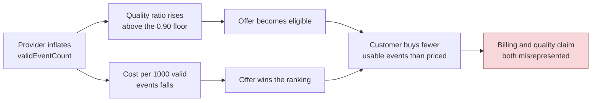
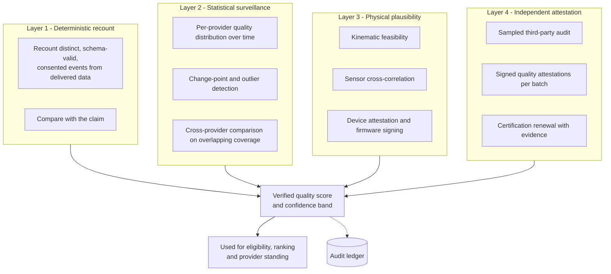
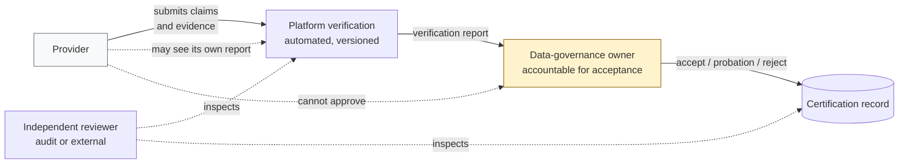

# 5. Data quality and provenance

> **Status: proposed.** The controls in this document are a proposal for
> discussion, not requirements the customer has approved. The brief does not
> name a certifying organisation and does not prescribe a complete evidence
> standard, so the evidence package in [5.6](#56-the-evidence-package) and the
> roles in [5.7](#57-who-decides-and-who-checks) are our recommendation. Two
> points remain open for the customer: whether **external** certification is
> required in addition to platform verification, and who holds the
> data-governance accountability named below.

The brief is explicit: for the coded exercise, trust the supplied quality
counts after validation, but **the architecture must explain how production
quality claims are independently verified**. A marketplace that takes a
seller's word for the quality of what it sells, and prices on that word, is
the precise shape of the allegation the group has just settled.

## 5.1 The core problem

`validEventCount` is supplied by the party that profits from it being high.
Worse, the normalisation rewards it twice: a higher valid count lowers cost
per 1000 valid events *and* lifts the quality ratio above the floor. An
unverified claim is therefore not a minor data-integrity issue; it is a direct
financial incentive to lie.

## 5.2 Four independent verification layers

No single layer is sufficient. Each catches a different class of
misstatement, and each is run by a component the provider does not control.

### Layer 1 — Deterministic recount

After delivery, the platform recounts the events itself using the same
published definition the provider is contractually held to: distinct,
schema-valid, consented. Distinctness is by `(deviceId, eventTimestamp,
schemaId)` with a content hash tiebreak; schema validity is a published
JSON Schema; consent is resolved against the consent service at the
observation time, not the delivery time.

The recount is the authority. The provider's claim is an assertion to be
checked against it, and the delta is recorded. A persistent positive delta is
a contractual breach, not a data-quality nuance.

Because recount happens after delivery, it cannot gate the purchase of the
first batch. It gates everything afterwards, through the standing score below.

### Layer 2 — Statistical surveillance

Quality ratios are stable for a healthy feed. Sharp movements, especially
movements that conveniently cross the 0.90 floor, are suspicious.

| Signal | What it suggests |
| --- | --- |
| Ratio jumps to just above 0.90 and stays | Floor-gaming rather than genuine improvement |
| Ratio variance collapses to near zero | Synthetic or templated counts |
| Provider's ratio diverges from peers on the same coverage | Misstatement or a real quality difference; both need investigating |
| Event counts round suspiciously (many exact multiples) | Fabricated volumes |
| Quality rises exactly when a competitor's price falls | Responsive manipulation |

The last one is the most telling and the easiest to detect once offers from
multiple providers for the same canonical product are stored over time, which
the audit ledger does by construction.

### Layer 3 — Physical plausibility and spoof detection

Telemetry describes the physical world, which constrains it in ways a forger
rarely reproduces completely.

| Check | Catches |
| --- | --- |
| Kinematic feasibility: implied speed, acceleration, jerk within vehicle class | Teleporting positions, impossible braking |
| Road-network snapping with a tolerance budget | Positions in rivers, buildings, the sea |
| Multi-sensor coherence: GNSS against wheel speed, accelerometer, fuel or state of charge | Fabricated location with a real engine trace, or the reverse |
| Temporal fingerprinting: inter-arrival distribution, clock drift signature | Replayed or bulk-generated batches |
| Device attestation: hardware-backed key, signed firmware, signed events | Software emulation of a device |
| Duplicate-across-providers detection via content hashing | The same raw feed resold twice as independent sources |

That last check is important for a marketplace that grows by acquisition: two
acquired subsidiaries may unknowingly resell the same underlying feed. Pricing
them as independent corroborating sources would misrepresent coverage.

Device attestation is the strongest control and the slowest to roll out, since
it depends on hardware in the field. The sequencing is: attestation required
for all newly provisioned devices from phase 1; existing fleets migrate during
normal hardware refresh; feeds without attestation carry a visible confidence
penalty rather than being excluded, so coverage is not lost on day one.

### Layer 4 — Independent attestation

Certified providers submit signed per-batch attestations of their counts.
Signing converts a disputed claim into a non-repudiable one: a provider cannot
later argue the platform misrecorded what they asserted.

A sampled subset is independently audited each quarter, weighted toward
providers with a worse standing score, and the evidence is retained in
WORM storage with the certification record.

## 5.3 The standing score and its consequences

The four layers roll up into a per-provider **standing score** with explicit
consequences, published to providers in advance so enforcement is predictable.

| Standing | Trigger | Consequence |
| --- | --- | --- |
| Certified | All checks pass; deltas within tolerance | Normal ranking participation |
| Watch | Recount delta above tolerance once, or a statistical anomaly | Flagged in responses; sampling rate increased |
| Probation | Repeated deltas, or a failed plausibility check | Confidence penalty applied to the quality ratio used for eligibility |
| Suspended | Evidence of misstatement, or a failed attestation | Offers excluded; existing entitlements honoured; customers notified |

The confidence penalty at probation is the mechanism that prevents a doubted
feed from winning on price while the investigation runs. It is applied to the
*eligibility* ratio, not to the price, so the customer is never charged more
because of a provider's conduct.

## 5.4 Explainability of insights

Every insight surfaced to a fleet operator carries its evidence:

| Element | Example |
| --- | --- |
| Source event references | Content-addressed ids of contributing events |
| Coverage | "based on 11 640 of 12 000 events, 97.0% valid" |
| Freshness | "observed 10:04Z, 1 minute before evaluation" |
| Provenance chain | provider → certification id → adapter version → ingestion batch |
| Quality indicators | Verified quality score plus confidence band, not just the claimed ratio |
| Model attribution | Model name, version, and training-data rights basis where an insight is model-derived |
| Configuration versions | `fxVersion`, `marginVersion` for anything with a price attached |

The coded slice already returns a meaningful subset of this: `providerId`,
`eventCount`, `validEventCount`, `qualityRatio`, `observedAt`, effective
`expiresAt`, `fxVersion`, `marginVersion`, `asOf`, and an explicit list of
excluded rows with reasons. A customer can see not only which offer won, but
which did not and why.

## 5.6 The evidence package

`validEventCount` counts *distinct, schema-valid, consented* events. Three
separate assertions, so a provider must evidence each of them separately
rather than offering one number and a promise.

A defensible package covers five claims. Each one names what the provider
submits and what the platform reproduces independently — the second column is
the part that makes the claim checkable rather than merely stated.

| Claim | Proposed evidence |
| --- | --- |
| **Events are distinct** | Reproducible event-identity and deduplication rules, with counts reconciled against the submitted dataset |
| **Events conform to the product** | Versioned schema-validation results linked to the canonical product and its observation window |
| **Data use is authorised** | Traceable consent and rights records covering the relevant vehicles, time period and permitted use |
| **Counts are reproducible** | A versioned verification job, its input references, output counts, timestamps, and an integrity-protected audit record |
| **Telemetry is trustworthy** | Source and device provenance plus plausibility checks, with stronger independent corroboration where the risk warrants it |

The fourth row is the one that converts the other four from assertions into
evidence. A count nobody can recompute is an opinion; a count produced by a
named job version, over named inputs, with a hash-chained record of the run,
can be re-executed by a third party years later. That is the same standard
the pricing path already meets
([4.5](04-pricing-and-comparison.md#45-versioned-configuration-and-reproducibility)),
applied to quality.

The fifth row is deliberately graduated: "where the risk warrants it".
Requiring third-party corroboration of every batch would make the marketplace
uneconomic. Requiring it of a provider on probation, of a newly onboarded
feed, or of a product where a single buyer's decision carries high
consequence, is proportionate. The standing score in
[5.3](#53-the-standing-score-and-its-consequences) is what sets the level.

## 5.7 Who decides, and who checks

**A provider never approves its own certification.** It submits claims and
evidence; the platform evaluates them. That separation is the whole point,
and it is worth stating explicitly because the obvious shortcut — accepting a
declared quality ratio — is exactly what the group has already been accused
of.

| Role | Who | What they may do | What they may not do |
| --- | --- | --- | --- |
| Provider | The supplying organisation | Submit claims and supporting evidence; see its own verification report, rejection reasons and standing | Approve its own certification, alter a verification result, or see another provider's evidence |
| Platform verification | Automated, versioned, platform-controlled | Recount, validate, score, produce a signed verification report | Exercise discretion — it is deterministic, so two runs agree |
| **Data-governance owner** | A named accountable person at VectorHarbor | Accept, place on probation, or reject a certification on the evidence | Modify the underlying evidence or the verification job's output |
| Independent reviewer | Internal audit, or an external assessor | Inspect any evidence, any verification run and any acceptance decision, read-only | Change any record |

Two design consequences follow. The verification job is **deterministic and
versioned**, so the reviewer can re-run it against the same inputs and expect
the same counts — discretion lives with the accountable human, not in the
code. And acceptance decisions are **audit events like any other**, carrying
the decision, the evidence references, the verification job version and the
person, which is what lets an auditor reconstruct not just what was decided
but on what basis.

**Open with the customer:** whether an external certification body is
required in addition to this, or whether platform verification with
independent internal review is sufficient. The design supports either; the
difference is cost and onboarding time.

## 5.8 Contract validity is not real-world accuracy

The single most important distinction in this document, and the one most
easily lost.

A row can be **contract-valid** — well-formed, schema-conformant, not a
duplicate, inside the observation window, covered by consent — and still be
**false**. A location that never happened is schema-valid. A fabricated
braking event parses perfectly. Deduplication cannot tell a unique real event
from a unique invented one.

| | What it establishes | What it cannot establish |
| --- | --- | --- |
| **Contract validity** | The row is well-formed, unique, in-window, consented, and conforms to the canonical product | That the event describes something that physically happened |
| **Real-world accuracy** | The event is consistent with physics, with other sensors, and with an attested device | Nothing about schema conformance; an accurate event can still be malformed |

The coded slice enforces contract validity only — strictly, with stable
reason codes, and that is all the brief asks of it. Production needs both,
and they are established by different layers: validity by
[layer 1](#layer-1--deterministic-recount), accuracy by
[layer 3](#layer-3--physical-plausibility-and-spoof-detection) and the device
attestation within it.

This is why the brief asks separately to *detect spoofed telemetry* as well as
to count valid events. Accepting a provider's declared quality ratio would
address neither, but passing a schema check addresses only the first. Stating
this plainly matters commercially too: a provider whose feed is 100%
contract-valid may still be the one to investigate.

## 5.9 What is implemented versus designed

| Capability | Status |
| --- | --- |
| Strict row validation with stable rejection reasons | **Implemented** |
| Quality floor enforcement at 0.90 | **Implemented** |
| Quality ratio and per-valid-event normalisation | **Implemented** |
| Provider identity bound to configuration | **Implemented** |
| Exclusion transparency in the response | **Implemented** |
| Deterministic recount after delivery | Designed |
| Statistical surveillance and standing score | Designed |
| Physical plausibility and spoof detection | Designed |
| Device attestation | Designed; depends on field hardware |
| Signed attestations and sampled third-party audit | Designed |
| Five-claim evidence package | **Proposed** — awaiting customer agreement on the standard |
| Separation of duties: provider submits, platform verifies, owner accepts | **Proposed** — requires a named accountable owner |
| External certification body | **Open question** for the customer |

This split is stated honestly in
[22 Assumptions and gaps](22-assumptions-and-gaps.md) as well, because the
brief asks for unimplemented requirements to be identified rather than
implied.
