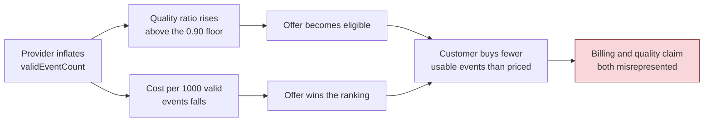
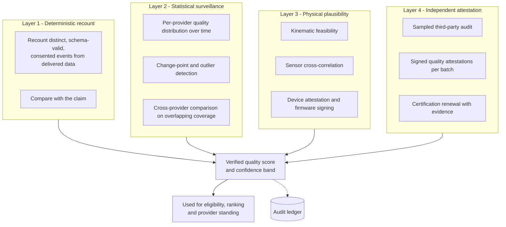

# 5. Data quality and provenance

The brief is explicit: for the coded exercise, trust the supplied quality
counts after validation, but **the architecture must explain how production
quality claims are independently verified**. A marketplace that takes a
seller's word for the quality of what it sells, and prices on that word, is
the precise shape of the allegation the group has just settled.

## 5.1 The core problem

`validEventCount` is supplied by the party that profits from it being high.
Worse, the normalisation rewards it twice: a higher valid count lowers cost
per 1000 valid events *and* lifts the quality ratio above the floor. An
unverified claim is therefore not a minor data-integrity issue; it is a direct
financial incentive to lie.

## 5.2 Four independent verification layers

No single layer is sufficient. Each catches a different class of
misstatement, and each is run by a component the provider does not control.

### Layer 1 — Deterministic recount

After delivery, the platform recounts the events itself using the same
published definition the provider is contractually held to: distinct,
schema-valid, consented. Distinctness is by `(deviceId, eventTimestamp,
schemaId)` with a content hash tiebreak; schema validity is a published
JSON Schema; consent is resolved against the consent service at the
observation time, not the delivery time.

The recount is the authority. The provider's claim is an assertion to be
checked against it, and the delta is recorded. A persistent positive delta is
a contractual breach, not a data-quality nuance.

Because recount happens after delivery, it cannot gate the purchase of the
first batch. It gates everything afterwards, through the standing score below.

### Layer 2 — Statistical surveillance

Quality ratios are stable for a healthy feed. Sharp movements, especially
movements that conveniently cross the 0.90 floor, are suspicious.

| Signal | What it suggests |
| --- | --- |
| Ratio jumps to just above 0.90 and stays | Floor-gaming rather than genuine improvement |
| Ratio variance collapses to near zero | Synthetic or templated counts |
| Provider's ratio diverges from peers on the same coverage | Misstatement or a real quality difference; both need investigating |
| Event counts round suspiciously (many exact multiples) | Fabricated volumes |
| Quality rises exactly when a competitor's price falls | Responsive manipulation |

The last one is the most telling and the easiest to detect once offers from
multiple providers for the same canonical product are stored over time, which
the audit ledger does by construction.

### Layer 3 — Physical plausibility and spoof detection

Telemetry describes the physical world, which constrains it in ways a forger
rarely reproduces completely.

| Check | Catches |
| --- | --- |
| Kinematic feasibility: implied speed, acceleration, jerk within vehicle class | Teleporting positions, impossible braking |
| Road-network snapping with a tolerance budget | Positions in rivers, buildings, the sea |
| Multi-sensor coherence: GNSS against wheel speed, accelerometer, fuel or state of charge | Fabricated location with a real engine trace, or the reverse |
| Temporal fingerprinting: inter-arrival distribution, clock drift signature | Replayed or bulk-generated batches |
| Device attestation: hardware-backed key, signed firmware, signed events | Software emulation of a device |
| Duplicate-across-providers detection via content hashing | The same raw feed resold twice as independent sources |

That last check is important for a marketplace that grows by acquisition: two
acquired subsidiaries may unknowingly resell the same underlying feed. Pricing
them as independent corroborating sources would misrepresent coverage.

Device attestation is the strongest control and the slowest to roll out, since
it depends on hardware in the field. The sequencing is: attestation required
for all newly provisioned devices from phase 1; existing fleets migrate during
normal hardware refresh; feeds without attestation carry a visible confidence
penalty rather than being excluded, so coverage is not lost on day one.

### Layer 4 — Independent attestation

Certified providers submit signed per-batch attestations of their counts.
Signing converts a disputed claim into a non-repudiable one: a provider cannot
later argue the platform misrecorded what they asserted.

A sampled subset is independently audited each quarter, weighted toward
providers with a worse standing score, and the evidence is retained in
WORM storage with the certification record.

## 5.3 The standing score and its consequences

The four layers roll up into a per-provider **standing score** with explicit
consequences, published to providers in advance so enforcement is predictable.

| Standing | Trigger | Consequence |
| --- | --- | --- |
| Certified | All checks pass; deltas within tolerance | Normal ranking participation |
| Watch | Recount delta above tolerance once, or a statistical anomaly | Flagged in responses; sampling rate increased |
| Probation | Repeated deltas, or a failed plausibility check | Confidence penalty applied to the quality ratio used for eligibility |
| Suspended | Evidence of misstatement, or a failed attestation | Offers excluded; existing entitlements honoured; customers notified |

The confidence penalty at probation is the mechanism that prevents a doubted
feed from winning on price while the investigation runs. It is applied to the
*eligibility* ratio, not to the price, so the customer is never charged more
because of a provider's conduct.

## 5.4 Explainability of insights

Every insight surfaced to a fleet operator carries its evidence:

| Element | Example |
| --- | --- |
| Source event references | Content-addressed ids of contributing events |
| Coverage | "based on 11 640 of 12 000 events, 97.0% valid" |
| Freshness | "observed 10:04Z, 1 minute before evaluation" |
| Provenance chain | provider → certification id → adapter version → ingestion batch |
| Quality indicators | Verified quality score plus confidence band, not just the claimed ratio |
| Model attribution | Model name, version, and training-data rights basis where an insight is model-derived |
| Configuration versions | `fxVersion`, `marginVersion` for anything with a price attached |

The coded slice already returns a meaningful subset of this: `providerId`,
`eventCount`, `validEventCount`, `qualityRatio`, `observedAt`, effective
`expiresAt`, `fxVersion`, `marginVersion`, `asOf`, and an explicit list of
excluded rows with reasons. A customer can see not only which offer won, but
which did not and why.

## 5.5 What is implemented versus designed

| Capability | Status |
| --- | --- |
| Strict row validation with stable rejection reasons | **Implemented** |
| Quality floor enforcement at 0.90 | **Implemented** |
| Quality ratio and per-valid-event normalisation | **Implemented** |
| Provider identity bound to configuration | **Implemented** |
| Exclusion transparency in the response | **Implemented** |
| Deterministic recount after delivery | Designed |
| Statistical surveillance and standing score | Designed |
| Physical plausibility and spoof detection | Designed |
| Device attestation | Designed; depends on field hardware |
| Signed attestations and sampled third-party audit | Designed |

This split is stated honestly in
[22 Assumptions and gaps](22-assumptions-and-gaps.md) as well, because the
brief asks for unimplemented requirements to be identified rather than
implied.
