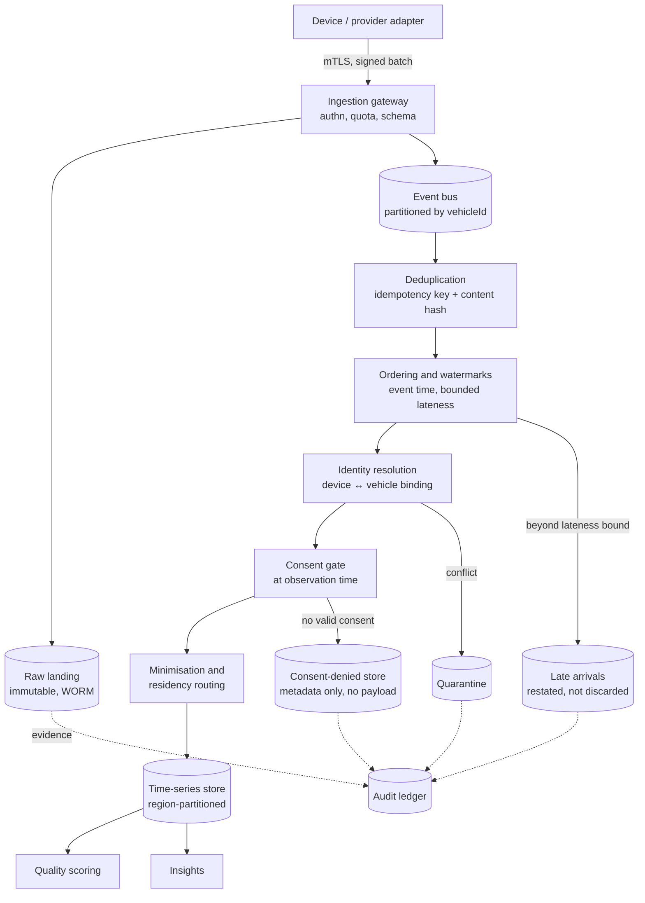
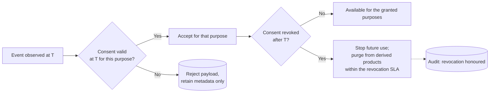

# 6. Telemetry ingestion

Vehicles are intermittently connected, devices buffer, networks reorder, and
identifiers conflict. Ingestion must treat all of that as the normal case.

## 6.1 Pipeline



Raw landing is written before any processing, immutably. If a downstream
decision is later disputed, the original bytes still exist to re-derive it.

## 6.2 Duplicates

Devices retry; gateways retry; providers replay. Duplicates are expected.

| Mechanism | Detail |
| --- | --- |
| Idempotency key | `(deviceId, eventTimestamp, schemaId, sequenceNumber)` |
| Content hash | SHA-256 over the canonicalised payload, as a tiebreak |
| Deduplication window | 7 days in a fast store, with a durable index beyond that |
| Conflict policy | Same key, same hash → drop silently. Same key, **different** hash → quarantine both and alert |

The second conflict case is the interesting one. Two different payloads
claiming the same identity is either a device bug or tampering, and it must
never be resolved by "last write wins", which would let an attacker overwrite
history.

## 6.3 Delayed and out-of-order events

Event time, not arrival time, is authoritative. Processing uses watermarks
with a bounded lateness allowance.

```mermaid
sequenceDiagram
  participant V as Vehicle (offline 40 min)
  participant G as Gateway
  participant W as Windowed aggregation
  participant I as Insights
  participant A as Audit

  V->>G: Buffered batch, event times 09:20–10:00
  G->>W: Events with event-time stamps
  Note over W: Watermark is at 10:05;<br/>the 09:20–10:00 window already closed
  alt Within the lateness bound (24 h)
    W->>I: Restate the affected windows
    I->>A: Record restatement with before/after and cause
    I->>I: Mark affected insights "restated"
  else Beyond the bound
    W->>A: Record as late arrival, excluded from aggregates
    Note over A: Retained and queryable;<br/>never silently discarded
  end
```

Aggregates are **restatable by design**, and every restatement is recorded
with its cause. The alternative — freezing a window and discarding late data —
produces insights that are quietly wrong, which is exactly the failure mode
the company is under scrutiny for.

The lateness bound is 24 hours for operational insights, and 30 days for
billing-relevant aggregates, reflecting that a disputed invoice deserves more
patience than a dashboard.

## 6.4 Intermittent connectivity

| Behaviour | Design response |
| --- | --- |
| Device buffers while offline | Batch ingest accepts bounded historical ranges with event-time stamps |
| Reconnection stampede after a regional outage | Per-device token bucket plus jittered backoff advertised in the response |
| Partial batches | Each event is independently idempotent; a half-delivered batch is safe to retry |
| Clock drift on the device | Device clock recorded alongside gateway receipt time; drift beyond tolerance flags the feed |
| Permanently silent device | Freshness monitor raises a coverage gap to the operator rather than inferring data |

Freshness is surfaced to customers rather than hidden. An insight computed
from a fleet where 30% of devices have been silent for a day is labelled as
such, because the coverage gap is often the most actionable fact available.

## 6.5 Consent is evaluated at observation time

A consent grant valid *now* does not retroactively authorise data captured
before it, and a revocation now does not erase the lawfulness of what was
captured earlier — but it does stop future use.



Purposes are separate and independently revocable: fleet operations,
analytics, AI training, advertising. Advertising consent is structurally
separate from fleet-operation consent, as the brief requires — they are
different scope records with different lifecycles, not flags on one record.
See [10 Privacy, consent and residency](10-privacy-consent-residency.md).

## 6.6 Capacity characteristics

| Property | Target | Note |
| --- | --- | --- |
| Sustained ingest | 50 000 events/second at phase 3 | See [12 Capacity plan](12-capacity-plan.md) |
| Surge headroom | 4× sustained for 2 hours | Severe-weather and seasonal logistics peaks |
| Partition key | `vehicleId` | Per-vehicle ordering without global ordering cost |
| Ingest-to-queryable | p95 under 10 seconds | Operational insights need to be near-live |
| Raw retention | 400 days, WORM | Exceeds the audit and dispute window |
| Deduplication state | 7 days hot, indexed beyond | Covers realistic device buffering |

Partitioning by `vehicleId` is the decision that makes the rest tractable:
ordering only needs to hold per vehicle, which is the only scope where it is
semantically meaningful, and it lets throughput scale linearly with fleet
count.
