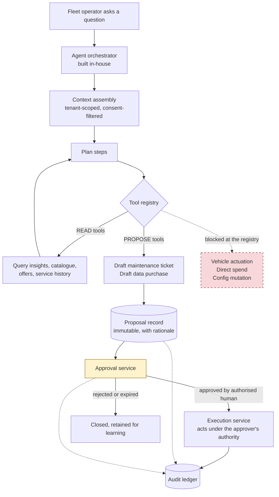

# 7. Agentic workflows

The brief draws a hard line: the assistant may **propose** maintenance
tickets and data purchases using allow-listed tools; explicit human approval
is required before any spend or operational change; and remote vehicle
actuation is **prohibited** outright.

This section describes how that line is enforced by architecture rather than
by prompt instructions, because a prompt is a request and an architecture is a
constraint.

## 7.1 Principle: propose, never execute



The agent has **no credential that can cause an effect**. Its identity can
call read tools and propose tools, and nothing else. Even if the model were
fully compromised by prompt injection in a provider description or a
maintenance note, the worst outcome is a bad proposal that a human then
declines — because the execution path requires an approval token that only
the approval service can mint, and it mints one only in response to an
authenticated human action.

## 7.2 The tool registry

Tools are declared, not discovered. Each entry carries a machine-readable
contract.

| Field | Purpose |
| --- | --- |
| `name`, `version` | Stable identity |
| `classification` | `read`, `propose`, or `execute` (agents may never bind `execute`) |
| `inputSchema` / `outputSchema` | Validated both ways; a malformed call is rejected, not coerced |
| `tenantScoped` | Forces a tenant context; no ambient access |
| `consentPurposes` | Purposes required before the tool may touch data |
| `rateLimit`, `costCeiling` | Bounds per conversation and per tenant |
| `approvalRequired` | Whether the output is a proposal needing a human gate |
| `auditEvent` | The event type emitted on every invocation |

Three rules make the registry meaningful:

1. **Default deny.** A tool absent from the allow-list cannot be called; there
   is no generic HTTP, shell or SQL tool.
2. **No actuation class exists.** There is no vehicle-command tool to
   allow-list, in any environment. The capability is absent from the codebase,
   not merely disabled by configuration — see
   [ADR-0010](../adr/0010-agent-tool-allowlisting.md).
3. **Schemas are enforced at both ends.** Model output is parsed and validated
   before it reaches a tool, so a hallucinated field is a rejected call.

## 7.3 The approval gate

```mermaid
sequenceDiagram
  autonumber
  participant A as Agent
  participant P as Proposal service
  participant N as Notification service
  participant H as Maintenance manager
  participant X as Execution service
  participant L as Audit ledger

  A->>P: Propose work order (vehicle, fault, parts, cost 1 240 EUR, rationale, evidence)
  P->>P: Validate schema, tenant, consent purposes, cost ceiling
  P->>L: PROPOSAL_CREATED (agent id, model + version, inputs digest)
  P->>N: Notify approvers (respecting quiet hours and escalation)
  N->>H: "Proposal awaiting approval"

  H->>P: Open proposal
  P-->>H: Rationale, source events, quality and freshness, cost, alternatives considered

  alt Approved
    H->>P: Approve (re-authentication; step-up for high value)
    P->>L: PROPOSAL_APPROVED (approver, timestamp, approved values)
    P->>X: Execute with a single-use approval token
    X->>X: Verify token, re-check tenant, budget and consent at execution time
    X->>L: ACTION_EXECUTED (outcome, correlation to proposal)
  else Rejected
    H->>P: Reject with reason
    P->>L: PROPOSAL_REJECTED (reason)
  else No response before expiry
    P->>L: PROPOSAL_EXPIRED
    Note over P: Expiry is the default outcome.<br/>Silence never authorises anything.
  end
```

Design points that are easy to get wrong and are therefore stated explicitly:

**Silence is rejection.** Proposals expire. An unattended queue must never
become an implicit approval path.

**Approval binds to specific values.** The approver approves "replace brake
pads on VH-4471, up to 1 240 EUR, before 2026-07-01", not "the agent's
suggestion". If the agent later re-plans with different values, that is a new
proposal.

**Re-validation at execution.** Budget, consent and entitlement are checked
again when the action executes, because time passes between approval and
execution and consent can be revoked in that window.

**Four-eyes above a threshold.** Above a configurable value, the approver must
differ from the requester, and both are recorded.

## 7.4 Prompt injection and untrusted content

Agent context includes provider descriptions, maintenance notes and other
text the platform does not control. All of it is treated as data.

| Control | Effect |
| --- | --- |
| Untrusted content is delimited and labelled in the context | The model is told which spans are data, not instruction |
| Tool calls are schema-validated before dispatch | Injected "call this tool with these args" cannot produce an out-of-contract call |
| Capability boundary is outside the model | No instruction can grant a capability the identity lacks |
| Proposals surface their evidence to the approver | A human sees the odd rationale before anything happens |
| Anomaly detection on tool-call patterns | Unusual sequences are flagged for review |

The honest summary: prompt injection is not fully solvable at the model layer,
so the design assumes it will sometimes succeed and ensures the blast radius
is a declined proposal.

## 7.5 Explainability and attribution

Every agent output records the model identifier and version, the prompt
template version, the tool calls made with their inputs and outputs, the
source events that informed the conclusion with their quality and freshness,
and the configuration versions in force. An insight whose model version cannot
be identified is not shown; it is treated as a defect.

## 7.6 Loyalty-aware personalisation

The assistant personalises offers using authorised purchase and service
history: usage frequency, operating area, price range and interests. Three
constraints bind it.

Personalisation uses **purchase and service history only**, never raw driver
location. Operating area is derived as a coarse region from entitlements and
service records, not from tracking individuals.

It requires the **analytics** consent purpose. A tenant may buy data and
decline personalisation.

Advertising personalisation requires the separate **advertising** consent and
is handled by a different pipeline with its own retention. See
[18 Advertising and loyalty](18-advertising-and-loyalty.md).
