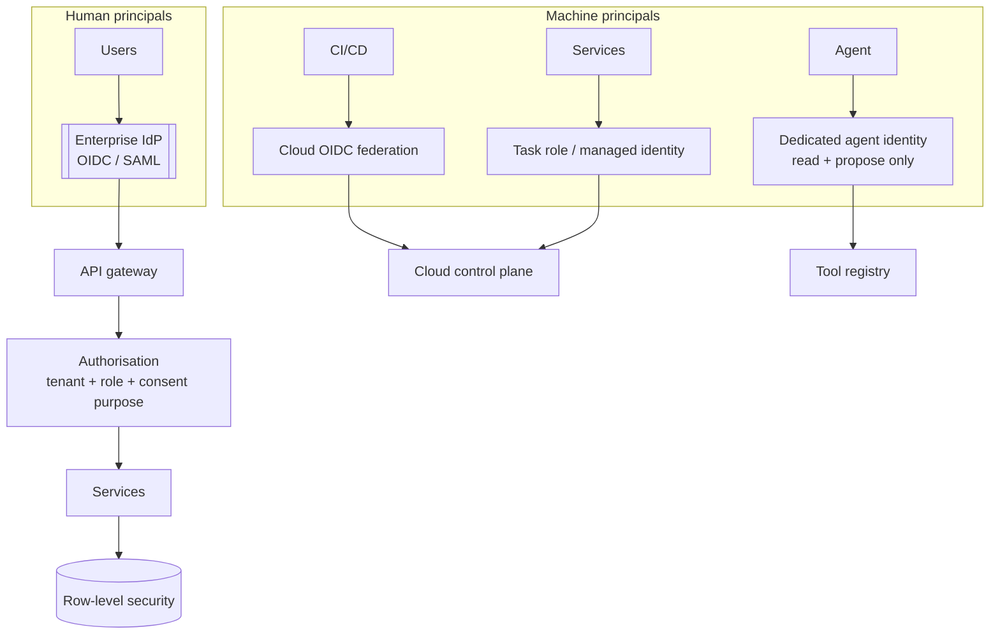

# 8. Security

## 8.1 Principles

Defence in depth, least privilege, no long-lived credentials, and fail
closed. Where a control cannot be enforced technically, it is made visible —
an undetected violation is worse than a blocked one.

## 8.2 Identity and access

| Principal | Credential | Lifetime |
| --- | --- | --- |
| Human user | OIDC access token, audience-bound, tenant claim | 15 minutes, refresh with rotation |
| Service | Task role (AWS) / user-assigned managed identity (Azure) | Rotated by the platform; never materialised in an image |
| CI/CD | GitHub OIDC federated into a deploy role | Per-job, minutes |
| Agent | Dedicated identity bound to `read` and `propose` tools | Per-conversation, scoped to one tenant |
| Provider adapter | mTLS client certificate plus signed payloads | Certificate rotated annually, revocable immediately |

There are no static cloud access keys anywhere in the repository or the
pipeline. This is verified mechanically: `npm run check` scans for AWS key
ids, private keys and provider tokens, and CI runs a secret scanner.

## 8.3 Authorisation model

Authorisation is the conjunction of four questions, evaluated in order, with
denial at any step ending the evaluation:

1. **Tenant** — does the principal belong to the tenant owning the resource?
2. **Role** — does the role permit this operation?
3. **Consent purpose** — is there a valid consent grant for the purpose this
   operation serves?
4. **Entitlement** — for data access, does an order grant access to this
   product and window?

Consent sits inside the authorisation path rather than beside it. A dispatcher
with every role in the system still cannot read telemetry whose driver has
revoked the relevant purpose.

## 8.4 Controls implemented in the coded slice

These are real, in this repository, and tested.

| Control | Where | Test |
| --- | --- | --- |
| Strict closed input validation; unknown fields rejected | `validation.js` | `test/unit/validation.test.js` |
| Provider identity from configuration, never payload | `provider-client.js`, `validation.js` | Rejects a `providerId` field |
| Response size cap on provider bodies | `provider-client.js` | `BODY_TOO_LARGE` tests |
| Per-attempt timeout and bounded retry budget | `retry.js`, `provider-client.js` | Timeout and budget tests |
| Per-request deadline and client-disconnect cancellation | `app.js` | `test/integration/lifecycle.test.js` |
| Concurrency shedding with 503 and `Retry-After` | `app.js` | Load-shedding test |
| Safe error bodies: stable code, safe message, request id only | `app.js` | Asserts no internals leak |
| Log redaction of credentials, payment data, VIN, geolocation | `logger.js` | `test/unit/logger.test.js` |
| Constant-time admin token comparison | `app.js` | Reload authorisation tests |
| Security response headers (`nosniff`, `no-store`, `no-referrer`) | `app.js` | HTTP tests |
| Non-root, read-only, capability-dropped containers | `Dockerfile`, compose, ECS/ACA task definitions | Container CI job |
| No runtime third-party dependencies | `package.json` | [ADR-0003](../adr/0003-zero-runtime-dependencies.md) |
| HTTP redirects refused (`redirect: 'error'`) | `provider-client.js` | Prevents SSRF pivot via a redirecting provider |

## 8.5 Network and edge

| Layer | AWS | Azure |
| --- | --- | --- |
| Edge protection | WAFv2: per-IP rate limit, managed rule sets, reputation list, tighter admin limit | Front Door Premium WAF: Default Rule Set 2.1, Bot Manager, rate limit, admin block |
| Volumetric DDoS | Shield Standard always on; Shield Advanced recommended pre-launch | Azure DDoS Protection via Front Door's global anycast |
| TLS | TLS 1.2+ at the ALB with a TLS 1.3 policy | TLS 1.2+ terminated at Front Door, HTTPS-only to origin |
| Compute exposure | Tasks in private subnets; only the ALB security group may reach them | Container Apps on a delegated subnet; NSG admits only `AzureFrontDoor.Backend` |
| Egress | NAT with stable IPs for provider allow-listing; port 443 only | VNet-integrated egress |
| Internal service traffic | Security-group references, not CIDRs | NSG plus the environment boundary |
| Admin surface | `/admin/*` returns 404 at the public listener | Blocked by a WAF custom rule |

The admin endpoint being blocked at the edge *and* requiring a bearer token
*and* being rate-limited separately is intentional redundancy: a
configuration-reload endpoint is the single most valuable target in this
service, since it controls prices.

## 8.6 Secrets

| Secret | Store | Access | Rotation |
| --- | --- | --- | --- |
| Admin reload token | Secrets Manager / Key Vault | Injected at task start; never logged | Quarterly, runbooked; Terraform `ignore_changes` so an apply cannot revert it |
| Database credentials | Secrets Manager / Key Vault, or IAM auth | Workload identity | Automatic |
| Provider mTLS keys | Managed certificate store | Per-adapter | Annual, revocable immediately |
| PSP credentials | PSP vault, never in platform storage | Payment orchestration only | Per PSP policy |

Secrets never appear in environment files in the repository, container images
or Terraform state (generated values are stored in the secret manager, and
the resources carry `ignore_changes`).

## 8.7 Supply chain

| Control | Status |
| --- | --- |
| Zero runtime dependencies in the service | Implemented; the transitive attack surface is the Node.js runtime alone, and the dependency scan evidences it on every build |
| Pinned base image with a digest-friendly tag | Implemented (`node:22.12.0-alpine`) |
| Multi-stage build; no build tooling in the runtime image | Implemented |
| Image scanning on push | Implemented (ECR scan-on-push, plus Trivy and Snyk Container in CI) |
| Filesystem, IaC and secret scanning in CI | Implemented (Trivy, SARIF to code scanning) |
| Static analysis of our own source (SAST) | Implemented (Snyk Code, blocking at high and above) |
| Terraform misconfiguration scanning | Implemented (Trivy misconfig and Snyk IaC) |
| Continuous monitoring of the default branch | Implemented (`snyk monitor` on the default branch) |
| Immutable image tags outside dev | Implemented |
| SBOM generation and signing (Sigstore) | Recommended before public launch; not implemented |
| Registry content trust | Enabled on the production Azure registry; recommended for AWS |

## 8.8 Data protection

Encryption in transit is TLS 1.2+ everywhere, including service-to-service and
to providers. Encryption at rest uses cloud-managed keys by default, with
customer-managed keys for the audit ledger and any store holding location
data, so that key revocation is an available control.

Driver location is the most sensitive element in the platform. It is
minimised at ingestion, access-controlled separately from other telemetry,
excluded from logs by the redaction deny-list, and never used for
personalisation. See
[10 Privacy, consent and residency](10-privacy-consent-residency.md).
