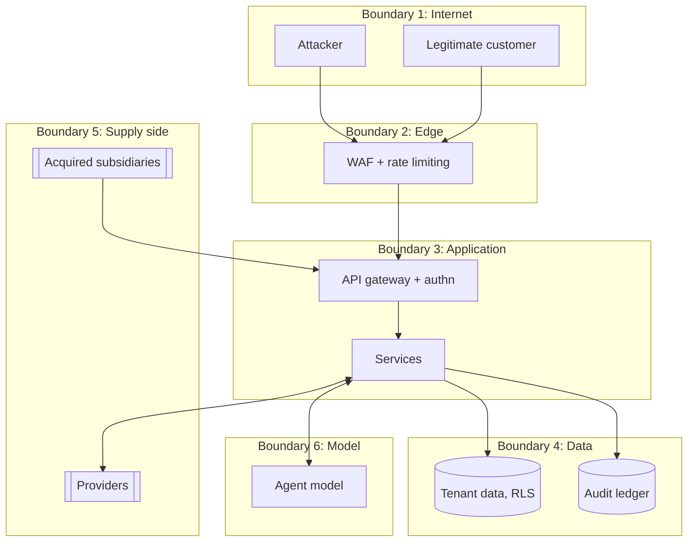
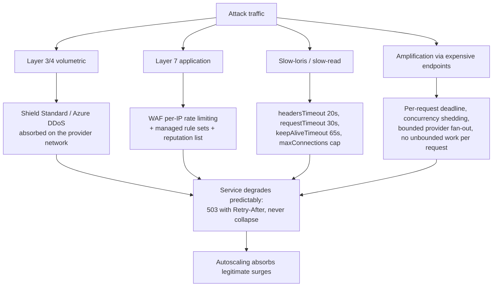

# 9. Threat model

Scope: the data marketplace, the ranking service, telemetry ingestion and the
supervised assistant. Method: STRIDE per trust boundary, plus abuse cases
specific to a data marketplace, plus a dedicated DDoS section because a sister
product was recently taken down.

## 9.1 Trust boundaries

## 9.2 STRIDE analysis

| # | Threat | Boundary | Impact | Likelihood | Mitigation | Status |
| --- | --- | --- | --- | --- | --- | --- |
| S1 | Provider spoofs another provider's identity | 5 | High | Medium | Identity bound to the configured endpoint; a `providerId` field is rejected; mTLS per adapter | **Implemented** (slice) |
| S2 | Stolen session token replayed | 3 | High | Medium | Short-lived audience-bound tokens, refresh rotation, device binding | Designed |
| S3 | Forged telemetry from an emulated device | 5 | High | Medium | Device attestation, signed events, plausibility checks | Designed |
| T1 | Price tampering via the reload endpoint | 3 | Critical | Low | Edge 404 on `/admin/*`, bearer token compared in constant time, separate rate limit, whole-document validation, audit on every attempt | **Implemented** (slice) |
| T2 | Audit record alteration to hide a bad price | 4 | Critical | Low | Append-only ledger, hash chaining, WORM object storage, separate key scope | Designed |
| T3 | In-flight modification of provider responses | 5 | High | Low | TLS everywhere, `redirect: 'error'`, strict validation | **Implemented** (slice) |
| R1 | Provider denies the quality counts it submitted | 5 | High | Medium | Signed attestations; raw landing retained WORM | Designed |
| R2 | Customer disputes a price | 3 | High | Medium | Versioned snapshots, recorded inputs, deterministic recomputation | **Implemented** (slice) |
| R3 | Approver denies authorising an action | 3 | High | Low | Re-authentication at approval, four-eyes above a threshold, immutable approval record | Designed |
| I1 | Cross-tenant data disclosure | 4 | Critical | Low | Four independent isolation layers ([ADR-0011](../adr/0011-multi-tenancy-isolation.md)) | Designed |
| I2 | Driver location leaked through logs | 3 | Critical | Medium | Deny-list redaction in the logger, enforced centrally | **Implemented** (slice) |
| I3 | Error responses leak internals | 3 | Medium | Medium | Error bodies carry only code, safe message and request id; asserted by test | **Implemented** (slice) |
| I4 | Location re-identified from "anonymised" demos | 1 | High | Medium | Spatial and temporal generalisation, k-anonymity floor, no trajectory export | Designed |
| I5 | Margin disclosed to a provider | 5 | Medium | Low | Provider-facing APIs never carry customer pricing | Designed |
| D1 | Volumetric DDoS | 1–2 | High | **High** | See [9.4](#94-ddos-posture) | **Implemented** (edge + slice) |
| D2 | Slow or hostile provider exhausts the service | 5 | High | Medium | Per-attempt timeout, bounded retry budget, request deadline, body cap, partial results | **Implemented** (slice) |
| D3 | Retry storm amplifies a provider outage | 3→5 | High | Medium | Bounded attempts, full jitter, total budget, circuit breaking at scale | **Implemented** (slice) |
| D4 | Ingestion flood from a compromised fleet | 5 | High | Medium | Per-device quotas, per-tenant backpressure, shed before the transactional path | Designed |
| E1 | Agent escalates to executing actions | 6 | Critical | Medium | No `execute` tool bindable by an agent; no actuation capability exists; approval token minted only by the approval service | Designed ([ADR-0010](../adr/0010-agent-tool-allowlisting.md)) |
| E2 | Prompt injection via provider or note text | 6 | High | **High** | Untrusted content labelled, schema-validated tool calls, capability boundary outside the model, human review of proposals | Designed |
| E3 | Compromised CI pushes a malicious image | 3 | Critical | Low | OIDC short-lived credentials, protected environments, immutable tags, scanning, signed images (recommended) | Partly implemented |
| E4 | Over-broad IAM on the task role | 3 | High | Medium | Task role grants exactly one SSM read and its own log stream | **Implemented** (IaC) |

## 9.3 Marketplace-specific abuse cases

| Abuse | Description | Countermeasure |
| --- | --- | --- |
| Quality inflation | Overstating `validEventCount` to win ranking and clear the floor | Deterministic recount, statistical surveillance, standing score with a confidence penalty ([5](05-data-quality-and-provenance.md)) |
| Floor gaming | Tuning quality to sit just above 0.90 | Distribution monitoring; a suspiciously tight band around the floor is itself a signal |
| Price shading on expiring offers | Posting a very cheap offer that expires before it can be bought | Strict expiry comparison (`now < expiry`), freshness window, and expiry shown in the response |
| Phantom coverage | Claiming regions not genuinely served | Certification sampling plus coverage verification against delivered data |
| Duplicate resale | Two providers reselling one underlying feed as independent sources | Cross-provider content hashing; corroboration weight reduced |
| Wash offering | A provider posting a non-viable offer to depress a competitor's rank | Fulfilment tracking; standing penalties for unfulfilled wins |
| Scraping the comparison | Harvesting pricing intelligence through the public surface | Authentication for detailed offers, per-tenant quotas, WAF rate limits |
| Consent laundering | Rebinding a device to a consented vehicle to make data sellable | Bindings never auto-overwrite; conflicts quarantine and alert ([3.4](03-domain-model.md#34-device-to-vehicle-identity-conflicts)) |

## 9.4 DDoS posture

A sister product recently suffered a major DDoS incident, so this is treated
as a launch requirement.

Several of these are in the coded service, not just the edge:

| Mechanism | Value | Rationale |
| --- | --- | --- |
| `MAX_CONCURRENT_REQUESTS` | 256 per task | Shed deterministically rather than queue without bound |
| `REQUEST_TIMEOUT_MS` | 10 000 | No request occupies a worker indefinitely |
| `PROVIDER_TIMEOUT_MS` | 2 000 per attempt | A slow provider cannot hold our capacity |
| `PROVIDER_RETRY_BUDGET_MS` | 5 000 total | Caps worst-case work per request |
| `maxConnections` | 4 × concurrency limit | Connection floods hit a bound before file descriptors do |
| `headersTimeout` / `requestTimeout` | 20 s / 30 s | Slow-loris resistance |
| Full-jitter backoff | — | Prevents synchronised retry storms across replicas |
| Response body cap | 8 MiB | A hostile provider cannot exhaust task memory |

The load-shedding behaviour is tested: with the concurrency limit set to 1 and
a deliberately slow provider, concurrent requests return a mix of 200 and 503
with `Retry-After: 1`, and the shed count appears in metrics.

### Residual DDoS risk

A sufficiently large, distributed, well-formed attack from many IPs can still
exhaust the autoscaling ceiling and the budget behind it. Accepted
mitigations: Shield Advanced (or Azure DDoS Network Protection) before public
launch, pre-agreed cost ceilings with a documented decision to shed rather
than scale indefinitely, and a runbook step to tighten WAF thresholds and,
if necessary, restrict to the known customer IP ranges of the pilot cohort.

## 9.5 Risk register summary

| Risk | Residual rating | Owner | Review |
| --- | --- | --- | --- |
| Quality misstatement by a provider | Medium | Data governance | Monthly |
| Prompt injection producing a plausible bad proposal | Medium | Agent platform | Monthly |
| Volumetric DDoS beyond the scaling ceiling | Medium | Platform SRE | Quarterly |
| Cross-tenant disclosure | Low | Security | Quarterly |
| Price tampering | Low | Pricing governance | Quarterly |
| Supply-chain compromise | Low | Platform engineering | Quarterly |

No risk is rated High after mitigation. The two Mediums that deserve standing
management attention are quality misstatement — because the incentive to
commit it is permanent and financial — and prompt injection, because the
research consensus is that it is mitigated rather than solved.
