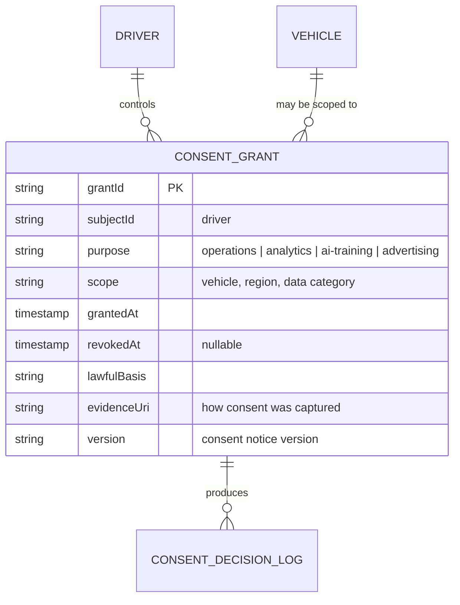
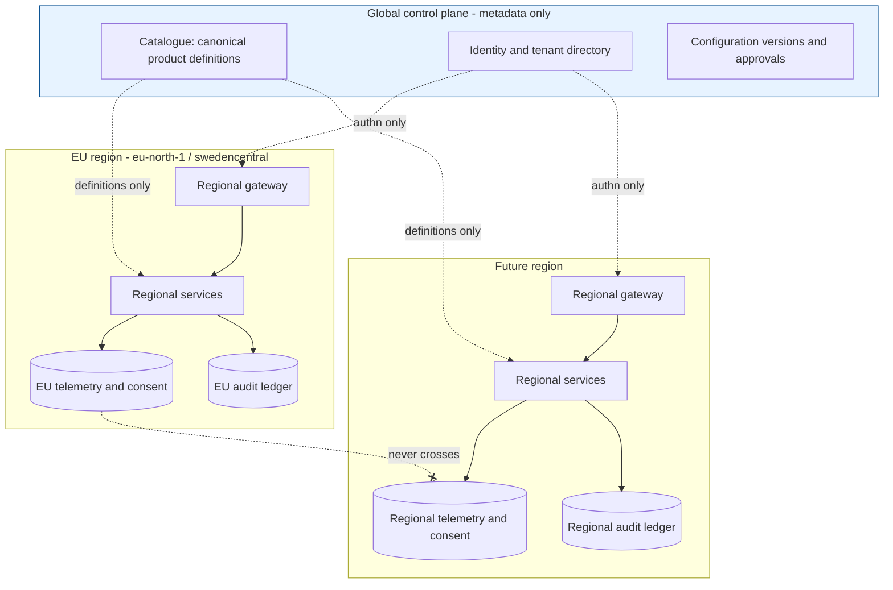

# 10. Privacy, consent and residency

## 10.1 Consent is a first-class, purpose-scoped object

The brief requires advertising consent to be separate from fleet-operation
consent, and requires revocable rights to use telemetry for analytics or AI.
A single boolean, or a flags column, would make both impossible to honour
cleanly. Consent is therefore modelled as independent grants per purpose.

| Purpose | What it permits | Revocable | Effect of revocation |
| --- | --- | --- | --- |
| `operations` | Dispatch, maintenance, safety | Yes, but withdrawing it may suspend the service | Future operational use stops |
| `analytics` | Aggregate insights, benchmarking | Yes | Removed from future aggregates; existing aggregates restated at the next cycle |
| `ai-training` | Training or fine-tuning models | Yes | Excluded from future training; models trained on it are retired on the documented schedule |
| `advertising` | Directed advertising and targeting | Yes | Immediate removal from all audiences |

Four properties follow from this model, and each matters:

**Separation.** Advertising consent is a different record with a different
lifecycle. Revoking advertising does not touch operations, and granting
operations never implies advertising.

**Evaluation at observation time.** An event is lawful to use for a purpose
if consent for that purpose was valid when the event was observed.

**Revocation has a deadline.** Future use stops immediately; removal from
derived products happens within the revocation SLA (72 hours for analytics
aggregates, 30 days for model retirement where retraining is required).

**AI training is separate from analytics.** Conflating them is a common and
serious error: a customer who accepts benchmarking has not thereby agreed
their telemetry trains a model that benefits competitors.

## 10.2 Minimisation

| Data | Minimisation applied |
| --- | --- |
| Precise driver location | Retained only where an operational purpose requires it; generalised for analytics; never used for personalisation or advertising |
| Driver identity | Pseudonymous identifiers in analytics; re-identification requires a separately authorised, audited lookup |
| Raw diagnostics | Aggregated after the operational window; raw retained only for the dispute period |
| Payment data | Never stored; tokenised at the PSP |
| Public demonstrations | Spatially and temporally generalised with a k-anonymity floor; no trajectories |

The brief notes that the full traffic-event stream is collected for
behavioural analytics and audit, and warns that this is **not** permission to
log secrets or payment details. That instruction is implemented mechanically:
`logger.js` applies a deny-list covering credentials, authorisation headers,
cookies, card and account identifiers, VIN, and latitude/longitude, at every
nesting depth, with a test asserting each field is redacted.

## 10.3 Residency

Residency is geofenced per region, with a region owning its own data plane.

The rule is simple and absolute: **personal and telemetry data never leave
their region.** What crosses regions is metadata only — product definitions,
tenant directory entries, configuration versions, aggregate non-personal
counters.

| Mechanism | Enforcement |
| --- | --- |
| Routing | The regional gateway is selected by tenant residency, not by client geography |
| Storage | Region-pinned stores; no cross-region replication of personal data |
| Backup and DR | In-region or to an explicitly permitted paired region in the same jurisdiction |
| Processing | Compute is region-local; no global batch job touches regional personal data |
| Access | Operator access is region-scoped; cross-region support requires an approved, audited break-glass |
| Verification | Residency assertions are tested as a rollout gate per region |

Phase one serves one jurisdiction, so this looks like over-engineering today.
It is not: retrofitting residency after a second region exists means
re-partitioning live data, which is both expensive and exactly the kind of
migration this greenfield build was meant to avoid.

## 10.4 Retention

| Category | Retention | Basis |
| --- | --- | --- |
| Raw telemetry (WORM landing) | 400 days | Audit and dispute window |
| Attributed operational telemetry | 90 days hot, 400 days cold | Operational need plus dispute |
| Derived aggregates | 3 years | Benchmarking value, no raw personal data |
| Consent decision log | Life of the relationship plus 7 years | Legal defensibility |
| Audit ledger | 7 years | Regulatory and litigation |
| Access logs | 400 days | Security investigation |
| Payment records (no card data) | 7 years | Financial |
| Quarantined and consent-denied events | 90 days, metadata only after 30 | Investigation without retaining unconsented payloads |

Retention is enforced by lifecycle policy, not by a cron job someone has to
remember. Deletion is recorded in the audit ledger, so the absence of data can
itself be evidenced.

## 10.5 Data subject rights

| Right | Implementation | Target |
| --- | --- | --- |
| Access | Self-service export of the driver's own records | 7 days |
| Rectification | Correction workflow with an audit entry; originals retained with a correction marker | 30 days |
| Erasure | Pseudonymisation of operational records plus deletion of personal payloads, subject to legal-hold exceptions | 30 days |
| Restriction | Purpose-level consent revocation, self-service | Immediate |
| Portability | Machine-readable export in the canonical schema | 30 days |
| Objection to automated processing | Opt out of assistant personalisation while keeping the marketplace | Immediate |

Erasure interacts awkwardly with an append-only audit ledger. The resolution
is standard and must be stated explicitly: the ledger retains the *fact* of
events with pseudonymous identifiers, while personal payloads live in
erasable stores referenced by the ledger. Erasing the payload leaves the audit
chain intact and verifiable, which keeps both obligations satisfiable at once.
