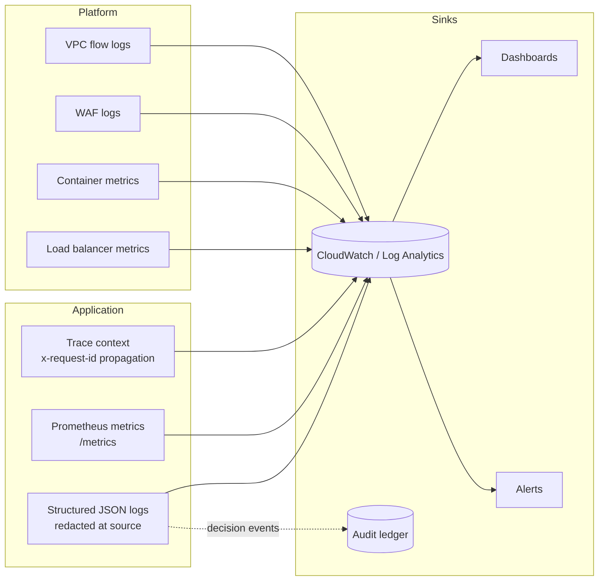

# 11. Observability

## 11.1 Service level objectives

| SLI | Definition | SLO | Error budget |
| --- | --- | --- | --- |
| Availability | Non-5xx responses ÷ all responses to `/best-offers` | 99.9% monthly (99.95% at phase 3) | 43 min/month |
| Latency | p99 of `/best-offers` | < 1.0 s (p50 < 150 ms) | 1% of requests |
| Freshness | Age of the newest usable offer at evaluation | < 15 min by contract | n/a — enforced, not measured |
| Correctness | Responses whose price is reproducible from the audit record | 100% | Zero tolerance |
| Ingest latency | Event receipt to queryable | p95 < 10 s | 5% |
| Approval integrity | Actions executed without a recorded approval | 0 | Zero tolerance |

Two of these have zero tolerance. They are the ones tied to the legal context,
and they are treated as correctness invariants rather than reliability
targets: a single violation triggers an incident regardless of budget.

## 11.2 Signals

### Metrics exposed by the coded service

| Metric | Type | Labels | Answers |
| --- | --- | --- | --- |
| `vh_http_requests_total` | counter | route, method, status | Availability, traffic mix |
| `vh_http_request_duration_seconds` | histogram | route, method | Latency percentiles |
| `vh_http_in_flight_requests` | gauge | — | Saturation |
| `vh_provider_requests_total` | counter | provider, outcome | Provider health |
| `vh_provider_retries_total` | counter | provider, cause | Is a provider degrading? |
| `vh_provider_request_duration_seconds` | histogram | provider | Which provider is slow? |
| `vh_provider_unavailable_total` | counter | provider, cause | Partial-result driver |
| `vh_rows_rejected_total` | counter | provider, reason | **Quality surveillance** |
| `vh_offers_returned_total` | counter | provider | Win-rate per provider |
| `vh_partial_responses_total` | counter | — | Degradation rate |
| `vh_config_reloads_total` | counter | outcome | Pricing-change integrity |
| `vh_rejected_load_total` | counter | — | Load shedding |

`vh_rows_rejected_total` by reason is the most commercially interesting series
in the service. A provider whose `QUALITY_BELOW_MINIMUM` rate climbs is
degrading before anyone complains, and a provider whose rate drops suddenly to
zero is worth a second look for the reasons in
[5 Data quality](05-data-quality-and-provenance.md).

Route labels are collapsed to a fixed set (`other` for anything unknown) so an
attacker cannot inflate metric cardinality by requesting random paths — there
is a test for this.

### Logs

Structured JSON, one object per line, redacted at source. Every line carries
`timestamp`, `level`, `message`, `service`, `env`, and a `requestId` that
propagates from the `x-request-id` header or is generated.

Key events: `http.request`, `provider.retry`, `provider.unavailable`,
`best-offers.completed`, `config.reload.applied`, `config.reload.rejected`,
`config.reload.unreadable`, `server.shutdown.*`, `http.client_disconnected`.

`best-offers.completed` deserves note: it records the evaluation instant, both
configuration versions, candidate and rejection counts, and whether the
response was partial — enough to reconstruct what happened without replaying
the provider payloads, which must not be logged.

## 11.3 Alerts

Every alert is actionable and maps to a runbook step. Anything merely
interesting lives on a dashboard.

| Alert | Condition | Severity | Action |
| --- | --- | --- | --- |
| Unhealthy targets | Any unhealthy target for 3 minutes | High | [Incident response](../runbooks/incident-response.md#unhealthy-targets) |
| 5xx rate | > 5/min for 3 of 5 minutes | High | Check provider health, then recent deploys |
| p99 latency | > 1 s for 3 of 5 minutes | Medium | Check provider latency and saturation |
| Provider unavailable | > 10 events / 5 min | Medium | Provider escalation path |
| Config reload rejected | Any occurrence | Medium | **Pricing change failed** — verify what is serving |
| CPU saturation | > 85% for 3 of 5 minutes | Medium | Check the autoscaling ceiling |
| No traffic | < 1 request / 5 min, 3 periods | High | Edge or DNS failure |
| Replica restarts (Azure) | > 5 in 15 min | High | Crash loop |

The config-reload alert fires on a *single* occurrence because a rejected
reload means someone tried to change prices and did not. The service is safe
(the previous snapshot keeps serving), but a human now believes a price change
is live when it is not, and that gap is exactly where billing disputes start.

### Metrics exposed by the fleet assistant

| Metric | Type | Labels | Answers |
| --- | --- | --- | --- |
| `vh_agent_turns_total` | counter | outcome | Is the assistant being used, and does it complete? |
| `vh_agent_proposals_created_total` | counter | — | Volume of proposals reaching humans |
| `vh_agent_proposals_decided_total` | counter | outcome | **Approval rate** — the assistant's real quality metric |
| `vh_agent_actions_executed_total` | counter | kind | Work actually carried out |
| `vh_agent_executions_refused_total` | counter | code | Replayed tokens, budget breaches, forged tokens |
| `vh_agent_tool_refusals_total` | counter | code | **Attempts to exceed the capability boundary** |
| `vh_agent_in_flight_requests` | gauge | — | Saturation; turns are long and model-bound |
| `vh_agent_rejected_load_total` | counter | — | Load shedding |

Two of these deserve standing attention. `vh_agent_proposals_decided_total`
by outcome gives the approval rate: an assistant whose proposals are declined
more often than accepted is costing approvers attention rather than saving
it, whatever a model benchmark says. And any non-zero
`vh_agent_tool_refusals_total{code="EXECUTE_CLASS_FORBIDDEN"}` means
something tried to reach an executing capability, which is either a defect or
an attack and is worth a look either way.

### Agent alerts

| Alert | Condition | Severity | Why |
| --- | --- | --- | --- |
| Execution without approval | Supervision invariant breached, any occurrence | **Critical** | Zero tolerance; the central safety claim |
| Audit chain broken | `verify()` returns invalid | **Critical** | Evidence integrity |
| Tool refusal spike | `EXECUTE_CLASS_FORBIDDEN` above zero | High | Capability-boundary probe |
| Model fallback engaged | `model.fallback.engaged` logged | Medium | Inference degraded; proposals are now rule-based |
| Approval latency | Median time to decision above 30 min | Medium | The product promise is saved time |
| Proposal expiry rate | More than 20% expiring unapproved | Medium | Nobody is reading the queue |

## 11.4 Audit evidence trail

Observability answers "is it healthy". Audit answers "can we prove what we
did". They are separate systems with different retention, different access
control and different integrity guarantees.

| Property | Operational telemetry | Audit ledger |
| --- | --- | --- |
| Mutability | Rolls off | Append-only, hash-chained |
| Retention | 14–90 days | 7 years |
| Access | Engineering | Auditors; engineering read-only via request |
| Integrity | Best effort | Hash chain plus WORM storage |
| Contents | Metrics, logs, traces | Decisions, approvals, pricing, consent |

Recorded as audit events: every ranking result with its inputs digest and
configuration versions; every pricing-configuration proposal, approval and
activation; every consent grant, revocation and the decisions that relied on
them; every agent proposal, approval, rejection, expiry and execution; every
provider certification change; every data access with purpose and
entitlement; and every break-glass access.

See [ADR-0008](../adr/0008-event-sourced-audit-trail.md).

## 11.5 Dashboards

The AWS stack provisions a CloudWatch dashboard with four panels — traffic and
errors, latency percentiles, capacity and saturation, provider health and
configuration integrity — plus a live query of recent warnings and errors.
The Azure stack provisions the equivalent through Log Analytics and
Application Insights.

A deliberate choice: the same four questions in the same order on both clouds,
so an on-call engineer does not have to re-learn the layout under pressure.
