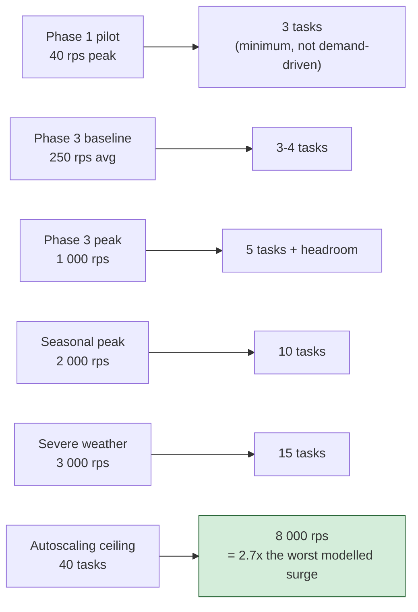

# 12. Capacity plan

Every figure below is either measured on this codebase or derived from a
stated assumption. Where a number is an assumption, it is labelled as one, so
a reviewer can challenge the input rather than the conclusion.

## 12.1 Measured performance

Measured on the delivered code with `node --test`-grade hardware: a 2 vCPU
container running the service, both mock providers and the load generator
**simultaneously**, so these are pessimistic for the service in isolation.

### End-to-end HTTP throughput

| Concurrency | Throughput | p50 | p95 | p99 |
| --- | --- | --- | --- | --- |
| 1 | 163 rps | 5.5 ms | 9.8 ms | 14.7 ms |
| 8 | 453 rps | 16.4 ms | 26.9 ms | 34.4 ms |
| 32 | 823 rps | 37.9 ms | 49.9 ms | 65.8 ms |
| 64 | 890 rps | 69.3 ms | 88.1 ms | 94.4 ms |

Throughput flattens near 890 rps because all three processes share two cores.
Latency grows linearly with concurrency past saturation, which is the
expected signature of a queue, and is exactly why the service sheds load
rather than letting that queue grow without bound.

### Ranking core in isolation

The pure pipeline — validate, price, rank, serialise — with no HTTP:

| Rows per request | Per call | Calls/sec/core |
| --- | --- | --- |
| 10 (the supplied fixtures) | 0.018 ms | 54 720 |
| 100 | 0.193 ms | 5 184 |
| 1 000 | 2.252 ms | 444 |

Cost is linear at roughly **2.25 µs per row**, including exact BigInt
arithmetic. The conclusion that matters: exact rational arithmetic is not the
bottleneck. At the realistic fixture size the ranking core could serve
50 000 requests per second per core; HTTP, JSON and TLS dominate everything
else. The integrity argument for exact arithmetic in
[ADR-0004](../adr/0004-exact-decimal-arithmetic.md) therefore costs
essentially nothing.

## 12.2 Planning figure per task

| Input | Value | Source |
| --- | --- | --- |
| Measured aggregate throughput | 890 rps | Contended 2-vCPU box, three processes |
| Derating for real provider latency and TLS | ÷ 2 | Assumption: 20–50 ms provider RTT and TLS handshakes versus loopback |
| Safety margin for p99 headroom | ÷ 2.2 | Assumption: run at ~45% of saturation so latency stays flat |
| **Planning capacity per 1 vCPU task** | **200 rps** | Derived |

200 rps per task is deliberately conservative. The autoscaling policy targets
`ALBRequestCountPerTarget = 12 000` requests per target per minute, which is
exactly 200 rps, so scale-out begins before latency degrades rather than
after.

## 12.3 Demand model

| Assumption | Value | Note |
| --- | --- | --- |
| Peak concurrent users (phase 3) | 30 000 | "Tens of thousands", read at the upper end |
| Requests per active user | 1 per 30 s | Assumption: mixed human browsing and API polling |
| **Peak sustained** | **1 000 rps** | 30 000 ÷ 30 |
| Seasonal logistics peak | ×2 → 2 000 rps | Assumption: Q4 and holiday freight |
| Severe-weather surge | ×3 → 3 000 rps, up to 2 hours | Assumption: regional weather event |
| Monthly average | 250 rps | Assumption: 25% of peak over a diurnal/weekly cycle |
| Monthly request volume | ~648 million | 250 × 2.592 M seconds |

Phase 1 is far smaller: 20 fleets, one jurisdiction, an estimated 40 rps peak,
served comfortably by the three-task minimum.

## 12.4 Sizing



| Scenario | Required rps | Tasks at 200 rps | Configured |
| --- | --- | --- | --- |
| Minimum (availability floor) | — | — | 3 (one per AZ) |
| Phase 3 average | 250 | 2 | 3 (floor applies) |
| Phase 3 peak | 1 000 | 5 | autoscaled |
| Seasonal peak | 2 000 | 10 | autoscaled |
| Severe-weather surge | 3 000 | 15 | autoscaled |
| **Ceiling** | **8 000** | **40** | `service_max_capacity` |

The ceiling gives 2.7× headroom over the worst modelled surge. It is a
*ceiling*, not a target: beyond it the service sheds load with 503 and
`Retry-After`, which is a deliberate choice to bound cost during an attack
rather than scale into an unbounded bill. See
[9.4](09-threat-model.md#94-ddos-posture).

### Scaling dynamics

| Parameter | Value | Why |
| --- | --- | --- |
| Scale-out cooldown | 60 s | Surges arrive fast; being slow to add capacity is the expensive error |
| Scale-in cooldown | 300 s | Prevents flapping when traffic is choppy |
| Task start to in-service | ~45 s | 30 s health-check grace plus image start |
| Effective ramp | ~100 % per minute | Doubling every minute reaches 15 tasks from 3 in about 2.5 minutes |

A severe-weather surge therefore has roughly a two-to-three minute window
where load shedding may engage. This is accepted and documented rather than
solved with permanently over-provisioned capacity; the alternative costs
roughly 3× the compute line for an event measured in hours per year.

## 12.4b Fleet assistant sizing

The assistant has a completely different shape from the ranking service: low
request volume, very long per-request duration, and almost no CPU of its own.

| Input | Value | Source |
| --- | --- | --- |
| Deterministic planner turn | ~20 ms end to end | Measured; four tool calls, no I/O |
| Hosted-model turn | 4–12 s | Assumption: 4–6 model round trips at 1–2 s each |
| Concurrency per task | 32 | `AGENT_MAX_CONCURRENT`; the limit is in-flight sockets, not CPU |
| Effective throughput per task | ~5 turns/second deterministic, ~4 turns/minute with a hosted model | Derived |
| Assumed demand | 2 000 turns/day, peaking at ~20 concurrent | Assumption: 20 pilot fleets, a handful of managers each |
| Tasks at peak | 2 | 20 concurrent ÷ 32 per task, rounded up, with an availability floor of 2 |

The planning conclusion is that **the assistant is bound by inference
latency, not by our compute**. Scaling it means more concurrent sockets, not
more CPU, which is why the autoscaling target is 120 requests per target per
minute against 12 000 for the ranking service. Two tasks cover the modelled
load with headroom to ten.

## 12.5 Other tiers

| Component | Phase 3 load | Sizing basis |
| --- | --- | --- |
| Telemetry ingestion | 50 000 events/s sustained, 200 000/s surge | Partitioned by `vehicleId`; scales linearly with partition count |
| Time-series store | ~4.3 B events/day at 300 bytes ≈ 1.3 TB/day raw | Compressed and tiered; 90-day hot window |
| Transactional store | < 500 writes/s | Orders, consent, approvals; small relative to telemetry |
| Audit ledger | ~1 500 events/s | One per ranking result plus decision events |
| Agent orchestrator | 50 concurrent conversations | Dominated by model latency, not our compute |

## 12.6 Bottleneck analysis

| Candidate | Verdict |
| --- | --- |
| Ranking arithmetic | **Not a bottleneck.** 2.25 µs/row measured; ~0.02 ms for a realistic request |
| JSON parsing of provider responses | Minor; bounded by the 8 MiB body cap |
| Provider latency | **The dominant term.** Async fan-out means it costs concurrency, not CPU |
| Event loop | The real limit per task; mitigated by horizontal scale, not bigger tasks |
| NAT data processing | **The dominant cost term** at scale — see [13 Cost model](13-cost-model.md) |
| Audit write amplification | One durable write per ranking; batched and asynchronous |

The single most important architectural consequence: because provider latency
dominates and the work is asynchronous, **scaling out beats scaling up**.
Tasks stay small (1 vCPU) and numerous, which also improves failure
granularity and bin-packing.

## 12.7 Validating these numbers

The measurements above are reproducible:

```bash
npm test                     # correctness first
node scripts/demo.js         # deterministic fixture output
# Then the load profile against a running stack:
make up && BASE_URL=http://localhost:8080 npm run smoke
```

Before each rollout gate, the capacity assumptions are re-measured in staging
against production-shaped infrastructure, and the planning figure of 200 rps
per task is revised if reality disagrees. An unrevised capacity plan is a
guess with a date on it.
