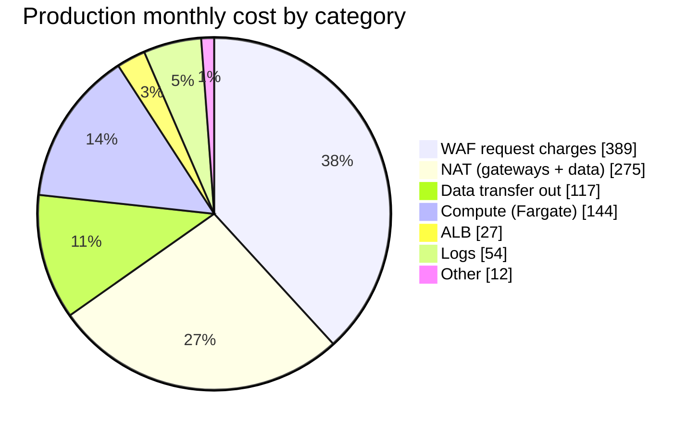

# 13. Cost model

Indicative monthly costs in EUR-equivalent USD, using AWS list prices for
`eu-north-1` (Stockholm) as at the time of writing. Prices change; the
*structure* of the model, and which line items dominate, is the durable part.

All figures exclude tax, support plans and enterprise discounts.

## 13.1 Unit prices used

| Resource | Unit price |
| --- | --- |
| Fargate vCPU | $0.04048 / vCPU-hour |
| Fargate memory | $0.004445 / GB-hour |
| Fargate Spot | ~70% discount on the above |
| Application Load Balancer | $0.0225 / hour + $0.008 / LCU-hour |
| NAT Gateway | $0.045 / hour + $0.045 / GB processed |
| WAFv2 | $5 / web ACL-month + $1 / rule-month + $0.60 / million requests |
| CloudWatch Logs | $0.50 / GB ingested + $0.03 / GB-month stored |
| ECR storage | $0.10 / GB-month |
| Secrets Manager | $0.40 / secret-month |
| Data transfer out | $0.09 / GB |
| S3 standard | $0.023 / GB-month |

Hours per month: 730.

## 13.2 Production (phase 3 scale)

Demand assumptions from [12 Capacity plan](12-capacity-plan.md): 250 rps
monthly average, 648 million requests/month, average 4 running tasks at
1 vCPU / 2 GiB, three availability zones.

| Line item | Derivation | Monthly |
| --- | --- | --- |
| Fargate vCPU | 4 tasks × 1 vCPU × $0.04048 × 730 | $118 |
| Fargate memory | 4 × 2 GB × $0.004445 × 730 | $26 |
| ALB fixed | $0.0225 × 730 | $16 |
| ALB LCUs | 1.8 LCU (bytes-processed dimension) × $0.008 × 730 | $11 |
| NAT gateways | 3 × $0.045 × 730 | $99 |
| NAT data processing | 250 rps × 2 providers × 3 KB ≈ 3.9 TB × $0.045 | $176 |
| WAF fixed | $5 ACL + 4 rules × $1 | $9 |
| WAF requests | 648 M × $0.60 / M | $389 |
| CloudWatch logs (sampled) | ~97 GB ingested × $0.50 + storage | $54 |
| Data transfer out | 648 M × 2 KB ≈ 1.3 TB × $0.09 | $117 |
| ECR, Secrets Manager, S3 | Flat | $12 |
| **Total** | | **≈ $1 027** |

### What this tells you

**Compute is 14% of the bill.** The dominant terms are per-request edge
charges and network data processing. Three consequences follow, and they are
the reason this model is worth building before launch rather than after the
first invoice:

1. Optimising the application's CPU would be close to pointless. The exact
   rational arithmetic that makes pricing defensible costs roughly nothing.
2. The expensive decisions are architectural: how many NAT gateways, whether
   provider traffic crosses NAT, and how many requests reach the WAF.
3. A DDoS attack is a **cost** event before it is an availability event. WAF
   request charges and data transfer scale with attack volume, which is why
   the design sheds load at a ceiling rather than scaling indefinitely.

## 13.3 Non-production

### Development

| Line item | Derivation | Monthly |
| --- | --- | --- |
| Fargate Spot (service, 0.25 vCPU / 0.5 GB) | ×0.3 Spot factor | $3 |
| Fargate Spot (2 mock provider tasks) | Small | $3 |
| ALB | Fixed + minimal LCU | $17 |
| NAT (single gateway) | $0.045 × 730 + light data | $38 |
| WAF | Fixed only | $9 |
| Logs, ECR, Secrets | Light | $8 |
| **Total** | | **≈ $78** |

The single shared NAT gateway is the main saving and the reason
`single_nat_gateway = true` exists as a dev-only option: with one per AZ, dev
would cost roughly $145.

### Staging

| Line item | Monthly |
| --- | --- |
| Fargate Spot (2 service tasks at 0.5 vCPU / 1 GB, plus mocks) | $15 |
| ALB | $20 |
| NAT (3 gateways + data) | $119 |
| WAF (fixed + modest request volume) | $14 |
| Logs | $20 |
| Other | $7 |
| **Total** | **≈ $195** |

### All environments

| Environment | Monthly | Annual |
| --- | --- | --- |
| Development | $78 | $936 |
| Staging | $195 | $2 340 |
| Production | $1 027 | $12 324 |
| **Total** | **$1 300** | **$15 600** |

## 13.4 Azure comparison

Same workload on the Azure stack:

| Line item | Monthly | Note |
| --- | --- | --- |
| Container Apps (consumption, ~4 replicas) | $130 | vCPU-second and GiB-second billing, comparable to Fargate |
| Front Door Premium | $330 | **Fixed base fee** — the significant structural difference |
| Front Door requests and egress | $180 | Lower per-request than WAFv2 at this volume |
| Log Analytics ingestion | $90 | ~$2.30/GB, pricier per GB than CloudWatch |
| Container Registry Premium | $50 | Required for trust policies and geo-replication |
| Key Vault, storage, misc | $20 | |
| **Total** | **≈ $800** | |

Azure is cheaper at this volume, mainly because Front Door's request pricing
beats WAFv2 plus ALB plus NAT data processing, and because Container Apps
bills by the second with no per-AZ NAT equivalent. That advantage inverts at
low volume: Front Door Premium's $330 fixed fee makes small environments
expensive, which is why `enable_front_door = false` in the Azure dev profile.

This cost difference did **not** decide the cloud recommendation. The margin
is roughly $2 700/year, which is immaterial next to the operational and
data-residency considerations in
[ADR-0001](../adr/0001-cloud-vendor-selection.md). It is documented so the
decision can be revisited honestly if volume grows by an order of magnitude.

## 13.5 Unit economics

| Metric | Value |
| --- | --- |
| Cost per million requests (production) | **$1.59** |
| Cost per request | $0.0000016 |
| Cost per fleet per month (phase 1, 20 fleets) | ~$4 |
| Marginal cost of 10× traffic | ~6×, not 10× — fixed costs amortise |

At phase 1 the entire production environment costs less per month than a
single engineer-day. Cost is not a constraint on launch; it becomes one at
phase 3 volumes, and the levers below are sized for that point.

## 13.6 Cost levers, in order of impact

| Lever | Saving | Trade-off |
| --- | --- | --- |
| Cache provider offers | Up to $176/mo NAT data | **Rejected for this slice.** The brief prohibits stale offers, and serving one is the exact misconduct the group settled |
| VPC endpoints for AWS service traffic | ~$40/mo | Already implemented; keeps ECR, logs, SSM and Secrets traffic off NAT |
| Sample info-level logs at high volume | ~$440/mo if unsampled | Reduced forensic detail; warn/error always kept in full |
| Compute Savings Plan (1-year) | ~20% of compute | Commitment risk if the architecture changes |
| Single NAT gateway | $66/mo | **Dev only.** An AZ failure removes provider egress |
| Fargate Spot | ~70% of compute | **Non-production only.** Reclamation during a surge is unacceptable |
| Reduce WAF managed rule groups | $1/rule/mo | Negligible saving, material security loss — not worth it |
| Shorter log retention | ~$10/mo | Constrained by the audit window; not a real lever |

The first row is the important one. Caching is the obvious optimisation, it
would save real money and latency, and it is deliberately not taken. The
decision is recorded here so that a future engineer who notices the saving
also finds the reason it was refused.

## 13.7 Cost governance

Budgets and anomaly detection are configured per environment with alerts at
80% and 100% of plan. Every resource carries `Project`, `Component`,
`Environment`, `Owner` and `CostCentre` tags (enforced by provider-level
default tags), so chargeback needs no manual allocation. Monthly review
compares actual against this model, and a variance above 20% triggers a
revision of the model rather than a quiet acceptance of the new number.
