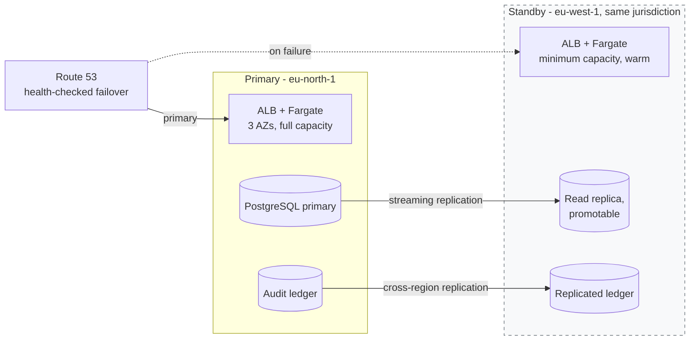

# 14. Disaster recovery

The brief asks for a dedicated disaster recovery plan. This is it: tiered
objectives, concrete procedures, named failure scenarios, and a drill
schedule with evidence requirements.

## 14.1 Objectives by tier

Tiering matters because a uniform RPO of zero across a telemetry platform is
unaffordable and unnecessary. What must never be lost is different from what
must never be unavailable.

| Tier | Components | RTO | RPO | Rationale |
| --- | --- | --- | --- | --- |
| **0 — Evidence** | Audit ledger, consent records, raw telemetry landing | 4 h | **0** | Legal defensibility. Losing evidence is unrecoverable in a way losing availability is not |
| **1 — Transactional** | Orders, entitlements, catalogue, pricing configuration | 1 h | 5 min | Money and access rights |
| **2 — Serving** | Ranking service, API gateway, insights read path | **15 min** | n/a (stateless) | Fleet operations are time-sensitive |
| **3 — Analytical** | Aggregates, benchmarks, dashboards | 24 h | 1 h | Recomputable from tier 0 |
| **4 — Derived** | Model artefacts, caches, search indexes | 72 h | n/a | Fully rebuildable |

The ranking service is tier 2 with no RPO at all, because it is stateless by
design: it holds no data that could be lost. Its recovery is simply "start
tasks elsewhere", which is why its RTO is the shortest.

## 14.2 Resilience posture by failure domain

```mermaid
flowchart TB
  subgraph T[Task failure]
    T1[Health check fails] --> T2[ECS replaces the task] --> T3[ALB drains in 30s]
    T3 --> T4["Impact: none<br/>RTO: seconds, automatic"]
  end
  subgraph A[AZ failure]
    A1[One of three AZs lost] --> A2[ALB stops routing to it]
    A2 --> A3[Autoscaling replaces capacity in survivors]
    A3 --> A4["Impact: brief elevated latency<br/>RTO: under 2 min, automatic"]
  end
  subgraph R[Region failure]
    R1[Region unavailable] --> R2[Health-check failover at DNS]
    R2 --> R3[Warm standby scaled up]
    R3 --> R4["Impact: service interruption<br/>RTO: 15-30 min"]
  end
  subgraph P[Provider failure]
    P1[One provider unreachable] --> P2[Retries, then marked unavailable]
    P2 --> P3[Partial result returned]
    P3 --> P4["Impact: fewer offers, clearly flagged<br/>RTO: none - degraded, not down"]
  end
  style T4 fill:#d4edda,stroke:#155724
  style A4 fill:#d4edda,stroke:#155724
  style R4 fill:#fff3cd,stroke:#856404
  style P4 fill:#d4edda,stroke:#155724
```



Provider failure deserves emphasis because it is the most likely of the four
and the only one already proven by automated test. With one provider down the
service returns HTTP 200, `partial: true`, the failing provider named in
`unavailableProviders`, and the surviving provider's offers ranked normally.
With both down it returns 503 with `ALL_PROVIDERS_UNAVAILABLE` and
`Retry-After`. Both paths are covered in
`test/integration/http.test.js`.

## 14.3 Multi-region strategy

Phase 1 is single-region, which is a deliberate and time-boxed acceptance of
regional risk during a 20-fleet pilot. Phase 3 is warm standby.



Warm standby rather than active-active, for three reasons. Active-active
doubles cost for a failure mode measured in minutes per year. It introduces
cross-region write coordination, which is precisely where consistency bugs
hide in a system whose defining requirement is reproducible pricing. And both
regions must sit inside the same jurisdiction to satisfy residency, which
limits the latency benefit active-active would otherwise buy.

The standby region is `eu-west-1`, inside the EU, so replication never
crosses a residency boundary. A non-EU standby would be cheaper and is not an
option.

## 14.4 Backup

| Asset | Method | Frequency | Retention | Restore tested |
| --- | --- | --- | --- | --- |
| PostgreSQL | Automated snapshots + continuous WAL archiving | Snapshot daily, WAL continuous | 35 days | Monthly |
| Audit ledger | Cross-region replication to WORM storage with Object Lock | Continuous | 7 years | Quarterly |
| Raw telemetry landing | Versioned object storage, Object Lock | Continuous | 400 days | Quarterly |
| Time-series store | Snapshot to object storage | Daily | 90 days | Quarterly |
| Pricing configuration | Versioned in Git **and** in Parameter Store / App Configuration | On change | Indefinite | Monthly |
| Secrets | Managed store with soft-delete and purge protection | Continuous | 30 days recovery | Quarterly |
| Infrastructure definition | Git, plus versioned remote state | On change | Indefinite | Each drill |

Two notes. Backups that have never been restored are a hypothesis, not a
control, which is why every row has a tested-restore cadence. And the pricing
configuration is deliberately stored twice — a Git history that can be
reviewed and a runtime store that can be reloaded — because the ability to
reconstruct *what price was in force on a given date* is a legal requirement,
not an operational convenience.

## 14.5 Recovery procedures

### Scenario A — Single task or AZ failure

Automatic. ECS replaces unhealthy tasks; the ALB drains them in 30 seconds;
autoscaling restores capacity in surviving AZs. No human action. Verify
afterwards that capacity returned and the alarm cleared.

### Scenario B — Regional failure

```mermaid
sequenceDiagram
  participant M as Monitoring
  participant OC as On-call
  participant IC as Incident commander
  participant DNS as Route 53
  participant SEC as Standby region

  M->>OC: Primary health checks failing (T+0)
  OC->>OC: Confirm scope; rule out a config or deploy cause (T+5)
  OC->>IC: Declare a regional incident (T+8)
  IC->>IC: Decide to fail over (explicit, logged decision)
  IC->>SEC: Promote the read replica to primary (T+12)
  IC->>SEC: Scale the service to production capacity (T+15)
  IC->>DNS: Shift the weighted/failover record (T+18)
  DNS-->>IC: Traffic arriving in the standby region (T+20)
  IC->>IC: Run the smoke test against the new endpoint
  IC->>IC: Verify configuration versions match the primary's last state
  Note over IC: Target RTO 30 min. Data loss bounded<br/>by replication lag, target under 5 min.
```

Failover is a **human decision**, not an automatic one. An automatic
cross-region failover triggered by a monitoring false positive is a
self-inflicted outage with a split-brain risk attached, and the 10 minutes a
human takes to confirm scope is cheaper than that.

Two verification steps are mandatory before declaring recovery: run
`npm run smoke` against the new endpoint, and confirm that `fxVersion` and
`marginVersion` in a live response match the last known-good values from the
primary. Serving correct availability with stale prices would be the worst
possible outcome for this particular company.

### Scenario C — Data corruption or bad pricing configuration

Corruption is more dangerous than loss, because it propagates silently.

1. **Stop the spread.** If a bad pricing snapshot is live, the fastest
   remedy is to restore the previous file and reload — the service keeps
   serving throughout, since an invalid document is rejected and the previous
   snapshot stays active.
2. **Establish the blast radius** from the audit ledger: every response
   records `fxVersion`, `marginVersion` and `asOf`, so the exact set of
   affected responses is a query, not an estimate.
3. **Recompute** the correct prices from the recorded inputs and the correct
   configuration version. The ranking function is deterministic and pure, so
   this is exact rather than approximate.
4. **Remediate commercially**: reissue or credit affected orders.
5. **Record** the incident, the affected set and the remediation in the audit
   ledger.

This procedure is the practical payoff of
[ADR-0007](../adr/0007-configuration-snapshots.md) and
[ADR-0008](../adr/0008-event-sourced-audit-trail.md). Without versioned
snapshots and recorded inputs, step 2 would be guesswork and step 3
impossible — which is approximately the position that produced the lawsuit.

### Scenario D — Provider outage

No recovery action is required: the service degrades to partial results
automatically. Operational response is to notify affected customers if a
provider is unavailable for more than 15 minutes, escalate via the provider's
support contract, and record the outage against the provider's standing
score, since availability is part of certification.

### Scenario E — Complete account or subscription compromise

The nuclear scenario, and the reason infrastructure is fully codified.

1. Isolate: revoke the compromised credentials and the OIDC trust
   relationship.
2. Rebuild into a clean account from Git: `terraform init && terraform apply`
   against a new backend.
3. Restore tier 0 and tier 1 data from the cross-account, Object-Locked
   backups, which the compromised account cannot delete.
4. Rotate every secret.
5. Forensics from the preserved audit ledger and flow logs.

Target RTO 24 hours. This is only achievable because no infrastructure exists
outside Terraform and no data exists only inside the primary account.

## 14.6 Drills

| Drill | Frequency | Evidence captured |
| --- | --- | --- |
| Task kill | Weekly, automated | Recovery time, zero failed requests |
| AZ evacuation | Monthly | Latency impact, capacity restoration time |
| Database restore to a scratch environment | Monthly | Restore duration, integrity check result |
| Regional failover (staging) | Quarterly | Full RTO/RPO measurement against targets |
| Pricing-configuration rollback | Quarterly | Time to restore, blast-radius query accuracy |
| Account rebuild from Git | Annually | Total RTO, gaps found |

Every drill produces a written record with the measured objective, the target,
and any deviation with a remediation owner. A drill that is not documented did
not happen, as far as an auditor is concerned. The procedure is in
[the DR drill runbook](../runbooks/dr-drill.md).

## 14.7 Dependency failure matrix

| Dependency | Failure handling | Customer impact |
| --- | --- | --- |
| Telemetry provider | Retry with jitter, then partial result | Fewer offers, explicitly flagged |
| Both providers | HTTP 503 with `Retry-After` | Comparison unavailable; everything else works |
| FX rate provider | Last valid snapshot continues; staleness alert | Prices use a slightly older rate, version-stamped |
| Payment provider | Queue and retry; secondary PSP for cards | Checkout delayed, not lost |
| Notification gateway | Queue with backoff; fail over by channel | Notification delayed; escalation unaffected |
| Identity provider | Cached session validation for the token lifetime | New logins fail; existing sessions continue |
| Model endpoint (agent) | Assistant degrades to read-only insights | No proposals; marketplace unaffected |
| Object storage | Writes buffered; reads from replica | Evidence capture delayed, never dropped |

The design intent throughout is that **no single external dependency can take
the marketplace down**. The only full-stop condition in the coded slice is
both providers being unavailable simultaneously, which is correct: with no
offers at all there is nothing truthful to return, and inventing one is the
behaviour this entire architecture exists to prevent.
