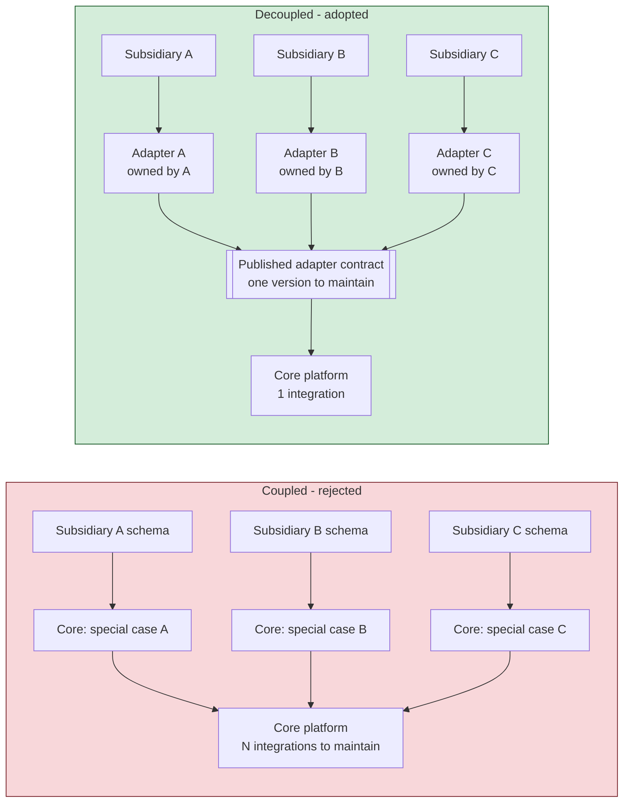
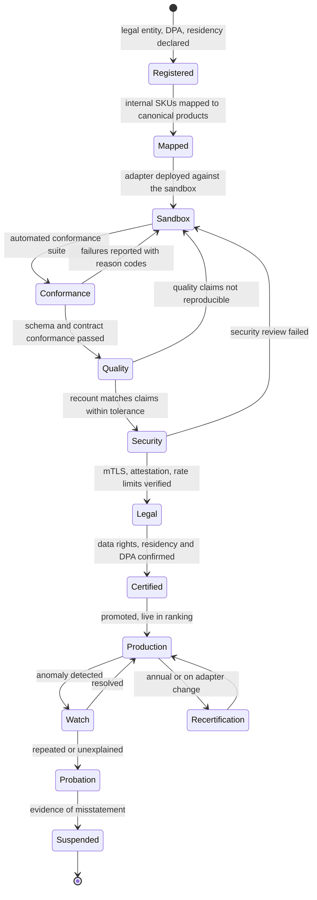

# 15. M&A integration governance

VectorHarbor grows by acquiring regional device manufacturers, fleet-service
companies and data providers. The brief is specific: *think about a REST API
for mergers; new subsidiaries must be able to certify adapters and join the
new platform without coupling their internal systems to its core.*

## 15.1 The failure mode being avoided

The default outcome of acquisition-led growth is an integration backlog: each
subsidiary needs bespoke work by the core team, the core team becomes the
bottleneck, and the platform accumulates per-subsidiary special cases that
nobody can safely remove. Three acquisitions in, integration velocity
collapses.

The structural fix is to invert the direction of adaptation. The platform
publishes a stable contract and a self-service certification process; the
subsidiary writes an adapter that satisfies it. The core never learns a
subsidiary's internal model.



The coded slice already demonstrates the contract in miniature. Both mock
providers return the **same schema** on different endpoints, and provider
identity comes from the configured endpoint rather than from the payload.
Adding a third provider is a configuration change, not a code change.

## 15.2 The merger REST API

Four public surfaces, versioned independently, consumed by a subsidiary's
engineers without a call to the core team.

### Registration and certification

```
POST   /v1/partners                           Register a legal entity
GET    /v1/partners/{id}
POST   /v1/partners/{id}/adapters             Declare an adapter + endpoints
GET    /v1/partners/{id}/adapters/{aid}
POST   /v1/adapters/{aid}/certification-runs  Start a conformance run
GET    /v1/certification-runs/{rid}           Poll results and evidence
GET    /v1/certification-runs/{rid}/report    Signed certification report
POST   /v1/adapters/{aid}/promote             Promote sandbox → production
```

### Catalogue mapping

```
GET    /v1/canonical-products                 The comparable-product universe
GET    /v1/canonical-products/{productId}     Region, consent scope, schema,
                                              window, permitted use
POST   /v1/adapters/{aid}/product-mappings    Map internal SKUs → canonical IDs
POST   /v1/adapters/{aid}/product-mappings:validate
```

### Offer and telemetry contracts

```
GET    /v1/contracts/offer-schema             The Offer JSON Schema
GET    /v1/contracts/telemetry-schema/{id}
GET    /v1/contracts/reason-codes             Every rejection code + meaning
POST   /v1/sandbox/offers:evaluate            Dry-run ranking against your feed
```

`POST /v1/sandbox/offers:evaluate` is the highest-value endpoint in the set.
It lets a subsidiary paste their offer payload and see exactly which rows
would be accepted, which rejected and why, and where they would rank — before
any integration work. Most adapter defects are found here in an afternoon
rather than in a three-week integration cycle.

### Operations and standing

```
GET    /v1/partners/{id}/quality-report       Verified quality vs claimed
GET    /v1/partners/{id}/standing             Certified / watch / probation / suspended
GET    /v1/partners/{id}/rejection-summary    Rejections by reason, over time
GET    /v1/partners/{id}/fulfilment           Win rate and fulfilment record
```

Showing a provider their own rejection reasons is both fair and efficient: it
converts "your feed is bad" into "rows 3 and 7 failed `QUALITY_BELOW_MINIMUM`
at 0.80 against a 0.90 floor", which a provider can act on without a meeting.

## 15.3 Certification pipeline



### The conformance suite

Run automatically; the same checks the production path applies, so passing
certification means the feed will behave in production.

| Category | Checks |
| --- | --- |
| Schema | Offer contract, no unknown fields, correct types |
| Semantics | `validEventCount ≤ eventCount`, positive counts, non-negative price |
| Temporal | RFC 3339 UTC, `observedAt` not in the future, `expiresAt` after `observedAt`, freshness achievable |
| Identity | No `providerId` in the payload; no duplicate `productId` within a response |
| Currency | Only currencies with configured FX rates |
| Availability | p95 latency, error rate, behaviour under a timeout |
| Quality | Recount of a delivered sample reproduces the claimed counts within tolerance |
| Residency | Data served from a permitted region |
| Security | mTLS, certificate chain, signed payloads, rate-limit behaviour |

The temporal and identity categories exist because they are precisely what
the coded validator rejects. Certification is therefore not a separate
standard: it is the production contract, applied earlier.

## 15.4 Integration patterns by acquisition type

| Acquired company | Pattern | Typical effort |
| --- | --- | --- |
| Data provider with a modern API | Thin adapter mapping their API to the Offer contract | 1–2 weeks |
| Device manufacturer | Telemetry adapter plus device attestation enrolment | 4–6 weeks |
| Fleet-service company | Dual role: tenant on the demand side, provider on the supply side | 6–8 weeks |
| Legacy provider, batch files only | Adapter with a staging buffer that synthesises offers from batch inventory | 8–12 weeks |

The last row is the one that tests the contract. A batch-only provider cannot
serve live offers, so the adapter holds inventory and publishes offers with
honest `observedAt` and `expiresAt`. It will frequently be rejected as stale,
and that is the correct outcome: the platform should not pretend a daily
batch is live telemetry. The commercial answer is to price batch products as
different canonical products with longer windows, not to weaken the freshness
rule.

## 15.5 Governance

| Control | Owner | Cadence |
| --- | --- | --- |
| Contract versioning (additive-only within a major version) | Platform architecture | On change |
| Deprecation policy: 12 months' notice, 6 months of parallel running | Platform architecture | On deprecation |
| Certification approval | Data governance + security | Per adapter |
| Standing review | Data governance | Monthly |
| Annual recertification | Data governance | Annual |
| Residency and DPA verification | Legal | Per partner, annually |
| Integration retrospective | Platform engineering | Per acquisition |

### Contract evolution rules

Reason codes and error codes are **append-only**: new values may be added,
existing values are never renamed or repurposed. Response fields may be added
but never removed or retyped within a major version. Anything stricter — a
new required field, a tightened validation rule, a raised quality floor —
ships behind a dated flag with notice, so a provider is never broken by a
change they could not have anticipated.

This is enforced in the repository: `src/best-offers/reason-codes.js` carries
a comment stating the rule, and `CONTRIBUTING.md` lists it in the definition
of done.

## 15.6 Target metrics

| Metric | Target | Why it matters |
| --- | --- | --- |
| Time from signed deal to certified adapter | < 30 days | The stated phase-4 gate |
| Core-team engineering days per acquisition | < 5 | Proves the decoupling holds |
| Self-service certification completion (no core involvement) | > 80% | The real test of the contract |
| Adapters broken by a platform change | 0 | Contract stability |
| Certification first-pass rate | > 60% | Measures how good the sandbox and documentation are |

The second metric is the one to watch. If core-team days per acquisition
start climbing, the contract is leaking and a special case has been accepted
somewhere; that is a signal to fix the contract rather than to hire.
