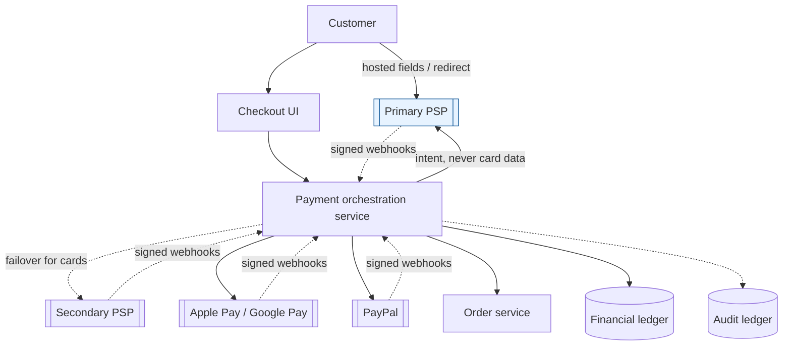
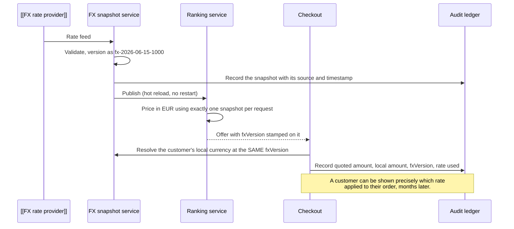

# 16. Payments and FX

**The platform does not build a payment processor.** It orchestrates
regulated third parties, holds no card data, and keeps itself out of PCI DSS
scope beyond SAQ-A. Payment integrations are external interfaces and are
mocked in the coded task.

## 16.1 Payment orchestration

Card data never touches our infrastructure. The browser posts directly to the
PSP's hosted fields or redirect flow; we receive a token. This single
decision is what keeps PCI scope at SAQ-A and keeps a card breach
structurally impossible rather than merely unlikely.

| Method | Integration | Notes |
| --- | --- | --- |
| VISA, MasterCard, AMEX | PSP hosted fields, 3-D Secure 2 | AMEX has lower acceptance in some markets; secondary PSP covers it |
| Apple Pay | PSP wallet API, device tokenisation | Domain verification required per environment |
| Google Pay | PSP wallet API | Same |
| PayPal | Redirect, server-side capture | Separate dispute process from cards |
| Bitcoin | **Assessed, not recommended for launch** — see [16.4](#164-bitcoin-assessment) | |

### Reliability

Idempotency keys on every payment intent, so a client retry can never double
charge. Webhooks are signature-verified, idempotent and replay-safe, with
reconciliation sweeps that catch any webhook that never arrived. Card traffic
can fail over to a secondary PSP; wallets and PayPal cannot, and degrade to
"temporarily unavailable" with the other methods still offered.

## 16.2 Currency conversion with a traceable snapshot

The brief requires automatic currency conversion so fleets pay in local
currency, **with a traceable exchange-rate snapshot**. That last clause is the
requirement that shapes the design.

Rules that make this traceable rather than merely automatic:

**A rate snapshot is immutable and versioned.** Rates are never edited in
place; a correction is a new version.

**One snapshot per pricing decision.** The coded slice enforces this: the
configuration snapshot is read once at the start of a request and used
throughout, so a mid-request FX publish cannot produce an internally
inconsistent comparison.

**The version travels with the result.** Every `/best-offers` response carries
`fxVersion`, and every order records the version used.

**Quotes are time-boxed.** A quoted local-currency amount is honoured for a
defined window; after it expires the customer is re-quoted rather than
silently charged at a different rate.

**Rates are decimal strings, not JSON numbers.** The configuration validator
rejects `0.92` as a number and requires `"0.92"`, because a JSON number would
reintroduce binary floating point into the pricing path. There is a test for
this.

### Degradation

If the FX provider is unavailable, the last valid snapshot continues to serve
and a staleness alert fires. Prices remain correct and attributable to a
named, slightly older version. This is strictly better than failing checkout,
and strictly better than guessing a rate — and because the version is stamped
on the response, nobody can later be misled about which rate applied.

## 16.3 FX risk

Converting at the moment of quotation exposes the business to movement
between quotation and settlement. Mitigations: a conservative spread
configured per currency pair, short quote validity, daily net exposure
monitoring, and hedging only if exposure exceeds a treasury-set threshold.
The spread is configuration with versioned approval, exactly like margin, and
is disclosed rather than buried — a hidden FX spread on top of a settled
fraud allegation about billing claims would be an unforced error.

## 16.4 Bitcoin assessment

The brief asks for an assessment of Bitcoin as an optional payment capability
with compliance and settlement trade-offs. The assessment is genuine, and the
recommendation is negative for launch.

| Dimension | Assessment |
| --- | --- |
| **Settlement finality** | Probabilistic, not deterministic. Six confirmations is roughly 60 minutes; a data purchase expected to complete in seconds does not fit |
| **Price volatility** | Intraday swings of several percent exceed the entire product margin. Requires immediate conversion via a payment processor, which reintroduces a third party and its fees |
| **Transaction cost** | Highly variable with network congestion; can exceed the value of a small data purchase outright |
| **Refunds and chargebacks** | No native reversal. Refunds must be a separate outbound payment, with their own AML exposure |
| **AML/CFT compliance** | Travel Rule obligations, sanctions screening against chain analytics, source-of-funds checks. Materially heavier than card acquiring |
| **Accounting and tax** | Treated as property in many jurisdictions: each receipt is a taxable disposal event requiring cost-basis tracking |
| **Licensing** | May trigger VASP registration depending on jurisdiction and whether custody is taken |
| **Customer demand** | Negligible among B2B fleet operators, who pay on invoice or by corporate card |
| **Reputational context** | The group has just settled a fraud allegation. Adding a pseudonymous payment rail invites exactly the wrong kind of regulatory attention |

### Recommendation

**Do not implement for launch.** The compliance burden is disproportionate to
demonstrated demand, and the settlement characteristics are a poor fit for a
transactional marketplace.

**If it is later required** — most plausibly for a specific market or a
strategic customer — the lowest-risk form is: accept via a regulated crypto
payment processor that assumes custody and settles to us in fiat
immediately; never take custody; screen counterparties with chain analytics;
treat the processor exactly like any other PSP behind the existing payment
orchestration abstraction. That abstraction exists precisely so this decision
stays reversible
([ADR-0012](../adr/0012-payment-provider-abstraction.md)).

**Stablecoins are not a workaround.** They solve volatility while leaving the
AML, licensing and reputational considerations intact, and add issuer
counterparty risk.

## 16.5 What is mocked in the coded task

Everything in this section is design only. The coded slice contains no
payment code at all: it produces EUR prices and an `fxVersion`, which is the
input a checkout flow would consume. FX conversion in the slice is the
configured static rate table from the brief (`fx-demo-1`), hot-reloadable and
version-stamped — a faithful stand-in for a live rate feed, exercising the
same snapshot-and-version mechanics the real integration needs.
