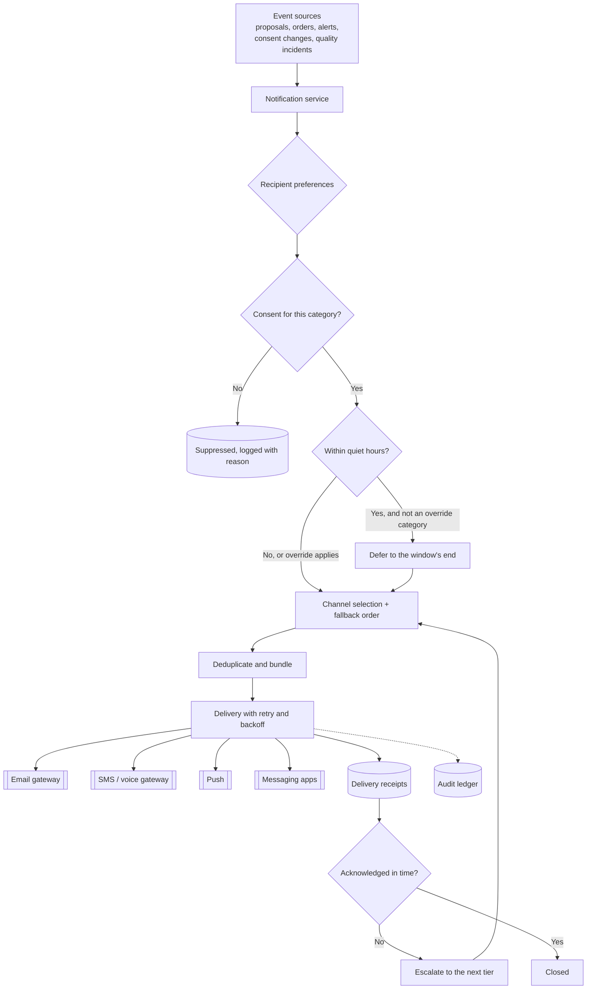

# 17. Notifications

Configurable notifications through email, phone and messaging apps, with
consent, quiet hours and escalation policies. Gateways are external
interfaces and are mocked in the coded task.

## 17.1 Pipeline



## 17.2 Categories and their rules

Category, not channel, determines urgency. This is what makes quiet hours
safe to offer.

| Category | Example | Quiet hours | Consent required | Escalates |
| --- | --- | --- | --- | --- |
| Safety-critical | Vehicle fault requiring immediate attention | **Overridden** | Operational (implied by service) | Yes |
| Operational | Work order approved, delivery ready | Respected | Operational | Yes, for approvals |
| Approval request | Agent proposal awaiting a decision | Respected, with a configurable override | Operational | Yes |
| Transactional | Receipt, invoice, order confirmation | Respected | Operational | No |
| Account and security | New sign-in, consent change, token rotation | **Overridden** | None — a legal obligation | No |
| Quality and provider | Feed degraded, provider suspended | Respected | Operational | No |
| Marketing and advertising | Offers, promotions | **Strictly respected** | **Advertising consent only** | No |

Two rows carry most of the risk. Safety-critical and security notifications
override quiet hours because suppressing them could cause harm or conceal a
compromise; the override list is short, explicit and reviewed. Marketing
requires the separate advertising consent and is never sent under operational
consent — the separation required by the brief, enforced at this gate rather
than trusted to the sender.

## 17.3 Quiet hours

Per recipient, with a timezone, a window, and per-category overrides.
Deferred notifications are bundled into a single digest at the end of the
window rather than arriving as a burst, which is the difference between a
feature and an annoyance.

Timezone handling uses the recipient's declared timezone, with daylight-saving
transitions resolved by storing the IANA zone identifier rather than a UTC
offset. A driver who moves across timezones updates their profile; the
platform does not infer it from location, because that would mean using
location data for a purpose the driver did not consent to.

## 17.4 Escalation

```mermaid
sequenceDiagram
  participant P as Proposal (1 240 EUR work order)
  participant N as Notification service
  participant T1 as Maintenance manager
  participant T2 as Fleet supervisor
  participant T3 as On-call duty manager

  P->>N: Approval required, SLA 4 hours
  N->>T1: Push + email (T+0)
  Note over N: No acknowledgement after 60 min
  N->>T1: SMS (T+60)
  Note over N: No acknowledgement after 120 min
  N->>T2: Push + SMS (T+120)
  Note over N: No acknowledgement after 180 min
  N->>T3: Voice call (T+180)
  Note over N: SLA breached at T+240
  N->>P: Mark the proposal expired
  P->>P: No action taken; recorded in the audit ledger
```

The terminal state is **expiry, not auto-approval**. An escalation policy that
ends in "approve it anyway because nobody responded" would defeat the
supervision requirement entirely. Escalation exists to find a human, not to
replace one.

## 17.5 Delivery guarantees

| Property | Approach |
| --- | --- |
| At-least-once with deduplication | Idempotency key per `(recipient, event, category)`; duplicates suppressed within a window |
| Ordering | Not guaranteed across channels; each message is self-contained and timestamped |
| Retry | Exponential backoff with jitter, bounded attempts — the same policy as provider calls ([ADR-0006](../adr/0006-retry-and-resilience-policy.md)) |
| Channel failover | Ordered preference list; failure on one channel tries the next |
| Receipts | Where the gateway supports them, recorded and used for escalation |
| Suppression transparency | Every suppressed notification is logged with its reason, so "I never got it" is answerable |

## 17.6 Content and privacy

Notification content is minimised: the message says a proposal needs
attention and provides a link, rather than embedding vehicle locations, fault
details or commercial terms in an email or SMS that may sit unencrypted on a
device. Deep links require authentication, so the sensitive content is only
ever rendered inside an authenticated session.

## 17.7 What is mocked

All gateways are external interfaces, mocked in the coded task. The coded
slice contains no notification code. The retry and backoff policy it does
implement (`src/best-offers/retry.js`) is the same policy the notification
sender would use, which is deliberate: one resilience approach, one place it
is tested.
