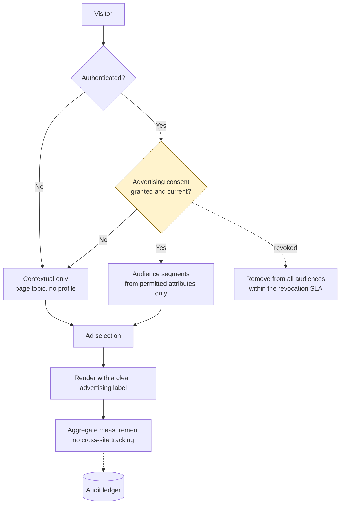

# 18. Advertising and loyalty

## 18.1 Loyalty tiers

Spend-based tiers give registered customers rewards, better prices and early
access.

| Tier | Qualifying 12-month spend | Discount | Early access | Support |
| --- | --- | --- | --- | --- |
| Bronze | Registered, any spend | 0% | — | Standard |
| Silver | ≥ €10 000 | 2% | 24 h on new products | Standard |
| Gold | ≥ €50 000 | 5% | 72 h | Priority |
| Platinum | ≥ €200 000 | 8% | 7 days + beta cohort | Named manager |

Tier is evaluated on a rolling 12-month window, recalculated nightly, with a
one-tier grace period on demotion so a quiet quarter does not abruptly change
someone's pricing. Tier changes are audited, because they affect price.

### Where the discount applies in the pricing chain

```
provider cost → FX → margin → LOYALTY DISCOUNT → tax → local currency
```

The position is deliberate and must not move. Applying loyalty *after* margin
means the discount comes out of VectorHarbor's markup rather than distorting
the provider comparison. If loyalty were applied earlier, two customers could
see **different winners** for the same canonical product, which would make
the comparison incoherent and unexplainable.

This is why the coded slice omits loyalty entirely (as the brief specifies)
and still produces the correct ranking: the winner is tier-independent by
construction. The ranking is a property of the market; the discount is a
property of the relationship.

Every applied discount is a separate audited line with its own tier version,
so an invoice decomposes into provider cost, FX, margin, discount and tax.

## 18.2 Directed advertising

Advertising is supported on the site, with advertising consent held strictly
separately from fleet-operation consent.



### Attributes permitted for targeting

| Permitted | Prohibited |
| --- | --- |
| Declared industry and fleet size band | Driver location, current or historical |
| Coarse operating region, from entitlements | Individual vehicle movements |
| Product categories previously purchased | Inferred driver behaviour or scoring |
| Self-declared interests | Health, biometric or any special-category inference |
| Loyalty tier | Data from any source lacking advertising consent |

The prohibitions are not a policy statement bolted on afterwards; they are
enforced because the advertising pipeline is a **separate data path** with its
own store, its own retention and its own access controls. It cannot read
telemetry. Making the boundary physical rather than procedural is what makes
"we never use driver location for advertising" a verifiable claim instead of
a promise.

### Separation of consent, concretely

| | Fleet-operation consent | Advertising consent |
| --- | --- | --- |
| Granted during | Service onboarding | An explicit, separate opt-in |
| Required for | Dispatch, maintenance, purchased data | Targeted advertising only |
| Default | Required to use the service | **Off** |
| Revocation effect | May suspend the service | Advertising reverts to contextual; service unaffected |
| Storage | Operational consent store | Separate advertising consent record |
| Retention after revocation | Per operational retention | Audience membership purged within the SLA |

A customer can therefore use every part of the marketplace while refusing
advertising, and refusing advertising degrades nothing. That is the test of
whether consent is genuinely separate or merely presented as separate.

## 18.3 Loyalty-aware personalisation by the assistant

The assistant personalises offers using authorised purchase and service
history, by usage frequency, operating area, price range and interests.

| Signal | Source | Consent purpose |
| --- | --- | --- |
| Usage frequency | Order history | Analytics |
| Operating area | Coarse region derived from entitlements | Analytics |
| Price range | Historical order values | Analytics |
| Interests | Declared preferences and product categories browsed | Analytics |
| Tier | Loyalty record | Operational |

Personalisation runs under **analytics** consent, never advertising consent,
and never touches raw telemetry or driver location. The distinction that
matters: personalisation helps a customer find data they are already trying
to buy, whereas advertising promotes something to them. They have different
consent bases and different pipelines, and conflating them would be both a
compliance failure and a product mistake.

A customer may decline personalisation while continuing to buy data; the
assistant then surfaces the same catalogue without reordering it.

## 18.4 Transparency

Every personalised or advertised surface is labelled, and a "why am I seeing
this?" control explains the signals used in plain language. Given the
company's recent history, being able to explain *why* a customer was shown a
particular offer is worth more than the marginal conversion gained by keeping
it opaque.
