# 19. Deployment and environments

## 19.1 Environments

| | Development | Staging | Production |
| --- | --- | --- | --- |
| Purpose | Fast iteration | Launch-gate measurement | Live service |
| Shape | Reduced | Production-shaped, smaller | Full |
| Availability zones | 2 | 3 | 3 |
| NAT gateways | 1 shared | Per AZ | Per AZ |
| Replicas (min–max) | 1–4 | 2–20 | 3–40 |
| Compute | Fargate Spot | Fargate Spot | Fargate on-demand |
| TLS | Optional | Required | Required |
| WAF | On, permissive | Detection mode | Prevention mode |
| Providers | Mocks | Mocks | **Certified feeds only** |
| Fleet assistant | On, deterministic planner | On, real model | On, real model |
| Inference key required | No | Yes | Yes |
| Log retention | 14 days | 30 days | 90 days |
| Deletion protection | Off | On | On |
| Deploy trigger | Automatic on merge | Automatic on merge | Manual, approved |

Production refuses to deploy the mocks. The Terraform precondition requires
real provider URLs when `deploy_mock_providers = false`, and the production
tfvars sets exactly that, so a mock cannot reach production through a
configuration slip.

## 19.2 Pipeline

```mermaid
flowchart LR
  PR[Pull request] --> SC[Static checks<br/>parse, hygiene, secrets, Terraform]
  SC --> UT[Tests on Linux, macOS, Windows<br/>coverage thresholds enforced]
  UT --> CB[Container build<br/>+ compose smoke test]
  CB --> GOLD[Golden fixture assertion<br/>end to end]
  GOLD --> TF[terraform fmt, init, validate<br/>AWS and Azure]
  TF --> SEC[Trivy: vulnerabilities,<br/>secrets, IaC misconfiguration]
  SEC --> REV[Review + approval]
  REV --> MERGE[Merge to main]
  MERGE --> DEV[Deploy to dev]
  DEV --> STG[Deploy to staging]
  STG --> GATE{Launch gates met?}
  GATE -->|Yes| PROD[Manual, environment-gated<br/>production deploy]
  GATE -->|No| BACK[Back to the backlog]
```



The golden-fixture step is worth calling out. CI starts the full stack and
asserts the exact winning provider and cost for all five products from the
brief's fixtures:

```
eu-north-diagnostics-hour=telemetry1@0.193787
eu-north-location-hour=telemetry2@0.115404
eu-north-temperature-hour=telemetry2@0.434708
eu-west-braking-hour=telemetry2@0.178241
eu-west-ev-health-hour=telemetry2@0.435417
```

Any change to the pricing contract fails the build with a visible diff. For a
company whose last legal problem was pricing claims, a pipeline that cannot
silently change a price is worth the twenty lines it costs.

### Credentials

No long-lived cloud credentials exist in the pipeline. GitHub Actions
federates via OIDC into an AWS role or an Azure app registration,
`permissions: id-token: write`, scoped per environment. Production applies
run in a protected GitHub Environment with required reviewers, so every
production change carries a recorded human approval.

## 19.3 Deployment strategy

Rolling deployment with a circuit breaker:

| Setting | Value | Effect |
| --- | --- | --- |
| Minimum healthy | 100% | Capacity never dips during a deploy |
| Maximum | 200% | New tasks start before old ones stop |
| Circuit breaker | Enabled with rollback | A failing deployment reverts itself |
| Health-check grace | 30 s | New tasks get time to become ready |
| Deregistration delay | 30 s | In-flight requests drain cleanly |

Graceful shutdown is implemented in the service and is what makes
zero-downtime deploys real rather than nominal: on `SIGTERM` the service
fails readiness first so the load balancer stops sending work, then stops
accepting connections, then drains in-flight requests, then exits — with a
forced exit after the grace period so a stuck request cannot block a rollout.
This sequence is covered by `test/integration/lifecycle.test.js`.

Blue/green is available through a second target group when a change is risky
enough to warrant instant rollback; it is not the default because rolling with
a circuit breaker covers the common case at lower cost and complexity.

## 19.4 Configuration and secrets at deploy time

| Item | Mechanism | Changeable without a deploy |
| --- | --- | --- |
| FX rates, default markup, quality floor | Parameter Store / App Configuration, hot-reloaded | **Yes** |
| Inference API key | Secrets Manager / Key Vault, created empty by Terraform and set out of band | Yes, by rotation |
| Model backend and model version | Task environment | No — a model change is a reviewed deployment, not a config tweak |
| Provider endpoints | Task environment | No — requires a new task definition |
| Resilience knobs (timeouts, attempts, concurrency) | Task environment | No |
| Admin token | Secrets Manager / Key Vault | Yes, by rotation |
| Log level | Task environment | No |

The split is deliberate. Pricing changes are frequent, governed and must not
need an engineer; resilience parameters are rare, risky and should go through
review.

## 19.5 Rollout gates

Each phase from [1.6](01-context-and-scope.md#16-phased-delivery) advances
only when its gate is measured and met in staging, then confirmed in
production.

| Phase | Gate | Measurement |
| --- | --- | --- |
| 1 — Pilot | Price reproducibility 100% on a sampled audit of 1 000 responses | Recompute from audit records; zero mismatches |
| | Availability ≥ 99.9% over 30 days | SLI from load-balancer metrics |
| | p99 < 1 s | Latency histogram |
| | Zero cross-tenant access events | Security alerting |
| 2 — Agent | Zero actions executed without a recorded approval | Audit query, zero tolerance |
| | Approval median latency < 30 min | Proposal lifecycle metrics |
| | Proposal acceptance rate > 50% | Quality proxy for the assistant |
| | Injection corpus produces zero unapproved actions | Adversarial suite, run per model version |
| | Safety suite passes identically on every model backend | `agent-supervision.test.js` against each configured backend |
| 3 — Scale | Residency isolation proven per region | Automated residency assertions |
| | Sustained 3 000 rps with p99 < 1 s | Load test against production-shaped staging |
| | DR failover within 30 min RTO | Quarterly drill evidence |
| 4 — M&A | Signed deal to certified adapter < 30 days | Certification pipeline metrics |
| | < 5 core-team days per acquisition | Engineering time tracking |

A gate that is not measured is not a gate. Each row names the measurement,
not just the target.

## 19.6 Local development parity

Local Docker Compose runs the same two images CI builds and production
deploys, with the same environment contract. The differences are explicit and
few: a fixed clock for reproducible fixture output, a local admin token, no
WAF or load balancer, and the mock providers instead of certified feeds.

Nothing about the service's behaviour differs between local and production
beyond configuration, which is what makes a local reproduction of a
production bug trustworthy.
