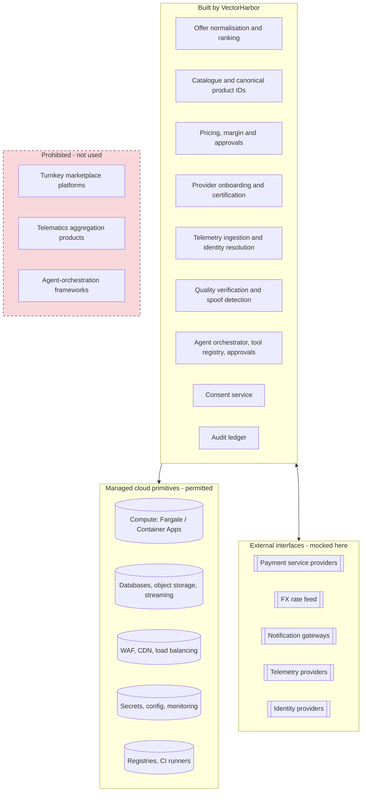

# 23. Boundaries and licensing

The brief requires documented boundaries and licensing assumptions. This
states exactly what is built, what is consumed, and under what terms.

## 23.1 The prohibition and how it is honoured

The brief forbids turnkey third-party **marketplace**, **telematics
aggregation** and **agent-orchestration** products. Open-source libraries and
models are allowed; cloud infrastructure and managed primitives are
permitted; regulated payment, notification and FX integrations may be treated
as external interfaces and mocked.

The distinction applied throughout: a managed primitive provides a
*capability* (run a container, store a row, terminate TLS); a prohibited
product provides the *domain solution* (be a marketplace, aggregate
telematics, orchestrate agents). Using a managed database is permitted;
using a product that ships offer ranking is not.

## 23.2 What is mocked in the coded task, and how faithfully

| External system | Mock | Fidelity | What the mock does **not** reproduce |
| --- | --- | --- | --- |
| Telemetry providers | `src/mock-providers/server.js`, serving the brief's fixtures over HTTP | **High.** Real HTTP, real JSON, identical schema on both endpoints, identity from the endpoint, fault injection for 5xx, 404, invalid JSON, non-array, empty body, latency and transient failure | TLS, authentication, pagination, rate limiting, real-world latency distribution |
| FX rate feed | Static rate table in `config/pricing-config.json`, hot-reloadable, version-stamped | **Medium-high.** Exercises the real snapshot, versioning and reload mechanics | Live rate movement, provider outages, bid/ask spreads |
| Payment providers | Not present | None — no payment code exists in the slice | Everything |
| Notification gateways | Not present | None | Everything |
| Identity provider | Not present; the slice is unauthenticated | None | Everything |

The provider mock is deliberately high fidelity. Its fault-injection modes
are what let the retry, timeout, partial-result and 503 paths be tested end
to end over real sockets rather than with stubbed functions, which is the
difference between testing the code and testing the behaviour.

## 23.3 Licensing position

### Runtime

**The service has zero third-party runtime dependencies**
([ADR-0003](../adr/0003-zero-runtime-dependencies.md)). It uses only the
Node.js standard library. There are therefore no third-party runtime licences
to track, no transitive licence obligations, and no supply-chain licence risk
in the deployed artefact.

| Component | Licence | Obligation |
| --- | --- | --- |
| Node.js 22 LTS | MIT | Attribution; no copyleft |
| Alpine Linux base image | Mixed (MIT, BSD, GPL for some userland) | GPL components are unmodified base-image utilities, not linked into our code |
| tini (init) | MIT | Attribution |

The Alpine row is the only nuance: the base image contains GPL-licensed
userland utilities. Our code neither links to nor derives from them, and the
image is redistributed unmodified, so no copyleft obligation attaches to our
source. This is the standard position for containerised applications and is
stated here so it is a documented judgement rather than an oversight.

### Build and deployment tooling

| Tool | Licence | Note |
| --- | --- | --- |
| Terraform 1.9.x | BUSL-1.1 | **Requires attention.** Permitted for internal infrastructure management; prohibited for offering a competing service. Our use is internal, so it is compliant. OpenTofu (MPL-2.0) is a drop-in alternative if legal prefers to avoid BUSL entirely |
| Terraform AWS / AzureRM providers | MPL-2.0 | Unmodified use; no obligation |
| Docker Engine / BuildKit | Apache-2.0 | Attribution |
| GitHub Actions and the actions used | MIT / Apache-2.0 | Attribution |
| Trivy | Apache-2.0 | Attribution |

Terraform's BUSL licence is flagged because it is the one genuine licensing
decision in this stack. The position taken is that internal infrastructure
management is clearly within the permitted use, and that migrating to
OpenTofu would be a low-cost switch if the group's legal team prefers a pure
open-source toolchain. Raising it now is cheaper than discovering it during
diligence on the next acquisition.

### Open-source policy proposed for the platform

| Licence class | Policy |
| --- | --- |
| MIT, BSD, Apache-2.0, ISC | Approved for any use |
| MPL-2.0, LGPL | Approved for unmodified use as a separate component; modifications require review |
| GPL, AGPL | **Prohibited** in anything network-facing. AGPL in particular would create source-disclosure obligations for a hosted marketplace |
| BUSL, SSPL, Elastic | Case-by-case legal review; permitted only where our use is clearly within the licence's permitted scope |
| Unlicensed or unclear | Prohibited |

Enforcement: licence scanning in CI, an approved-dependency list, and an ADR
for any new runtime dependency. The zero-dependency position means this
policy currently has nothing to enforce against in the service, which is a
side benefit of ADR-0003 that is easy to undervalue.

### Open-source models

Open-source models are permitted for the assistant. The obligations that
matter are not only code licences but **data rights**: a model's licence may
permit commercial use while its training data carries separate restrictions.
Each model used will carry a recorded assessment of licence, acceptable-use
terms, training-data provenance, and whether outputs may be used
commercially. Model attribution in insights
([5.4](05-data-quality-and-provenance.md#54-explainability-of-insights))
records the model and version, which also makes the licence position
auditable per insight.

## 23.4 Intellectual property

All code in this repository is original work produced for this engagement.
No code was copied from a third-party marketplace, telematics or
agent-orchestration product. The pricing algorithm implements the formulas
specified in the brief. The architecture patterns used — C4 diagrams, STRIDE
threat modelling, ADRs, the strangler-free greenfield approach — are
published industry practice, not proprietary methods.
