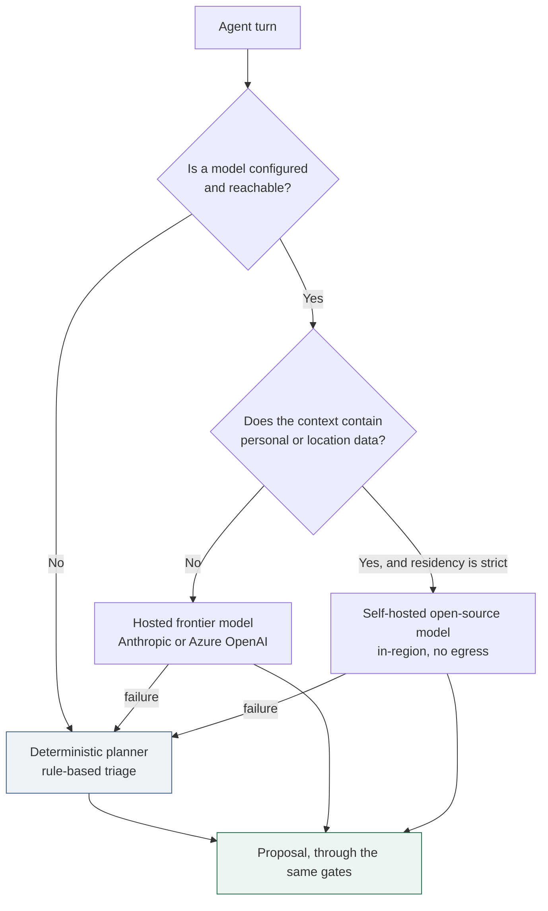
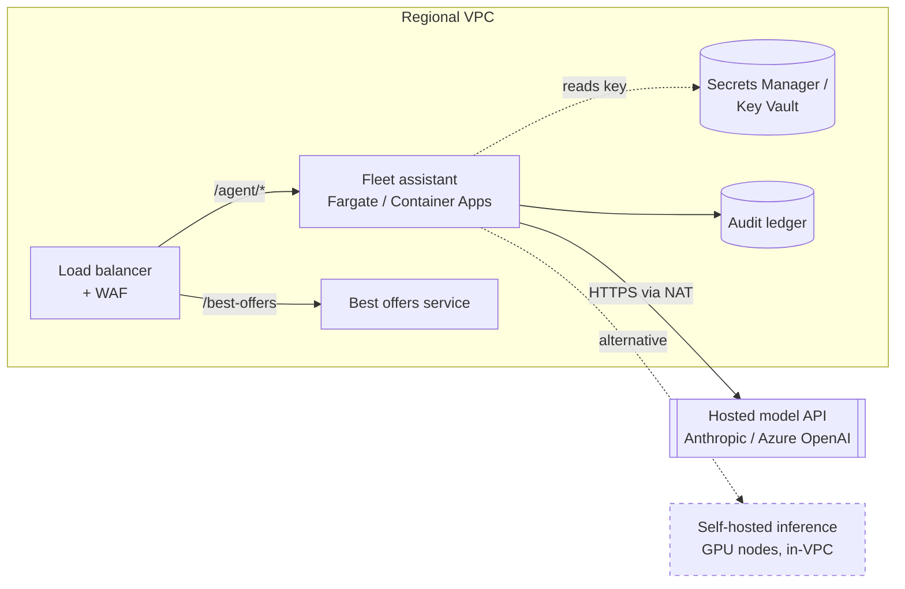

# 24. AI model strategy

Which models the platform uses, why, how to run them locally, how to deploy
them, and how they are governed.

The brief permits open-source libraries and models while prohibiting turnkey
agent-orchestration products. The split we hold to throughout: **we build the
orchestration, we rent the inference.**

## 24.1 What is actually implemented

| Component | Status |
| --- | --- |
| Orchestration loop, tool registry, approval gate, audit ledger | **Implemented** in `src/agent/`, hand-written, no framework |
| Model adapter interface | **Implemented** — one interface, four backends |
| Anthropic Claude adapter | **Implemented** — Messages API over plain HTTP |
| OpenAI / Azure OpenAI adapter | **Implemented** — chat-completions shape |
| Ollama adapter (local open-source models) | **Implemented** |
| Deterministic planner (no model) | **Implemented** — the default |
| Embeddings, RAG, fine-tuning | Designed only; see [24.8](#248-what-is-not-implemented) |

## 24.2 Model selection



Every path converges on the same gates. The model influences the *quality* of
a proposal, never what may happen to it.

### Recommended models by environment

| Environment | Backend | Model | Why |
| --- | --- | --- | --- |
| Local development, demos, CI | `deterministic` | `deterministic-planner-1` | No key, no network, no cost, fully reproducible |
| Local with a real model | `ollama` | `llama3.1:8b` or `mistral-nemo` | Open-source, runs on a laptop, no data leaves the machine |
| Staging | `anthropic` | `claude-sonnet-4-5` | Strong tool-use reliability; good instruction adherence under injection |
| Production (recommended) | `anthropic` | `claude-sonnet-4-5` | As above, with a commercial agreement covering data handling |
| Production (Microsoft estate) | `azure-openai` | `gpt-4o` on a regional deployment | Keeps inference inside the Azure tenancy and the EU data boundary |
| Production (strict residency) | `ollama` or vLLM | `llama-3.1-70b-instruct` self-hosted | Inference never leaves our VPC; the strongest residency position |

### Why a frontier hosted model for the default production path

This workload is tool use with strict schemas over safety-relevant content,
and the failure mode that matters is a *plausible but wrong* proposal reaching
a busy approver. Three properties drive the choice: reliable structured tool
calling, resistance to instruction-following from injected text, and the
ability to produce an evidence-cited rationale a human can check in seconds.
Larger hosted models are currently meaningfully better at all three than
models we would self-host economically.

### Why self-hosted open-source stays a first-class option

Agent context contains fleet operations data and may contain personal data.
Where a jurisdiction or a customer contract forbids sending that to a third
party, self-hosted inference inside the regional VPC is the only compliant
answer. The adapter interface exists so this is a configuration change, not a
re-architecture — see [ADR-0013](../adr/0013-agent-model-provider-abstraction.md).

### Why the default is no model at all

The deterministic planner is the default in every unconfigured environment.
It is not a stub: it surveys the fleet, ranks by fault severity then service
overrun, prices the remedy from the parts catalogue and writes an
evidence-cited rationale.

It exists because a demonstration of a safety property must not depend on a
vendor being reachable, and because identical behaviour across planners is
the clearest possible evidence that the guarantees come from the tool
registry and the approval gate rather than from the model's cooperation.

## 24.3 Running it locally

```bash
node src/agent/server.js          # or: npm run agent
```

Open http://localhost:8082/. No key, no network, no model.

### With a hosted model

```bash
# Anthropic
MODEL_BACKEND=anthropic MODEL_API_KEY=sk-ant-... MODEL_NAME=claude-sonnet-4-5 npm run agent

# OpenAI
MODEL_BACKEND=openai MODEL_API_KEY=sk-... MODEL_NAME=gpt-4o-mini npm run agent

# Azure OpenAI (MODEL_NAME is the deployment name, not the model name)
MODEL_BACKEND=azure-openai \
  MODEL_API_KEY=... \
  MODEL_NAME=gpt4o-eu \
  OPENAI_BASE_URL=https://my-resource.openai.azure.com \
  AZURE_OPENAI_API_VERSION=2024-10-21 \
  npm run agent
```

On Windows PowerShell, set each variable on its own line first:

```powershell
$env:MODEL_BACKEND = "anthropic"
$env:MODEL_API_KEY = "sk-ant-..."
$env:MODEL_NAME    = "claude-sonnet-4-5"
node src\agent\server.js
```

### With a local open-source model

```bash
# One-time: install Ollama from https://ollama.com, then pull a model
ollama pull llama3.1

MODEL_BACKEND=ollama MODEL_NAME=llama3.1 npm run agent
```

Nothing leaves the machine. Expect slower turns and less reliable tool
calling than a frontier model; the gates behave identically, which is the
point of trying it.

### Diagnosing "it still says deterministic"

```bash
npm run diagnose:model
```

Prints the variables the process can actually see, the resolved backend, and
what to fix. Add `--ping` to make one real call and confirm the credential.

Environment variables are read **once, at boot**. The two usual causes are a
service that was never restarted, and variables set in a different shell from
the one running it. Note also that a missing key or an unknown backend name
makes the service refuse to start, so a service that is running and reporting
`deterministic` simply never received the variables.

A backend reported as `anthropic+fallback` is correct and expected: the
deterministic planner stands by in case the backend fails.

### Verifying which model answered

```bash
curl -s localhost:8082/readyz | jq '{modelBackend, model}'
```

Every response from `/agent/ask` also carries the model that produced it, and
every proposal records `modelAttribution`. If a backend failed and the
deterministic planner answered instead, the model reads
`deterministic-planner-1 (fallback from <model>)`. A substitution is never
silent.

## 24.4 Deploying to the cloud

The agent is a stateless container like any other service, with one addition:
a model credential, and in the self-hosted case an inference endpoint.



### AWS

The agent is deployed by the same Terraform root module, behind the same
load balancer on the `/agent/*` path. The model key lives in Secrets Manager
and is injected at task start; it never appears in the image, in Terraform
state or in a log.

```bash
cd infrastructure/aws

# Enable it and choose a backend in your tfvars:
#   deploy_agent      = true
#   agent_model_backend = "anthropic"
#   agent_model_name    = "claude-sonnet-4-5"

# Put the key in Secrets Manager BEFORE applying, or let Terraform create an
# empty secret and set the value afterwards:
terraform apply -var-file=environments/prod.tfvars

aws secretsmanager put-secret-value \
  --secret-id "$(terraform output -raw agent_model_secret_name)" \
  --secret-string 'sk-ant-...'

aws ecs update-service --cluster "$(terraform output -raw ecs_cluster_name)" \
  --service "$(terraform output -raw agent_service_name)" --force-new-deployment

curl "$(terraform output -raw agent_console_url)/readyz"
```

### Azure

```bash
cd infrastructure/azure

#   deploy_agent        = true
#   agent_model_backend = "azure-openai"
#   agent_model_name    = "gpt4o-eu"

terraform apply -var-file=environments/prod.tfvars

az keyvault secret set \
  --vault-name "$(terraform output -raw key_vault_name)" \
  --name model-api-key --value 'sk-...'

az containerapp revision restart \
  --name "$(terraform output -raw agent_app_name)" \
  --resource-group "$(terraform output -raw resource_group_name)"
```

### Egress to a hosted model

Outbound HTTPS to the model API goes through NAT, so the provider sees a
stable set of addresses that can be allow-listed. The task security group
permits port 443 only. For a stricter posture, AWS PrivateLink or an Azure
Private Endpoint to the model service removes public egress entirely where
the provider supports it.

### Self-hosting inference

Out of scope for this build and designed as follows. Run vLLM or Ollama on
GPU nodes inside the regional VPC, expose it on an internal load balancer,
and point `OLLAMA_BASE_URL` or an OpenAI-compatible `OPENAI_BASE_URL` at it.
The agent service needs no code change. Indicative cost is in
[24.6](#246-cost).

## 24.5 Data handling

> The governing policy, the approval gate and its enforcement are in
> [25 Model data governance](25-model-data-governance.md). This section
> summarises the data position; that document is the control.

What is sent to the model, and what is not.

| Sent | Not sent |
| --- | --- |
| Vehicle identifiers, fault codes, odometer, service history | Driver identity |
| Technician free text, clearly labelled as untrusted | Driver location, current or historical |
| Parts catalogue and labour rates | Payment data of any kind |
| The operator's question | Other tenants' data |
| Tool schemas and the system prompt | Secrets, tokens or credentials |

Enforcement is structural rather than procedural, in two layers. The agent
can only see what a read tool returns; every read tool is tenant-scoped and
consent-gated, and no tool returns location or driver identity. Behind that,
an egress guard classifies the outbound payload and **blocks** the call if a
prohibited class is present, failing closed and recording the violation
([ADR-0014](../adr/0014-model-egress-data-classification.md)). The second
layer is a backstop for the day the first is wrong.

### Vendor terms required before production

Zero data retention or a contractually bounded retention window; no training
on our data; EU data residency for the inference endpoint; a signed data
processing agreement naming the provider as a processor; and a documented
sub-processor list. A provider that cannot meet all five is not usable for
this workload, which is a commercial gate rather than a technical one.

## 24.6 Cost

Agent inference is the one genuinely variable AI cost. Indicative figures at
phase 3, assuming 2 000 assistant turns per day and roughly 8 000 input plus
600 output tokens per turn across the tool-use loop:

| Option | Unit cost (indicative) | Monthly at 2 000 turns/day |
| --- | --- | --- |
| Deterministic planner | nil | **$0** |
| Claude Sonnet class | ~$3 / M input, ~$15 / M output | ~$1 980 |
| GPT-4o-mini class | ~$0.15 / M input, ~$0.60 / M output | ~$100 |
| Self-hosted Llama 3.1 70B | 2 × A10G or 1 × A100, always on | ~$1 100–2 200 |

Three observations worth putting to the customer. Inference becomes the
largest single line in the platform's run cost well before compute does — the
whole best-offers production environment is about $1 030/month
([13 Cost model](13-cost-model.md)). A smaller model on the routine triage
path with escalation to a frontier model for ambiguous cases cuts this
substantially, and is the first optimisation to make. And self-hosting only
pays once volume is high and steady, because the cost is fixed rather than
per-token; below roughly 1 500 turns/day a hosted model is cheaper as well as
better.

Controls: a per-tenant turn quota, `AGENT_MAX_ITERATIONS` bounding the loop,
`MODEL_MAX_TOKENS` bounding each call, and a cost alert per environment.

## 24.7 Evaluation and governance

A model is a dependency that changes under you, so it needs the same
discipline as any other.

| Control | Approach |
| --- | --- |
| Regression suite | A fixed set of fleet scenarios with expected proposals, run against each candidate model and version |
| Safety suite | The adversarial tests in `test/integration/agent-supervision.test.js`, which must pass identically on every backend |
| Injection corpus | A growing set of hostile technician notes; the pass criterion is that no proposal is self-approved and no refused tool is called |
| Quality metric | Approval rate of proposals, tracked per model version. A falling rate means the assistant is wasting approvers' attention |
| Version pinning | `MODEL_NAME` is explicit; no floating aliases in production |
| Change control | A model or prompt version change is a deployment, reviewed and recorded, not a configuration tweak |
| Attribution | Model and version recorded on every proposal and every audit entry |

The approval rate is the metric to watch in production. The assistant's
purpose is to save a maintenance manager time; a proposal stream that is
declined more often than accepted is costing attention rather than saving it,
whatever the model benchmark says.

## 24.8 What is not implemented

| Capability | Note |
| --- | --- |
| Retrieval-augmented generation over manuals and service bulletins | The highest-value next step; needs an embedding model and a vector index |
| Embeddings and semantic search over fault history | Same dependency |
| Fine-tuning on VectorHarbor's own service outcomes | Requires the AI-training consent purpose and a retention-aware dataset ([10](10-privacy-consent-residency.md)) |
| Streaming responses | The adapter interface returns a complete reply; streaming would be an added method |
| Multi-turn conversation memory | Each turn is independent today |
| Self-hosted inference infrastructure | Designed above; no Terraform for GPU nodes in this repository |
| Model-level guardrail services | Deliberately not relied upon: containment is the capability boundary, not a classifier |

The last row is a position rather than a gap. Guardrail classifiers reduce
the rate of bad model output; they do not bound what bad output can cause.
The architecture is built so that the worst outcome of a fully compromised
model is a proposal a human declines
([ADR-0010](../adr/0010-agent-tool-allowlisting.md)).
