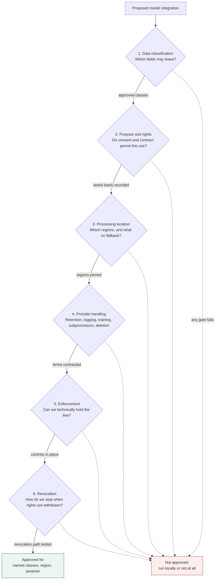

# 25. Model data governance

> **Status: proposed safeguards, pending customer approval.** Nothing here
> claims that a particular provider or deployment already meets the policy.
> The policy itself does not yet exist; this is a proposal for what it should
> cover and how the platform would enforce it.

## 25.1 The standing position until a policy is approved

**No raw operational telemetry, no precise driver location and no
identifiable driver record leaves the operational boundary for an external
model endpoint.**

This is not a future intention. It is the configured default today, and the
service refuses to start in production with it disabled.

| Control | State |
| --- | --- |
| Default inference backend | **No model at all** — the in-process deterministic planner. Nothing crosses any boundary |
| Permitted data classes when a model *is* configured | `OPERATIONAL`, `VEHICLE_ID` only |
| Precise location, driver identity, VIN | Blocked. The call fails rather than proceeding |
| Secrets, payment data | Blocked, and **not configurable** — the service refuses to boot if asked to permit them |
| Policy disabled | Refused in production; permitted only outside it, deliberately |

Implemented in `src/agent/model/egress-policy.js`, enforced at the adapter
boundary, evidenced by `test/unit/agent-egress-policy.test.js`. See
[ADR-0014](../adr/0014-model-egress-data-classification.md).

## 25.2 The approval gate

Any model integration must pass this gate before it may process a given data
class, in a given region, for a given purpose. One gate, six dimensions, each
with a named decision and an owner.

An approval is **specific**, not general: this provider, these data classes,
this region, this purpose, these terms. Changing any one of them is a new
approval, in the same way that an agent proposal binds to specific values
rather than to an intention
([ADR-0010](../adr/0010-agent-tool-allowlisting.md)).

### 1. Data classification — exactly which fields may leave

The unit of approval is a **data class**, not a field name, so adding a field
cannot quietly widen the boundary.

| Class | Examples | Default |
| --- | --- | --- |
| `OPERATIONAL` | Fault codes, odometer, service history, parts, labour rates | **Permitted** |
| `VEHICLE_ID` | `VH-4471`, registration plates | **Permitted** — pseudonymous but re-identifiable, so approved explicitly rather than by omission |
| `PRECISE_LOCATION` | Coordinates, geohashes, trajectories | Blocked |
| `DRIVER_IDENTITY` | Names, driver numbers, licences, contact details | Blocked |
| `VIN` | Vehicle identification numbers | Blocked |
| `PAYMENT` | Card numbers, IBANs | **Never permittable** |
| `SECRET` | Keys, tokens, credentials | **Never permittable** |

The last two are not merely absent from the default. The environment
validator rejects a configuration that tries to permit them, so the service
will not start. A control that can be switched off by an environment variable
in a hurry is not a control.

Decision owner: data governance, with security.

### 2. Purpose and rights — may this AI use happen at all

Consent is purpose-scoped
([10.1](10-privacy-consent-residency.md#101-consent-is-a-first-class-purpose-scoped-object)),
and **AI use is a separate purpose from analytics**. A customer who agreed to
benchmarking has not agreed that their telemetry informs a model.

The gate must record, per integration: which consent purpose authorises it;
whether the provider contracts permit onward processing by a named
subprocessor; and whether a works council or equivalent must be consulted,
since this touches driver data.

Decision owner: legal and data protection.

### 3. Processing location — approved regions, and what happens on fallback

Inference is processing, so it sits inside the residency boundary
([10.3](10-privacy-consent-residency.md#103-residency)).

The gate records the approved inference regions, and — the part usually
forgotten — **what happens when the primary region is unavailable**. A
provider that silently fails over to another continent has moved the
processing outside the approved region without telling anyone.

Our position: cross-region fallback is **not** permitted by default. If the
approved region is unavailable, the assistant degrades to the local planner
rather than processing elsewhere. That behaviour already exists, because the
deterministic fallback is the standing design
([ADR-0013](../adr/0013-agent-model-provider-abstraction.md)).

Decision owner: data governance, with architecture.

### 4. Provider handling — retention, logging, training, subprocessors, deletion

Contractual rather than technical, and no less binding for it.

| Term | Required position |
| --- | --- |
| Retention | Zero retention, or a contractually bounded window with a stated purpose |
| Logging | What the provider logs, for how long, and who can read it |
| Training use | No training or fine-tuning on our data, including for abuse monitoring, or an explicit carve-out |
| Subprocessors | A named list, with notice of change and a right to object |
| Deletion | A deletion mechanism with a stated SLA and evidence of completion |
| Residency | The inference endpoint is in an approved region, contractually |
| Audit | A right to evidence of the above, directly or via a recognised certification |

A provider that cannot meet retention, training use and residency is not
usable for this workload. That is a commercial gate, not a technical one, and
it should be settled before engineering effort is spent.

Decision owner: procurement and legal.

### 5. Enforcement — can we technically hold the line

A policy nobody can enforce is a statement of intent. Four mechanisms, all
implemented:

| Mechanism | How | Where |
| --- | --- | --- |
| **Minimisation at source** | No tool returns driver identity or precise location, so the data is not in the context to begin with | `src/agent/tools/fleet-tools.js` |
| **Tenant-aware authorisation** | Every read tool is tenant-scoped and consent-gated; an ambient call is refused | `src/agent/tools/registry.js` |
| **Controlled model egress** | The outbound payload is classified before the call; a prohibited class blocks it and fails closed | `src/agent/model/egress-policy.js` |
| **Redaction in telemetry** | Logs are redacted by deny-list, so a blocked value is not then written to a log | `src/best-offers/logger.js` |

The egress guard is deliberately a **backstop**, not the primary control. The
primary control is that the data is never in the context. The guard exists
because defence in depth means assuming that will one day be wrong — a new
tool, a new field, a well-meant change — and a boundary that depends on
everyone remembering is not a boundary.

It sits at the adapter level rather than inside each adapter, so it applies
to every backend and cannot be bypassed by adding a new one.

A block is loud: an error-level log, a `vh_agent_egress_blocked_total`
metric, and a `MODEL_EGRESS_BLOCKED` entry in the hash-chained ledger naming
the class and where it was found — never the value. The turn then degrades to
the local planner, so the service stays up while the violation is
investigated.

Decision owner: architecture and security.

### 6. Revocation — stopping when rights are withdrawn

The hardest of the six, and the one most often omitted.

| When rights are withdrawn | Required behaviour |
| --- | --- |
| Future retrieval | The consent gate excludes the subject's data at query time, so it never enters a context again |
| In-flight conversation | Current turn completes; the next turn sees the data gone |
| Provider-side retention | Deletion requested under the contracted mechanism, with evidence retained |
| Model memory | Not applicable today — each turn is independent and no conversation memory is persisted |
| Models trained on the data | Retirement on the documented schedule ([10.1](10-privacy-consent-residency.md#101-consent-is-a-first-class-purpose-scoped-object)); the stronger reason not to permit training use at all |
| Evidence | The revocation and the actions taken are recorded in the audit ledger |

The clean position is the simple one: **do not permit training use, and keep
turns stateless.** Revocation then reduces to "stop sending it", which is
enforceable at the consent gate and verifiable. Permitting training use makes
revocation a research problem rather than an engineering one.

Decision owner: data protection, with architecture.

## 25.3 What this means for the recommendation

The deterministic planner is the default precisely because it clears every
gate trivially: no data leaves, so there is nothing to classify, no region to
approve, no provider to contract with and nothing to revoke.

For a hosted model, gates 1, 3, 5 and 6 are addressable today; gates 2 and 4
are commercial and legal work that should start now because they have the
longest lead time.

Where the answer to gate 2 or 4 is "no" for a given jurisdiction or customer,
**self-hosted inference inside the regional VPC** is the fallback: it keeps
every data class inside the boundary and reduces gates 3, 4 and 6 to internal
controls. The cost and crossover point are in
[24.6](24-ai-model-strategy.md#246-cost).

## 25.4 Open questions for the customer

1. Who owns this policy, and who signs an approval under it?
2. Is an existing AI governance policy in force that this should inherit from?
3. Is `VEHICLE_ID` acceptable as a permitted class, or should even
   pseudonymous vehicle identifiers stay inside the boundary?
4. Must a works council or union be consulted before any model processes
   data derived from driver activity?
5. Is cross-region inference fallback ever acceptable, or is local
   degradation always preferred?
6. Is there an approved model provider list, or is provider selection part of
   this engagement?
