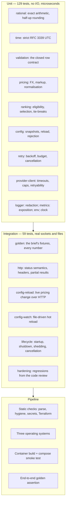

# Coding task: test strategy

188 tests, 97.0% line coverage, 95.4% branch, 94.4% function — thresholds
enforced by the test command itself, so coverage cannot quietly regress.

## Philosophy

A test earns its place by defending a specific property that could plausibly
break. Tests here are named after the behaviour they protect, not the
function they call, and the ones guarding non-obvious decisions carry a
comment explaining what would go wrong without them.

Three properties get disproportionate attention because they are the ones the
business depends on: **monetary exactness**, **deterministic ranking**, and
**predictable degradation**.

## Levels



Integration tests use real HTTP servers on ephemeral ports, real temporary
files and real sockets. Nothing is stubbed at the boundary being tested,
because the defects worth catching — a timer that keeps the event loop alive,
a header that is not set, a shutdown that hangs — do not appear when the
boundary is a mock.

## What each area defends

### Exact arithmetic (`rational.test.js`, 12 tests)

Asserts that `0.1 + 0.2` equals `0.3` exactly, that round-half-up gives 0.13
for 0.125 where banker's rounding gives 0.12, that magnitudes beyond 10³⁰
serialise correctly, and that two values identical at six decimal places but
different in exact value still compare correctly.

That last test is the important one. It is the case where floating point
would silently select the wrong provider, and it would pass trivially under a
naive implementation — which is exactly why it is written explicitly.

### Validation (`validation.test.js`, 15 tests)

One test per rejection reason, including boundaries: `validEventCount`
equal to `eventCount` is accepted; `priceMinor` of zero is accepted (a free
promotional bundle is legitimate); `observedAt` exactly equal to now is
accepted, one second later is not.

### Ranking (`ranking.test.js`, 19 tests)

Eligibility boundaries are tested on both sides: quality exactly 0.90
accepted; observation exactly 15 minutes old accepted, 15 minutes and one
second rejected; expiry exactly at now rejected, one second later accepted.

Tie-breaking has one test per level, and each constructs a genuine tie at the
previous level rather than asserting the final ordering of a convenient
example.

Two tests deserve naming. *"A lower bundle price does not win if it is worse
per valid event"* asserts the core commercial rule in both directions.
*"Insertion order must not matter"* runs selection with providers in both
orders and asserts the same winner, because a `Map`-iteration-dependent
result would pass a single-order test and fail in production under a
different fan-out timing.

### Retry (`retry.test.js`, 15 tests)

Backoff maths with an injected `random()` so jitter is deterministic. Budget
exhaustion with an injected clock. Retryable versus permanent classification.
Prompt cancellation both before the first attempt and mid-backoff.

The mid-backoff cancellation test asserts the operation returns in under two
seconds despite a five-second configured delay. This test found a real bug:
the backoff timer was originally `unref`'d, which let the event loop drain
while a retry was pending and left the caller's promise permanently
unsettled. The fix and the reasoning are recorded in a comment in
`retry.js` so it is not reintroduced.

### Provider client (`provider-client.test.js`, 17 tests)

Retry on 503 then success; no retry on 404, invalid JSON or a non-array body;
timeout and recovery; body size caps both by declared `Content-Length` and by
actual stream length; caller cancellation; and an assertion that
`cache: 'no-store'` is actually set, because "we do not serve stale offers"
is a contractual claim and deserves a test rather than a comment.

### Golden fixtures (`golden.test.js`, 10 tests)

Asserts the complete response body for the brief's fixtures at the specified
instant — every field of every offer, both rejections with their reasons, and
the configuration versions. Each expected value carries a comment deriving it
([worked examples](worked-examples.md) shows the full arithmetic).

Also asserts determinism across repeated runs, independence from provider
order, partial-result behaviour with one provider down, an empty `offers`
array when nothing is eligible, and that a mid-service configuration change
moves both the price and the reported versions.

### HTTP behaviour (`http.test.js`, 14 tests)

Status semantics for every case in the contract, security headers, request-id
echo and sanitisation, metric cardinality bounds, and an explicit assertion
that error bodies leak neither hostnames nor stack traces.

### Lifecycle (`lifecycle.test.js`, 10 tests)

Startup refusal on invalid configuration, invalid environment and a missing
config file. Graceful and idempotent shutdown. Readiness failing before the
listener closes. Load shedding returning a mix of 200 and 503 with
`Retry-After`. Client-disconnect cancellation leaving the server healthy. A
request deadline bounding a 4-second provider delay.

### Configuration reload (`config-reload.test.js` + `config-watch.test.js`, 9 tests)

A live markup change moving a real price from 13.16 to 14.35 EUR. A
malformed file rejected with HTTP 422 while prices stay exactly as they were.
Authorisation, including the wrong method and a missing token. File-watch
reload without a restart, followed by a broken write that leaves the last
valid snapshot serving.

### Hardening (`hardening.test.js`, 16 tests)

Every test in this file corresponds to a defect found by an independent code
review **after** the original 169-test suite was passing at 97.5% coverage.
They are kept in one file so the reason they exist stays visible.

High coverage did not catch these, which is the useful lesson: coverage
measures which lines ran, not which conditions were considered. Every one of
these bugs lived on a line the suite already executed.

| Test | Defect it prevents returning |
| --- | --- |
| 200k rows do not overflow the call stack | `push(...array)` made each element a function argument, throwing `RangeError` at ~130k rows — a 439 KB provider body produced a 500 for every client |
| 200k malformed rows are summarised, not echoed | Unbounded `rejectedRows` turned a 293 KB request into a 6 MB response: ~21× amplification |
| A malformed `Host` header still produces a response | `new URL` sat outside the try block, so the handler's promise rejected, nothing was written, and the socket was held for 30 s |
| A burst of malformed requests leaves the server serving | ~1 000 unauthenticated requests could occupy every socket |
| An expired deadline returns 503, not 500 | A routine timeout returned `INTERNAL_ERROR`, discarded a healthy provider's offers, and logged at error level |
| An oversized `content-length` does not leak sockets | The body was never cancelled, so 20 requests left 19 sockets open |
| Reload survives an atomic rename | `fs.watch` on the file silently stopped after the first ConfigMap-style update |
| A snapshot cannot be mutated | `Object.freeze` does not freeze a `Map`'s contents |
| A pinned clock is refused in production | `FIXED_CLOCK` makes every freshness and expiry check pass forever |
| Concurrent reloads are serialised | Three reload triggers with no ordering guarantee |
| Leap seconds are accepted | `:60` is valid RFC 3339 and was rejected |

The socket-leak test was verified to **fail** without its fix, then pass with
it. A regression test that passes either way is worse than none, because it
creates false confidence.

## Bugs these tests found during development

Worth recording, because they are the return on the investment:

| Bug | Found by | Fix |
| --- | --- | --- |
| `unref`'d backoff timer left retry promises unsettled when the event loop drained | Retry tests failing with "promise resolution is still pending" | Removed the `unref`; documented why in the code |
| Mock provider request counters were module-global, so state leaked between server instances in one process | The `failFirst` integration test passing alone and failing in a suite | Moved the counter into the server instance closure |
| `failedReloadCount` counted semantic failures but not unparseable files | The config-watch test asserting the counter after a broken write | Count and log unreadable files as failed reloads too |
| `PORT=0` (ephemeral) was rejected by environment validation | The demo script failing to start | Allow 0, documented as "bind an ephemeral port" |

Each was a genuine defect reachable in production, and each was fixed in the
source rather than worked around in the test.

A further eleven defects, listed in the hardening table above, were found by
an independent review of the finished code. Two were critical: both allowed a
single malformed input to deny service to every client. The review is the
reason the suite grew from 169 tests to 188.

## Static checks

`npm run check` runs without network access on a clean machine:

| Check | Purpose |
| --- | --- |
| Every JavaScript file parses | Catches syntax errors before the test runner |
| No `console.log`, `debugger`, `.only`, `TODO`/`FIXME` | A focused test silently skipping the suite is a real risk |
| No hard-coded secrets | AWS key ids, private keys, provider tokens |
| Source files carry a file-level comment | Enforces the "explain why this exists" convention |
| Required project files exist | Prevents a half-landed restructure |
| JSON is well-formed | Config and fixtures |
| Terraform consistency | Undeclared or unused variables, module wiring, output references, brace balance, provider pinning |

The Terraform checker exists because `terraform validate` needs a provider
download, which is slow and may be unavailable offline. It catches the
mistakes that actually happen when editing modules by hand — and it did:
two unused variables and a dependency cycle in the Azure module graph were
found this way before CI ever ran.

## Running the suite

```bash
npm test                  # everything, with coverage thresholds
npm run test:unit         # unit only, sub-second
npm run test:integration  # integration only
npm run check             # static checks, offline
make verify               # check + test, what CI runs
```

## Deliberate gaps

| Not tested | Why | Mitigation |
| --- | --- | --- |
| Sustained load over hours | Needs dedicated infrastructure | Benchmarked; staging load test at each rollout gate |
| Real cloud deployment | No account available in this environment | `terraform validate` in CI; offline consistency checker |
| Chaos and fault injection in cloud | Needs a deployed environment | Fault injection is exercised against the mocks |
| Browser or frontend tests | No frontend; optional per the brief | — |
| Security penetration testing | Needs a deployed target and a specialist | Threat model; Trivy scanning in CI |
