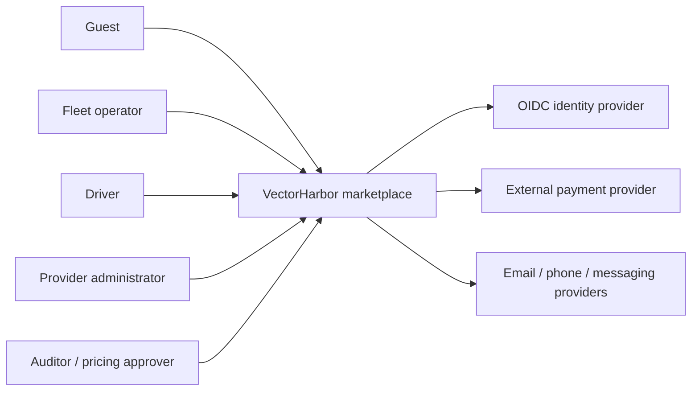
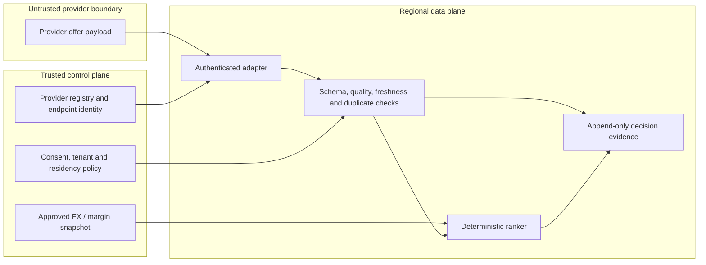

# Architecture diagrams and decision records

This folder contains the solution overview and detailed infrastructure design for the Greenfield VectorHarbor Mobility assessment. Diagrams are written in Mermaid and render directly in GitHub Markdown.

## Documents

- [Solution design](solution-design.md) — end-to-end logical architecture, requirements mapping, reliability, security, capacity, DR, AI safety, governance, and rollout gates.
- [Subsystem diagrams](subsystem-diagrams.md) — Mermaid diagrams for the full solution and subsystem flows.
- [Terraform / IaC](iac.md) — parameterized team, domain, and provider onboarding design.
- [Development guide](../development.md) — implementation workflow, tests, retry policy, and known scaffold gaps.
- [Wiki home](../wiki/Home.md)
- [User access and payment controls](../wiki/User-Access-and-Payment-Controls.md)
- [ADR-001: offer ranking](adr/ADR-001-provider-offer-ranking.md)
- [ADR-002: access governance](adr/ADR-002-access-governance.md)

## System context



## Offer evaluation sequence

```mermaid
sequenceDiagram
  autonumber
  actor Fleet as Fleet client
  participant API as Offer API
  participant Config as Config snapshot
  participant One as Provider telemetry1
  participant Two as Provider telemetry2
  participant Rank as Validator and ranker
  Fleet->>API: GET /best-offers
  API->>Config: Capture one validated snapshot
  par Bounded parallel fetch
    API->>One: GET configured endpoint
    One-->>API: Offer array or failure
  and
    API->>Two: GET configured endpoint
    Two-->>API: Offer array or failure
  end
  API->>Rank: Payloads + source IDs + snapshot + injected clock
  Rank->>Rank: Validate, reject duplicates, check quality and freshness
  Rank->>Rank: Decimal FX and markup; rank unrounded normalized cost
  Rank-->>API: Sorted winners, rejections, unavailable sources
  API-->>Fleet: 200 partial/complete, or 503 if no valid source array
```

## Trust boundaries



Provider claims are data to validate, not instructions. Audit evidence must be privacy-minimized, access-controlled, retained under policy, and sufficient to reproduce decisions without retaining secrets or payment details. These diagrams describe the proposed target; they do not claim every subsystem is implemented or deployed.
