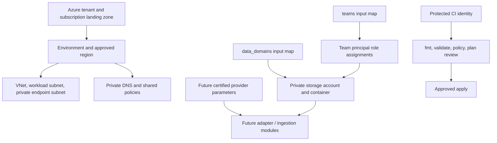

# Terraform and infrastructure onboarding (Azure)

**Status:** The executable foundation is in [`infra/terraform/`](../../infra/terraform/). It provisions a regional Azure network and private Blob Storage domains, and grants team principals domain-scoped access. This guide describes that initial module and its extension points; it is not a full application deployment.

## Module layers



## Implemented resources

The current Terraform foundation includes:
- Azure resource group with location allowlist check.
- Virtual network, private workload subnet, and private endpoint subnet.
- Private DNS zone and VNet link for Azure Blob Storage.
- One private StorageV2 account and container per data domain, with TLS, public network disabled, shared-key auth disabled, soft delete, versioning, and lifecycle policy.
- Blob private endpoint per domain.
- Entra principal role assignments driven by `teams[*].principal_object_ids` and each team's `data_domains` grants.
- AzureRM remote state backend configuration, which expects a separately bootstrapped storage account/container.

It does not deploy the FastAPI app, event hub, database, payment, AI, telemetry ingestion, or identity provider. Add modules only with explicit workload and threat-model requirements.

## Parameterized onboarding

Add a team map entry for owner, cost center, domain names, and Entra principal object IDs. Add domain metadata for jurisdiction, classification, retention, and owner. Cross-reference checks fail for unknown team/domain names. The Terraform role assignment is intentionally team/domain-level; individual access and payment restrictions belong in runtime identity/policy systems rather than IaC state.

```hcl
teams = {
  analytics = {
    owner_email           = "analytics@example.invalid"
    cost_center           = "CC-300"
    data_domains          = ["provider-quality"]
    principal_object_ids  = ["<approved-entra-object-id>"]
  }
}

data_domains = {
  provider-quality = {
    jurisdiction   = "eu-north"
    classification = "internal"
    retention_days = 365
    owning_team    = "analytics"
  }
}
```

## State and CI

Bootstrap Azure Blob remote state separately; state infrastructure cannot be created by the same state that needs it for initialization. Enable blob versioning/soft delete, private access, and tightly scoped Entra RBAC. Initialize with `terraform init -backend-config=backend.hcl`. Use CI federation/OIDC and protected apply gates. PR checks should include `terraform fmt -check`, `terraform validate`, provider lock-file review, security/policy scanning, and a saved plan review for region, identity, network, retention, destruction, and cost.

## Important production decisions

Confirm Azure region, ZRS/LRS and replication legality, data retention and deletion basis, customer-managed key needs, network egress, workload identity, role granularity, audit destinations, and recovery objectives before production. Sample principal IDs and subscription IDs are placeholders. Review deletion behavior: lifecycle expiry is based on blob modification time and interacts with soft delete/version retention. Never apply the examples without replacing placeholders and reviewing the plan.
