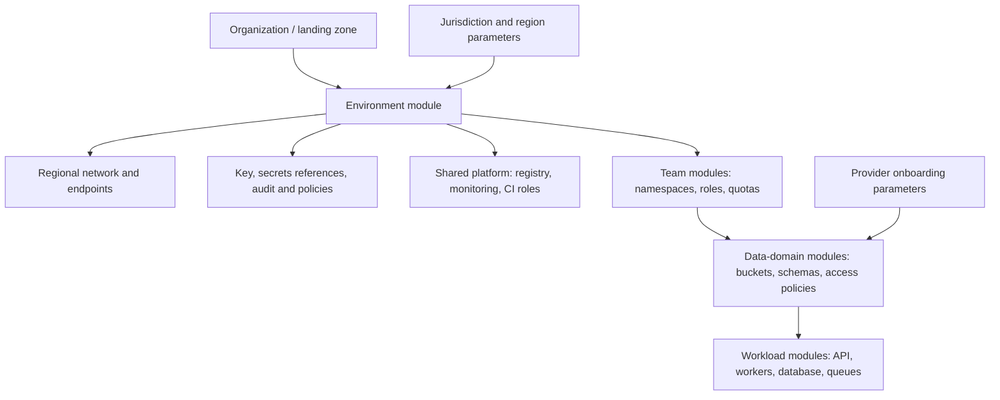

# Terraform and infrastructure onboarding

**Status:** Target IaC design; this document is a module contract and operating guide, not evidence that the Terraform module is already implemented. The current branch's initial code scaffold does not yet include deployable Terraform resources.

## Objectives

- Provision isolated, repeatable environments using Terraform and cloud-hosted state.
- Onboard a new team or data domain by passing a reviewed parameter, not by copying infrastructure code.
- Keep data residency, encryption, identity, network boundaries, monitoring, and ownership explicit.
- Make changes reviewable through `fmt`, `validate`, security/policy checks, and saved plan review.
- Avoid secrets in variables, plans, Git, and logs.

## Module layers



Use small composable modules with explicit inputs/outputs. The cloud landing-zone baseline is owned centrally. Teams may request approved team/domain instances; they must not independently weaken encryption, network, logging, or residency policies.

## Suggested repository structure

```text
infra/terraform/
  bootstrap/                 # one-time remote state and state encryption bootstrap
  modules/
    environment/
    team/
    data-domain/
    provider-adapter/
    service/
  environments/
    dev/
    staging/
    prod/
  policies/                  # policy-as-code checks
  README.md
```

Keep environment root modules thin. Pin Terraform and provider versions. Pin module sources to immutable tags or commit SHAs. Separate state by environment and jurisdiction; use locking and encryption. Apply workload roles with least privilege and avoid long-lived access keys.

## Parameter contract for onboarding

Illustrative variables (not yet a checked-in `.tf` implementation):

```hcl
variable "environment" {
  type        = string
  description = "Deployment environment: dev, staging, or prod."
}

variable "region" {
  type        = string
  description = "Approved cloud region for this jurisdiction's data plane."
}

variable "teams" {
  description = "Approved team definitions to provision."
  type = map(object({
    owner_email = string
    cost_center = string
    data_domains = set(string)
  }))
  default = {}
}

variable "data_domains" {
  description = "Domain contract and residency/purpose controls."
  type = map(object({
    jurisdiction = string
    purposes     = set(string)
    retention_days = number
    classification = string
    owning_team    = string
  }))
  default = {}
}

variable "providers" {
  description = "Certified provider adapter identities and endpoints."
  type = map(object({
    endpoint      = string
    jurisdiction  = string
    product_ids   = set(string)
    certification = string
  }))
  default = {}
}
```

Use `for_each` over validated maps for teams and domains. `owning_team` must refer to a declared team; every domain must specify permitted purposes and residency. Provider endpoint secrets/credentials are stored in the managed secret service and referenced by secret identifier; never pass secret values in Terraform variables. Avoid broad, arbitrary endpoint inputs in production—validate domain ownership and approved hostnames in CI policy.

Example invocation after implementation:

```hcl
teams = {
  fleet_ops = {
    owner_email = "fleet-ops@example.invalid"
    cost_center = "CC-104"
    data_domains = ["telematics", "diagnostics"]
  }
  data_governance = {
    owner_email = "data-governance@example.invalid"
    cost_center = "CC-210"
    data_domains = ["provider-quality"]
  }
}

data_domains = {
  telematics = {
    jurisdiction = "eu-north"
    purposes = ["fleet-operations", "consented-analytics"]
    retention_days = 90
    classification = "sensitive"
    owning_team = "fleet_ops"
  }
}
```

This describes intent; real values, names, provider schema, and resource mappings must be approved and implemented before `terraform apply` can work.

## State, secrets, and environment controls

1. Bootstrap remote state in a dedicated account/project. Enable encryption with customer-managed keys, state locking, versioning, access logging, and tightly scoped CI role access.
2. Separate state by environment and jurisdiction. Never use a single shared production/non-production state file.
3. Use OIDC federation from CI to assume short-lived cloud roles. Require protected environments and approval for production apply.
4. Store runtime secrets in a managed secret service. Terraform should create or reference secret containers/policies only; application secret values are populated through a controlled secrets workflow.
5. Use encrypted databases and object storage, private endpoints, restricted egress, and region-specific keys. Reject cross-region replication unless explicitly approved.
6. Tag resources with environment, owner/team, cost center, data classification, jurisdiction, and expiry where appropriate.

## CI and change workflow

```mermaid
flowchart LR
  PR[Pull request] --> FMT[terraform fmt -check]
  FMT --> INIT[terraform init -lockfile=readonly]
  INIT --> VALID[terraform validate]
  VALID --> SEC[lint, secret scan, policy and security scan]
  SEC --> PLAN[plan per environment]
  PLAN --> REVIEW[human review of diff and cost/residency]
  REVIEW --> APPLY[protected apply after merge]
  APPLY --> VERIFY[health, policy, drift and audit checks]
```



Run plan-only validation for pull requests. Apply only from a protected workflow after review; capture plan/apply identity and artifact. Use drift detection and a documented import/remediation workflow. Require policy-as-code checks for public ingress, unencrypted storage, wildcard IAM, missing data tags, disallowed regions, and unapproved replication. Never automatically apply an unreviewed plan to production.

## Onboarding checklist

- [ ] Business owner, cost center, team, data owner, and on-call contact assigned.
- [ ] Data classification, purpose, consent basis, retention/deletion, and jurisdiction approved.
- [ ] Region and approved network paths confirmed; no unauthorized cross-region paths.
- [ ] Roles map to least privilege and are tested for both allowed and denied access.
- [ ] Domain schema, product IDs, event identifiers, quality signals, and provider contract version registered.
- [ ] Provider certification and security/privacy review complete before production traffic.
- [ ] Encryption, audit, backup, metrics, alerts, quotas, and budget alarms configured.
- [ ] Contract, failure, retry, duplicate, stale-data, and rollback tests pass.
- [ ] Terraform plan reviewed for cost, security, and data residency; deployment is attributable.

## Operational safety

Terraform is not a user-management database and should not create an individual resource per end user. Use the identity provider and application authorization service for users; IaC provisions team roles, service identities, policy boundaries, and domain infrastructure. Payment method blocks are runtime business policies with audit history, not Terraform resources. This keeps frequent user/policy changes out of infrastructure state while retaining infrastructure governance.
