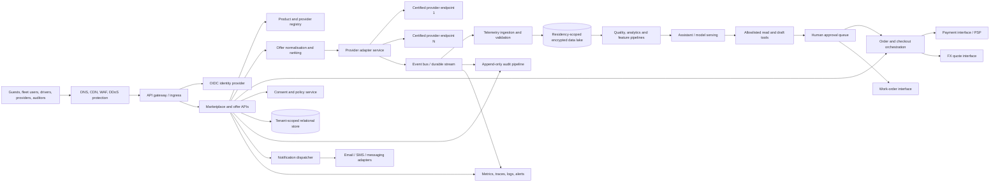

# Solution design: VectorHarbor Mobility

**Status:** Proposed target architecture for the supplied assessment use case  
**Scope:** Greenfield cloud-native marketplace, data platform, and supervised fleet assistant. The runnable code in this branch is a starter implementation of the offer-ranking slice; this document describes the broader target and does not imply that every component is implemented.

## 1. Goals and boundaries

Build a trusted marketplace for consented telematics products and a supervised assistant for fleet operations. Launch with 20 fleets in one jurisdiction, then expand through measurable regional and provider-cohort gates.

The platform must provide:

- Public, anonymised discovery for guests; authenticated, tenant-scoped fleet purchases and records for customers.
- Canonical products and independently certified provider adapters.
- Reproducible, quality-normalised offer ranking and versioned margin decisions.
- Consent-aware telemetry use, privacy-preserving analytics, and verifiable provenance.
- Loyalty-aware offers and explainable insights.
- Human approval before purchases or work-order changes; no remote vehicle actuation.
- Resilient operation during DDoS and seasonal/weather demand surges.

Out of scope for the coding slice: payment processing, the complete marketplace, production identity provider integration, vehicle ingestion, and autonomous AI actions. Payment, FX, email, phone, and messaging integrations are external interfaces; use sandbox or mock adapters in the assessment implementation. Do not store card data or build a payment processor.

## 2. Architecture at a glance

The diagram is logical. Deployments should split public APIs, provider adapters, ingestion, analytics, and AI workloads into separately scaled and permissioned services. Prefer managed cloud primitives over operating bespoke control planes, but retain portable interfaces and avoid turnkey marketplace, telematics-aggregation, or agent-orchestration products.

## 3. Suggested cloud and deployment model

**Recommendation: AWS**, subject to the customer’s legal, procurement, and residency review. The choice is based on mature regional coverage, managed networking and DDoS controls, managed Kubernetes or container services, object storage, relational database, streaming, KMS, and infrastructure-as-code support. Azure or GCP are viable alternatives if the customer’s existing identity, landing zone, or residency requirements favor them; validate service availability in each selected region before commitment.

Use a multi-account landing zone: security/log archive, shared networking, non-production, and production accounts. Isolate jurisdictions into separate regional data planes where required. Keep control-plane metadata global only when legally permitted; telemetry, consent records, and derived data remain in approved regions. Terraform provisions all environments and operational resources. CI/CD, state, secrets, databases, and monitoring are cloud-hosted; do not rely on a developer workstation for shared state or production operations.

## 4. Core services and responsibilities

| Capability | Responsibility | Important invariant |
|---|---|---|
| Identity and authorization | OIDC login, workforce identity federation, tenant/team roles, service identities | Deny by default; every API enforces tenant and domain scope server-side |
| Consent and rights | Driver consent, purpose, scope, jurisdiction, revocation, evidence | No event enters an analytics/AI purpose without a current legal basis and policy decision |
| Provider registry | Provider identity, adapter version, certification, regions, keys, health | Provider identity comes from trusted configuration, never a provider-supplied row field |
| Product catalogue | Canonical product schema, region, consent scope, time window, purpose, quality contract | Only identical canonical product IDs are comparable |
| Adapter and ingestion | Schema validation, event identity, deduplication, ordering, quarantine | Preserve source references and make retries idempotent |
| Offer ranking | Freshness, quality threshold, FX conversion, markup, deterministic rank | Compare unrounded decimal/rational normalized cost per valid event |
| Pricing governance | Product/provider/region markup, approval, effective time, history | Every result refers to immutable FX and margin versions |
| Checkout | Quote, reservation, idempotent order, payment provider hand-off, reconciliation | Do not store payment credentials; never charge without authorized confirmation |
| Analytics and AI | Rights-filtered features, explainable outputs, model/version lineage | Recommendations are drafts, not commands; no remote actuation |
| Audit | Access, consent, ranking inputs/versions, prices, approvals, actions | Append-only evidence; exclude secrets and payment details |
| Notifications | Per-channel consent, quiet hours, escalation, delivery status | Retry safely, honor opt-outs, avoid duplicate notifications |

## 5. Offer comparison contract

The coded service accepts offers containing `productId`, `eventCount`, `validEventCount`, `priceMinor`, `currency`, `observedAt`, and optional `expiresAt`. Provider identity is configured per endpoint. Supported rates and margin settings are loaded as one validated immutable request snapshot.

For each source response:

1. A bad transport, timeout, non-success response, malformed JSON, or non-array top-level response marks that provider unavailable. Retry transient failures within a bounded deadline; never substitute a stale cache.
2. Validate every row independently. Reject unknown fields and malformed values with stable reason codes. Reject repeated product IDs within one provider response as a group rather than selecting whichever duplicate happened to occur first.
3. Require a positive event count and valid count, `validEventCount <= eventCount`, nonnegative integer price, configured currency, parseable UTC timestamps, no future observation, at least the configured quality ratio, observation age at most 15 minutes, and `now < effective expiry`. Missing expiry means observation time plus 15 minutes.
4. Calculate with decimal or rational arithmetic: `providerEUR = priceMinor / 100 * FX[currency]`; `customerBundleEUR = providerEUR * (1 + markupBps / 10000)`; `costPer1000ValidEventsEUR = customerBundleEUR * 1000 / validEventCount`.
5. Rank per product by unrounded normalized cost, then higher unrounded quality, newer observation time, then lexicographically smaller configured provider ID. Format only at serialization using round-half-up (bundle 2 places, cost 6, quality 4).
6. Sort selected products lexically. Return `partial=true` for provider unavailability or any excluded row. Return HTTP 200 and empty offers when a valid provider array exists but no offer is eligible; return 503 only if neither source provides a valid top-level array.

The assessment fixture clock is `2026-06-15T10:05:00Z`; production uses an injectable UTC clock. Snapshot versions are returned with each response. These requirements should be enforced by tests, not only documentation.

### Production quality verification

Do not treat provider-reported quality counts as authoritative in production. Provider certification should define schemas, consent evidence, event identity, sampling windows, and quality thresholds. Verify signatures and source identity; validate schema and consent state at ingestion; deduplicate by stable event key; run independent completeness, freshness, plausibility, and spoofing checks; compare provider counts with independently sampled/audited counts; preserve raw evidence subject to retention and residency; and quarantine material discrepancies. Quality score methodology and changes require versioning, approval, reproducible calculation, and an audit trail. The sample exercise explicitly trusts counts after validation only for its limited scope.

## 6. Identity, access, and payment controls

Use an OIDC-compatible identity provider rather than the in-memory sample access manager for production. Map workforce and customer principals to tenant, team, role, and data-domain attributes. Apply ABAC/RBAC checks in every service and database query; tenant ID must be derived from authenticated claims and cross-checked against the requested resource. Suggested roles include fleet dispatcher, maintenance manager, driver, provider administrator, auditor, pricing approver, and platform operator. Separate duties for provider onboarding, pricing approval, and audit administration. Use short-lived credentials for workloads and MFA for privileged human access.

Payment methods are policy-controlled options, not credentials. Apply allow/deny rules at tenant, user, jurisdiction, and checkout policy levels, with audit events and clear customer errors. Support card wallets and PayPal through a PCI-compliant external provider and tokenized references; do not receive or log PAN/CVV. Bitcoin is a separately gated capability requiring compliance, sanctions, custody, refund, tax, settlement, volatility, and regional legal assessment; keep disabled by default until approved. A blocked method must be rejected before checkout authorization and again before payment hand-off.

## 7. AI assistant safety and explainability

Use retrieval only from explicitly authorized, consented purchase/service history and purpose-limited features. Personalization can consider loyalty tier, frequency, operating area, price range, and explicit interests, but should minimize sensitive location precision and honor opt-out/revocation. Every insight or recommendation contains source-event references, data quality/freshness indicators, model and prompt/template version, and a concise explanation. Keep decision traces privacy-minimized and exclude secrets.

Expose a small, schema-validated allowlist of tools: read authorized records, compare eligible offers, draft a purchase proposal, and draft a maintenance ticket. Tool calls use user-scoped credentials and idempotency keys. Require explicit human approval for any spend or operational change, show price/data provenance and impact, revalidate consent/offer freshness at approval, and record approver identity. No remote vehicle actuation tools are permitted. Test prompt injection, poisoned provider content, cross-tenant retrieval, unsafe tool arguments, stale recommendations, and revoked consent.

## 8. Reliability, capacity, and operational targets

These are proposed initial service objectives to validate during pilot load tests, not guarantees:

| Measure | Initial target |
|---|---|
| Offer API availability | 99.9% monthly in the pilot region, excluding documented provider outages where partial response is returned |
| Offer API latency | p95 <= 500 ms and p99 <= 1.5 s with healthy providers; bounded source timeout and explicit partial response |
| Provider fan-out | Parallel requests, 2 retries after first attempt for transient failures, exponential backoff with jitter, max 5 s per attempt, overall API deadline <= 8 s |
| Web/API capacity | 10,000 concurrent sessions at launch, scale test to 30,000 concurrent sessions; distinguish sessions from request rate and load test realistic traffic |
| Ingestion | Sustain 2x forecast peak for 30 minutes; retain queue-based burst absorption and per-source throttles |
| RPO / RTO | Regional service metadata RPO <= 5 min / RTO <= 60 min; telemetry lake RPO <= 15 min / RTO <= 4 h, subject to jurisdiction architecture |
| Security response | Critical alert acknowledgement <= 15 min for on-call; documented containment and evidence preservation procedures |

Use queues/streams to decouple bursty ingestion; autoscale stateless APIs by concurrency/latency and workers by queue lag; enforce quotas and backpressure. Use CDN caching only for public anonymous content, never private fleet data. DDoS controls include edge protection, WAF managed rules, rate limits, bot controls, request size/time limits, origin isolation, autoscaling limits, and rehearsed incident runbooks. Retries must be bounded and jittered to avoid retry storms. Circuit breakers and bulkheads protect downstreams. Idempotency and deduplication handle duplicate events and payment callbacks.

## 9. Resilience and disaster recovery

Deploy across multiple availability zones in each approved region. Back up encrypted relational state with point-in-time recovery; replicate approved artifacts according to residency policy. Store immutable audit records in a separate security account and retain signed exports. Use infrastructure-as-code to recreate regional services. Run quarterly restore tests and at least annual regional failover exercises. A failover must not move telemetry or consent data into an unapproved region. If legal residency prevents cross-region replication, use in-region backup and document the residual RPO.

During provider degradation, return partial results with unavailable provider IDs; do not serve stale ranking results. During checkout/PSP degradation, preserve idempotent order state and expose a safe pending/retry status; never assume a timed-out charge failed without reconciliation. For compromised telemetry, quarantine the provider cohort, freeze affected comparisons, preserve evidence and notify governance owners.

## 10. Observability and audit evidence

Emit structured, redacted logs, metrics, and distributed traces with request/correlation IDs. Track API latency/error/partial rates, provider latency and availability, rejected-row reason counts, offer age, ranking coverage, queue lag, duplicate/out-of-order rates, consent denials, payment outcomes, and AI approval/rejection rates. Avoid raw telemetry, precise driver locations, secrets, payment details, and personal identifiers in general-purpose logs. Use access-controlled audit storage for attributable evidence. Alert on DDoS signals, unusual access, provider quality drift, FX/margin version changes, residency policy failures, and repeated authorization denials.

## 11. Threat model summary

| Threat | Primary controls |
|---|---|
| DDoS and resource exhaustion | Managed edge protection, WAF, quotas, concurrency caps, autoscaling guardrails, provider timeouts |
| Cross-tenant data access | OIDC claims, tenant-scoped authorization at every layer, database row-level constraints, isolation tests |
| Forged/poisoned telemetry or cheap low-quality offers | Provider signatures, certification, independent quality checks, anomaly detection, quarantine, provenance |
| Consent misuse or revoked rights | Purpose-bound consent service, revocation propagation, deny-by-default policy checks, deletion/derivation workflows |
| Provider/API compromise | Per-provider identity, least privilege, secret rotation, egress allowlists, schema validation, circuit breaker |
| Pricing manipulation / fraud allegation | Versioned approved inputs, deterministic decimal computation, reproducible evidence, immutable audit logs, separation of duties |
| Credential or payment-data leakage | Managed secret store, tokenized PSP integration, redaction, no PAN/CVV handling, scoped workloads |
| AI prompt injection or unauthorized action | No direct provider-content instruction authority, retrieval ACLs, tool allowlist, schema validation, human approval, no actuation |
| Supply-chain compromise | Dependency pinning/scanning, signed images, SBOM, protected CI, Terraform plan review |
| Data residency violation | Region-bound data planes, policy checks, tagged data, controlled replication, auditable deployment gates |

## 12. Pricing transparency and financial model

Use versioned FX snapshots with source, capture time, base currency, and expiry; quote checkout with a traceable snapshot. Store provider price, currency, rate version, converted cost, markup policy/version, resulting amount, and timestamps so a historical result can be reproduced. Markup is a multiplier on converted cost, not a gross-margin calculation. Tax and loyalty discounts are later, explicit pricing stages and must not silently alter ranking semantics.

A full cloud cost estimate requires selected regions, provider event volumes, retention, query mix, egress, streaming throughput, and availability tier. Do not present an ungrounded dollar figure as a forecast. Before pilot approval, build a region-specific calculator model with low/base/high scenarios for API compute, databases, stream ingestion, lake storage/queries, security/observability, DDoS protection, backup, and egress. Report unit economics (cost per 1M ingested events and per 1k offer comparisons), growth assumptions, and sensitivity to retention and peak throughput. Re-estimate from pilot telemetry monthly.

## 13. M&A provider onboarding governance

Acquired subsidiaries remain independently operated data suppliers, not coupled internal modules. Publish a versioned REST adapter contract, sandbox, contract tests, sample payloads, certification checklist, support SLA, key lifecycle, change policy, and deprecation window. Each provider declares legal entity, ownership, jurisdiction, data rights, purposes, consent evidence, schemas, quality controls, retention, security contact, and incident process. Certification verifies identity, schema, event-key/idempotency behavior, clock semantics, quality metrics, privacy controls, and security posture. Use per-provider credentials and quotas. A provider cohort progresses through sandbox, shadow observation, limited 20-fleet pilot, and production with explicit quality/availability gates and rollback. Changes are backward-compatible or versioned; provider-specific behavior stays in adapters.

## 14. Rollout gates

1. **Foundation:** landing zone, threat model, DPIA/legal review, consent policy, CI/CD, observability, recovery tests.
2. **Provider sandbox:** two certified mock providers, contract tests, adversarial/duplicate/out-of-order fixtures.
3. **Pilot readiness:** 20 fleets, one jurisdiction, capped throughput/spend, support rota, tested revocation and checkout reconciliation.
4. **Pilot exit:** meet availability/latency/quality targets for 30 days, zero unresolved critical privacy/security findings, audit replay succeeds, restore/failover exercise passes.
5. **Expansion:** add a region or provider cohort only after residency and certification gates; monitor independent quality and user outcomes.

## 15. Decisions and open questions

See `docs/design/adr/` for the initial decisions. Resolve before production: selected cloud regions and legal entity boundaries; identity provider; telemetry retention and deletion obligations; source-of-truth for consent; quality score methodology; canonical product governance; provider SLAs; payment jurisdictions and Bitcoin position; model hosting/license; cost envelope; and whether regional recovery is legally possible.
