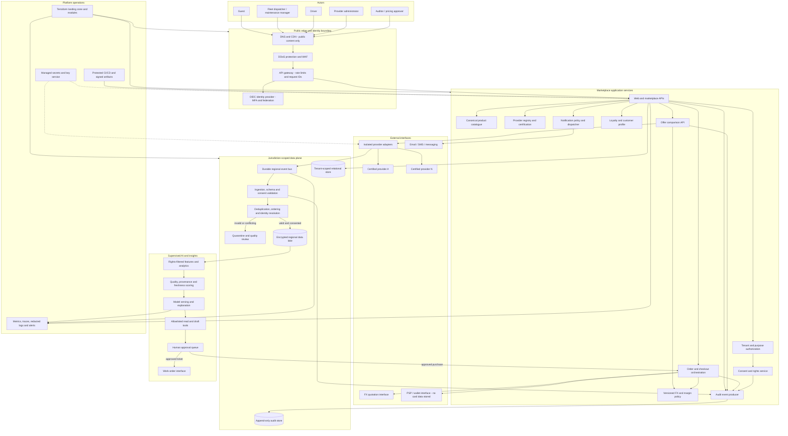
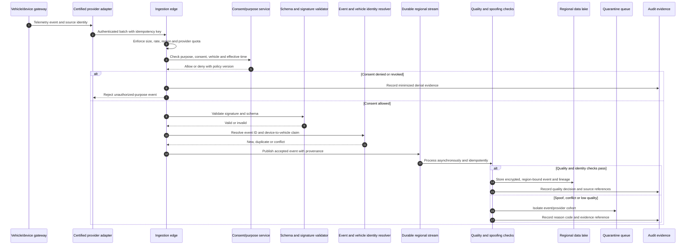
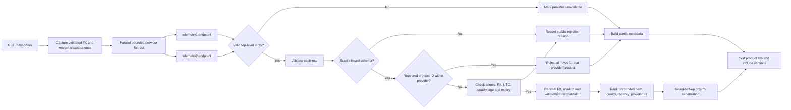
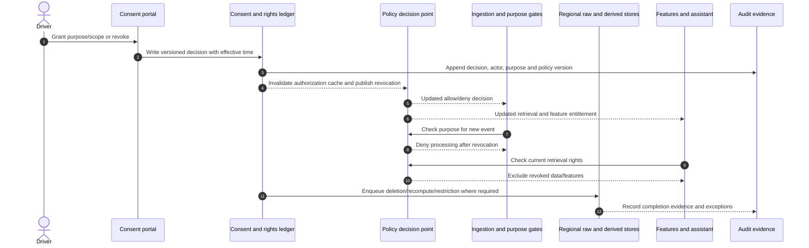
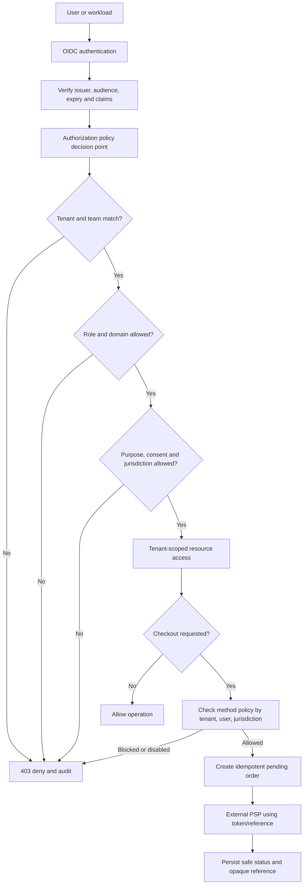
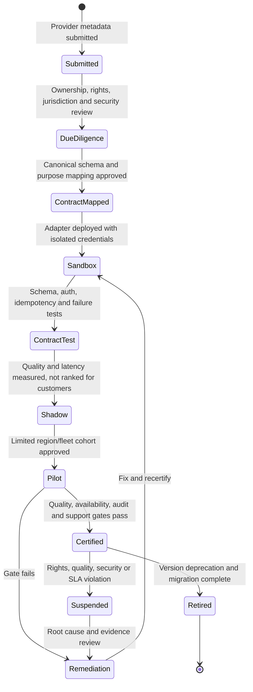
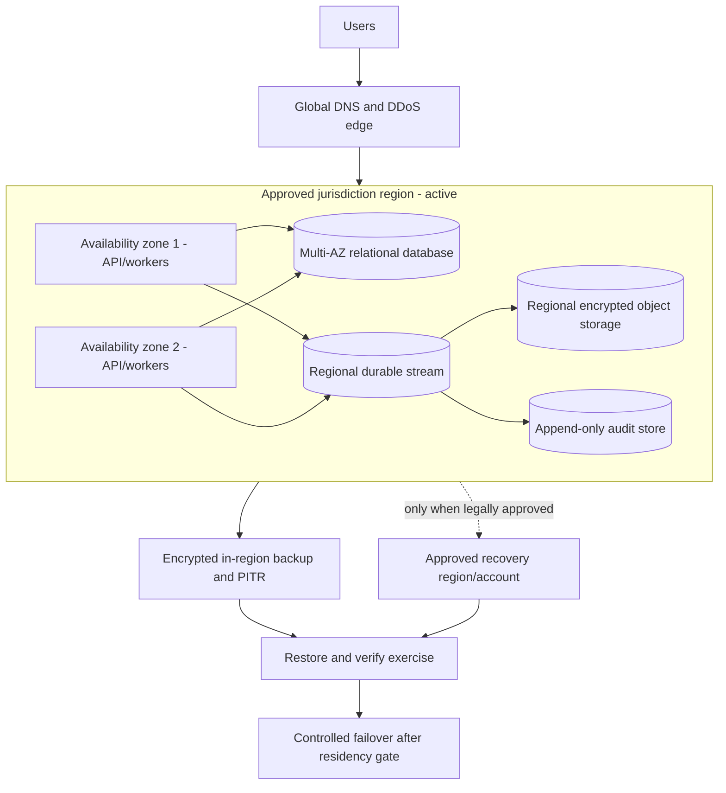
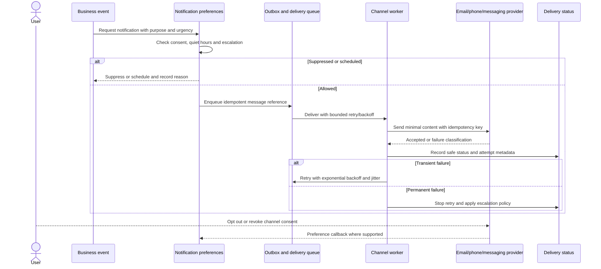
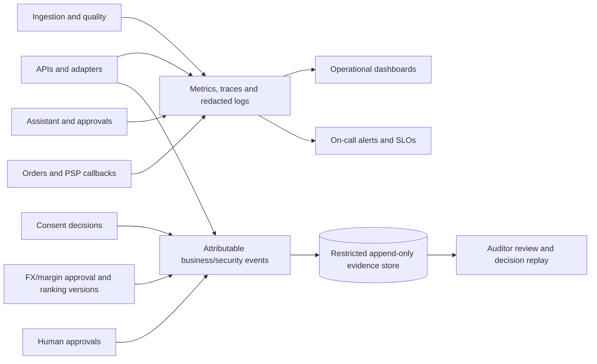

# Subsystem architecture diagrams

These diagrams expand the [solution design](solution-design.md). All diagrams are Mermaid source embedded in Markdown, suitable for GitHub rendering. They describe the target architecture, not deployment evidence.

## 1. Full solution architecture



**Boundaries:** guests see only public/anonymised content; APIs enforce tenant, purpose, and jurisdiction; provider connections are isolated; telemetry remains in the approved region; payment is external; assistant actions remain drafts until approved. No remote vehicle actuation capability is present.

## 2. Telemetry ingestion and data quality



Use stable event identifiers and idempotent writes so replay does not inflate counts. Preserve event-time and ingestion-time separately. Handle late events through a documented event-time window. Conflicting device-to-vehicle claims go to quarantine; never silently reassign sensitive location history.

## 3. Offer ranking subsystem



The winner is lowest unrounded `customerBundleEUR * 1000 / validEventCount`; ties are higher quality, newer observation, then lexically smaller configured provider ID. A malformed row does not poison sibling rows. Any rejected row or unavailable source makes the response partial. If neither source yields a valid top-level array, return safe HTTP 503; never use stale cache data.

## 4. Consent, revocation, and derived-data rights



Revocation affects future collection/use promptly and triggers a defined policy for previously derived data, backups, legal retention, and audit evidence.

## 5. Identity, tenant access, and payment controls



End-user membership and payment blocks belong in identity/application policy, not individual Terraform resources. Payment credentials never pass through platform storage or logs. Bitcoin is deny-by-default until approved.

## 6. AI recommendation and human approval boundary

```mermaid
sequenceDiagram
  autonumber
  actor Manager as Fleet manager
  participant API as Assistant API
  participant Auth as Tenant/purpose authorization
  participant Retrieval as Rights-filtered retrieval
  participant Model as Model and explanation layer
  participant Tools as Allowlisted tools
  participant Approval as Human approval service
  participant Order as Order/work-order system
  participant Audit as Audit log
  Manager->>API: Request maintenance or data recommendation
  API->>Auth: Check tenant, role, purpose and current consent
  Auth-->>API: Scoped authorization
  API->>Retrieval: Fetch authorized history and quality metadata
  Retrieval-->>Model: Minimized context with event references
  Model-->>API: Explanation, freshness, model version and draft
  API->>Tools: Validate tool name and typed arguments
  Tools-->>API: Draft only; no spend or actuation
  API->>Audit: Record proposal and provenance references
  API-->>Manager: Present rationale, price and impact
  Manager->>Approval: Explicitly approve or reject
  Approval->>Auth: Recheck role, consent, freshness and offer expiry
  Auth-->>Approval: Decision
  alt Approved and still valid
    Approval->>Order: Submit idempotent purchase or ticket
    Order->>Audit: Record outcome and approver identity
  else Rejected, stale or revoked
    Approval-->>Manager: Explain refusal; require refreshed proposal
    Approval->>Audit: Record rejection or denial
  end
```

Model output is untrusted. Provider text cannot change policy or grant tools. Approval binds to exact proposal, price, product, tenant, and expiry; material changes require new approval. No actuation tool may be registered.

## 7. M&A provider onboarding lifecycle



A versioned REST contract and provider-specific adapters keep subsidiary internals decoupled from marketplace core. Certification includes identity/key rotation, consent rights, region, canonical products, schema/event IDs, quality, timestamps, late/duplicate handling, security response, retention, support, and rollback.

## 8. Parameterized Terraform onboarding

```mermaid
flowchart LR
  Params[Reviewed onboarding parameters] --> Validate[Validate schema, owner and residency]
  Validate --> Plan[Terraform plan per environment and jurisdiction]
  Plan --> Policy[Check region, encryption, IAM, tags and network]
  Policy --> Review[Human review of plan, cost and residency]
  Review --> Apply[Protected short-lived CI apply role]
  Apply --> Modules[Composable Terraform modules]
  subgraph Modules
    Landing[Landing zone]
    Env[Environment and region]
    Team[Teams via for_each]
    Domain[Data domains via for_each]
    Provider[Certified providers via for_each]
    Workload[Services, queues, database and storage]
  end
  Modules --> Verify[Health, drift, audit and budget checks]
  Verify --> Ready[Onboarded infrastructure and boundaries]
  Validate -->|Invalid owner, domain or residency| Reject[Fail closed; no apply]
```



Terraform provisions team-level roles, service identities, policy boundaries, regional resources, and monitoring. It does not create per-user payment blocks or store application secrets. See [IaC onboarding](iac.md) for variable examples and state guidance.

## 9. Availability zones, recovery, and residency



Cross-region failover is conditional on legal residency and data-rights approval. If replication is prohibited, use in-region backup and document residual recovery objectives. Test restore integrity, consent behavior, key availability, DNS cutover, audit continuity, and data-location controls.

## 10. Notifications and retry safety



Retries cannot bypass opt-outs or quiet hours. Use an outbox and idempotency keys to prevent duplicate sends.

## 11. Observability and audit flow



Operational telemetry and audit evidence have separate access and retention policies. Neither should contain secrets, card data, raw payloads by default, or unnecessary precise location. Audit records should retain stable references and versions needed for review.

## Status note

The assessment's coded scope is provider-offer normalization and ranking. These diagrams document the broader proposed architecture; identity integration, durable consent, payment-policy enforcement, ingestion, independent quality verification, AI safety, deployable Terraform, alerting, and DR still require implementation and verification.
