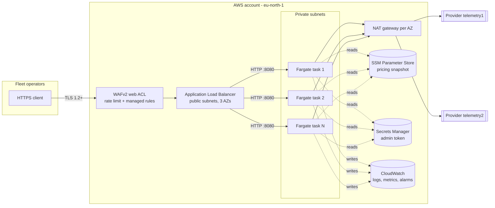

# Infrastructure

Terraform for the VectorHarbor best-offers service on **AWS** (the recommended
primary cloud, see [ADR-0001](../docs/adr/0001-cloud-vendor-selection.md)) and
on **Azure** (a fully specified alternative, kept deployable so the vendor
recommendation is a decision rather than a lock-in).

Both stacks deploy the same container images and expose the same contract, so
a deployment can be compared like for like.

```
infrastructure/
├── aws/
│   ├── main.tf, variables.tf, outputs.tf, versions.tf
│   ├── environments/            # per-environment tfvars and backend config
│   └── modules/
│       ├── network/             # VPC, subnets, NAT, VPC endpoints, flow logs
│       ├── ecr/                 # image registry with scanning and lifecycle
│       ├── service/             # ALB, ECS Fargate, IAM, autoscaling, config
│       │   └── agent.tf         # fleet assistant: task, routing, model secret
│       ├── waf/                 # WAFv2 web ACL, rate limits, logging
│       └── observability/       # alarms, dashboard, log metric filters
└── azure/
    ├── main.tf, variables.tf, outputs.tf, versions.tf
    ├── environments/
    └── modules/
        ├── network/             # VNet, delegated subnet, NSG
        ├── registry/            # Azure Container Registry
        ├── container_app/       # reusable Container App definition
        ├── frontdoor/           # Front Door Premium + WAF policy
        ├── observability/       # Log Analytics, App Insights, log alerts
        └── app_alerts/          # alerts scoped to the deployed app
```

## Architecture in one picture



The Azure topology is the same shape: Front Door with a WAF policy replaces
WAFv2 plus the ALB, Container Apps replaces Fargate, Key Vault replaces
Secrets Manager, and Log Analytics replaces CloudWatch.

## Prerequisites

| Tool | Version | Purpose |
| --- | --- | --- |
| Terraform | 1.9.x | Both stacks pin `>= 1.9.0, < 2.0.0` |
| AWS CLI | 2.x | AWS authentication and ECR login |
| Azure CLI | 2.60+ | Azure authentication and ACR login |
| Docker | 24+ | Building and pushing the images |

Install instructions for each operating system are in the
[root README](../README.md#prerequisites-by-operating-system).

## One-time state bootstrap

Terraform state is remote and locked in both clouds. State is created once per
account or subscription, outside the service stack, because a stack must never
own the thing that stores its own state.

### AWS

```bash
ACCOUNT_ID=$(aws sts get-caller-identity --query Account --output text)
REGION=eu-north-1
BUCKET="vectorharbor-tfstate-${ACCOUNT_ID}"

aws s3api create-bucket \
  --bucket "$BUCKET" \
  --region "$REGION" \
  --create-bucket-configuration LocationConstraint="$REGION"

# Versioning gives you a recoverable history of every state change.
aws s3api put-bucket-versioning \
  --bucket "$BUCKET" --versioning-configuration Status=Enabled

aws s3api put-bucket-encryption --bucket "$BUCKET" \
  --server-side-encryption-configuration \
  '{"Rules":[{"ApplyServerSideEncryptionByDefault":{"SSEAlgorithm":"AES256"}}]}'

aws s3api put-public-access-block --bucket "$BUCKET" \
  --public-access-block-configuration \
  'BlockPublicAcls=true,IgnorePublicAcls=true,BlockPublicPolicy=true,RestrictPublicBuckets=true'
```

State locking uses S3 native locking (`use_lockfile = true`), so no DynamoDB
table is required with Terraform 1.9+.

### Azure

```bash
LOCATION=swedencentral
RG=rg-vectorharbor-tfstate
SA=stvhtfstate$RANDOM   # must be globally unique, lowercase alphanumeric

az group create --name "$RG" --location "$LOCATION"

az storage account create \
  --name "$SA" --resource-group "$RG" --location "$LOCATION" \
  --sku Standard_LRS --kind StorageV2 \
  --min-tls-version TLS1_2 --allow-blob-public-access false

az storage account blob-service-properties update \
  --account-name "$SA" --resource-group "$RG" \
  --enable-versioning true

az storage container create \
  --name tfstate --account-name "$SA" --auth-mode login

echo "storage_account_name = \"$SA\""   # put this in your backend.hcl
```

## Deploying

The two stacks follow the same five steps. Replace `<env>` with `dev`,
`staging` or `prod`.

### AWS

```bash
cd infrastructure/aws

# 1. Copy and edit the environment inputs.
cp environments/<env>.tfvars.example      environments/<env>.tfvars
cp environments/<env>.backend.hcl.example environments/<env>.backend.hcl
$EDITOR environments/<env>.tfvars environments/<env>.backend.hcl

# 2. Initialise against the remote backend.
terraform init -backend-config=environments/<env>.backend.hcl

# 3. Review the plan. Never skip this.
terraform plan -var-file=environments/<env>.tfvars -out=tfplan

# 4. Apply the reviewed plan.
terraform apply tfplan

# 5. Push the images, then force a new deployment.
aws ecr get-login-password --region eu-north-1 \
  | docker login --username AWS --password-stdin "$(terraform output -raw service_repository_url | cut -d/ -f1)"

docker build -t "$(terraform output -raw service_repository_url):latest" ..
docker push "$(terraform output -raw service_repository_url):latest"

docker build -f ../Dockerfile.mock -t "$(terraform output -raw mock_provider_repository_url):latest" ..
docker push "$(terraform output -raw mock_provider_repository_url):latest"

aws ecs update-service \
  --cluster "$(terraform output -raw ecs_cluster_name)" \
  --service "$(terraform output -raw ecs_service_name)" \
  --force-new-deployment
```

Verify:

```bash
BASE_URL="$(terraform output -raw service_url)" npm --prefix ../.. run smoke
```

#### The fleet assistant

The assistant deploys behind the same load balancer on `/agent/*`, with the
console on `/console`. Push its image alongside the others:

```bash
docker build -f ../Dockerfile.agent -t "$(terraform output -raw agent_repository_url):latest" ..
docker push "$(terraform output -raw agent_repository_url):latest"
```

With `agent_model_backend = "deterministic"` that is all it needs: no key, no
network, no model. For a hosted backend, set the key **after** apply, because
Terraform deliberately never holds it:

```bash
aws secretsmanager put-secret-value \
  --secret-id "$(terraform output -raw agent_model_secret_name)" \
  --secret-string 'sk-ant-...'

aws ecs update-service --cluster "$(terraform output -raw ecs_cluster_name)" \
  --service "$(terraform output -raw agent_service_name)" --force-new-deployment

curl "$(terraform output -raw agent_console_url)"
```

Model choice, cost per turn and the residency trade-offs are in
[docs/architecture/24-ai-model-strategy.md](../docs/architecture/24-ai-model-strategy.md).

### Azure

```bash
cd infrastructure/azure

az login
az account set --subscription "<subscription-id>"

cp environments/<env>.tfvars.example      environments/<env>.tfvars
cp environments/<env>.backend.hcl.example environments/<env>.backend.hcl
$EDITOR environments/<env>.tfvars environments/<env>.backend.hcl

terraform init -backend-config=environments/<env>.backend.hcl
terraform plan -var-file=environments/<env>.tfvars -out=tfplan
terraform apply tfplan

# Push the images.
REGISTRY="$(terraform output -raw registry_name)"
LOGIN_SERVER="$(terraform output -raw registry_login_server)"
az acr login --name "$REGISTRY"

docker build -t "$LOGIN_SERVER/best-offers:latest" ../..
docker push "$LOGIN_SERVER/best-offers:latest"

docker build -f ../../Dockerfile.mock -t "$LOGIN_SERVER/mock-providers:latest" ../..
docker push "$LOGIN_SERVER/mock-providers:latest"

# Container Apps picks up :latest on the next revision.
az containerapp revision restart \
  --name "ca-vh-<env>-bestoffers" \
  --resource-group "$(terraform output -raw resource_group_name)"
```

Verify:

```bash
BASE_URL="$(terraform output -raw service_url)" npm --prefix ../.. run smoke
```

#### The fleet assistant

```bash
docker build -f ../../Dockerfile.agent -t "$LOGIN_SERVER/fleet-assistant:latest" ../..
docker push "$LOGIN_SERVER/fleet-assistant:latest"

# Only for a hosted backend; the deterministic planner needs no key.
az keyvault secret set --vault-name "$(terraform output -raw key_vault_name)" \
  --name model-api-key --value 'sk-...'

az containerapp revision restart \
  --name "$(terraform output -raw agent_app_name)" \
  --resource-group "$(terraform output -raw resource_group_name)"

curl "$(terraform output -raw agent_console_url)readyz"
```

### Chicken-and-egg on the first apply

Both stacks create the registry and the compute in one apply, so the first
apply references an image tag that does not exist yet. Two supported options:

1. **Apply, push, redeploy** (shown above). The service is briefly unhealthy
   while the first image is missing; harmless in dev and staging.
2. **Pre-seed the image.** Apply with `-target` on the registry module first,
   push the images, then apply the rest:
   ```bash
   terraform apply -target=module.ecr_service -target=module.ecr_mock \
     -target=module.ecr_agent                                           # AWS
   terraform apply -target=module.registry                              # Azure
   ```
   This is the recommended path for production.

## Verifying without deploying

```bash
# From the repository root
npm run check:tf          # offline consistency checks, no provider download

cd infrastructure/aws     # or azure
terraform fmt -check -recursive
terraform init -backend=false
terraform validate
```

CI runs all of the above on every push.

## Tearing down

```bash
terraform destroy -var-file=environments/<env>.tfvars
```

Production has guards that make a destroy deliberately awkward, which is the
point: ALB deletion protection (AWS), Key Vault purge protection (Azure), and
`prevent_deletion_if_contains_resources` on the resource group. Disable them
explicitly, one at a time, if a production teardown is genuinely intended.

## Environment differences at a glance

| | dev | staging | prod |
| --- | --- | --- | --- |
| Availability zones | 2 | 3 | 3 |
| NAT gateways | 1 (shared) | per AZ | per AZ |
| Replicas (min–max) | 1–4 | 2–20 | 3–40 |
| TLS | optional | required | required |
| WAF | on | Detection mode | Prevention mode |
| Mock providers | yes | yes | **no** — certified feeds only |
| Fleet assistant | yes, deterministic planner | yes, real model | yes, real model |
| Inference key needed | no | yes | yes |
| Fargate capacity | Spot | Spot | On-demand |
| Log retention | 14 d | 30 d | 90 d |
| Deletion protection | off | on | on |

## Cost

Indicative monthly figures, with the derivation and the levers, are in
[docs/architecture/cost-model.md](../docs/architecture/13-cost-model.md).
The dominant line items are NAT gateways and the load balancer, not compute,
which is why dev shares a single NAT.

## Security notes

- No long-lived cloud credentials exist anywhere in this repository. CI
  authenticates with OIDC federation (`id-token: write`), and workloads use
  task roles (AWS) or a user-assigned managed identity (Azure).
- `terraform.tfvars` and `*.backend.hcl` are git-ignored; only the `.example`
  files are tracked, because they carry account ids and network ranges.
- Terraform state contains resource metadata and must be treated as sensitive:
  both backends are encrypted, versioned and access-controlled.
- The admin token is generated by Terraform and stored in Secrets Manager or
  Key Vault. Both resources carry `ignore_changes` so that rotation performed
  by the security runbook is never reverted by an apply.
